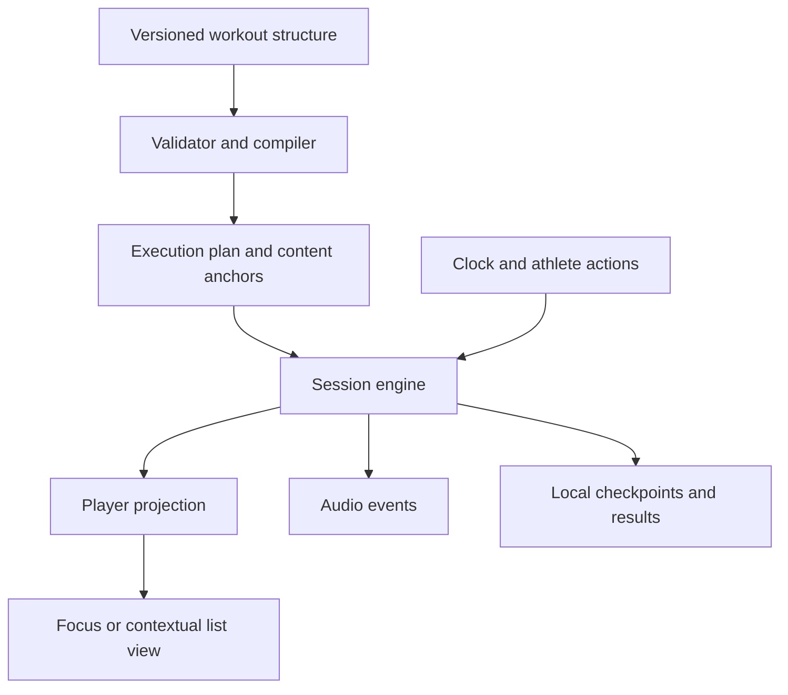
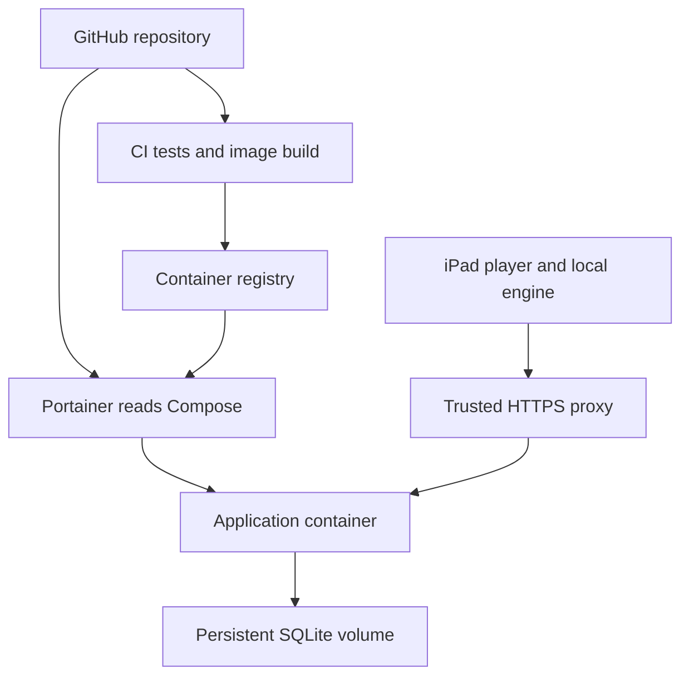

# Home Workout Player System Requirements and Implementation Plan

Version 1.0 · 26 October 2026 · Implementation baseline

Build a self-hosted web application for collecting, composing, and performing home workouts, especially solo and partner CrossFit-style and HYROX-style sessions. A shared iPad placed approximately two metres away is the primary workout display. The app combines a reusable workout library with an execution engine, a context-sensitive player, a perimeter timer, and spoken cues.

The core interaction is synchronised workout content: the execution engine identifies the relevant row, athlete assignments, or exercise block; the player highlights and presents that content with what comes next. Repeated execution revisits the same content with a new round context. Timers must never invent progress through repetitions or distance-based work.
q
Deployment is a product requirement: a GitHub repository must be deployable through Portainer using its root Compose file, a prebuilt application image, and persistent SQLite storage.

# 1 Purpose and requirement conventions

This specification defines observable behaviour, data semantics, operating constraints, acceptance tests, and an implementation sequence. It is sufficient to begin implementation without choosing a product name or creating a full design system first.

**SHALL** identifies a mandatory requirement for its release priority. **SHOULD** identifies a preferred implementation or usability target with a documented reason required for deviation. Architectural suggestions are explicitly separated from behavioural requirements.

| Priority | Meaning |
| - | - |
| P0 | Required for the first dependable household release. |
| P1 | Follow-up improvements after P0 passes acceptance. |
| P2 | Possible future scope; not a commitment for the first release. |

Requirements carry stable IDs. Changes should preserve IDs, record the reason, and update associated acceptance fixtures. All unmarked normative requirements are P0. Numerical limits and UI defaults below are proposed product decisions, not facts about the users' hardware.

Success means the couple can create a workout once, select it on the iPad, press Play, and complete a timed partner session without touching the screen again. Completion-driven formats require only meaningful actions such as Switch, Done, or Finish.

# 2 Scope and product defaults

## 2.1 Included in the first release

- A shared household exercise and workout library, plus named collections of workouts called programs.

- One or two athlete profiles, mapped to stable A and B positions at session start.

- Structured workouts containing sections, ordered activities, repeat blocks, timed work, rest, and completion-driven work.

- Timed circuits, Tabata-style presets, AMRAP, EMOM and configurable every-N intervals, For Time, chippers, fixed rep ladders, partner circuits, and you-go-I-go.

- HYROX-style run/station sequences, using manual completion for distances and repetitions.

- A distance-readable workout player, optional contextual list view, audio cues, and an animated screen-edge timer.

- Basic session results, local interruption recovery, JSON import/export, and server backup/restore.

- GitHub Actions image publishing, Docker Compose, and Portainer Community Edition deployment on Docker Standalone.

## 2.2 Explicitly deferred

P1: separate login accounts, richer progress comparisons, reusable section templates, calendar scheduling, a larger exercise catalogue, configurable language packs, and optional locally hosted speech generation.

P2: independent athlete timelines, live synchronisation across multiple devices, remote-control phones, wearables, equipment sensors, automatic rep detection, voice commands, workout generation by AI, public sharing, leaderboards, nutrition tracking, and official competition scoring.

P0 is one authoritative player device per session. Two profiles do not imply two independently running timers. A simple household application does not require microservices or a database server.

## 2.3 Defaults that permit implementation now

| Decision | Baseline |
| - | - |
| Interface and speech | English; kg, metres, kilometres, and machine calories. Schema permits other units. |
| Athlete identities | A and B are session roles; display names are editable. A stays left, B stays right. |
| Access | One household login, shared library, optional persistent trusted-device session. Profiles are not security boundaries. |
| Display | Landscape iPad first; portrait and desktop supported. Dark high-contrast player. |
| Timer perimeter | Remaining time drains clockwise from a full border to empty. |
| Prep | One configurable 10-second countdown before starting; excluded from workout score. |
| Section boundaries | Manual Ready by default; explicit automatic continuation permitted. |
| Hidden app | Auto-pause at visibility loss when detected; return requires Resume. |
| Interrupted reload | Recover paused from the last durable local checkpoint; no automatic wall-time catch-up. |
| Deployment | One application container, SQLite in a named Docker volume, one replica. |
| HTTPS | Trusted HTTPS for the intended iPad experience, normally through an existing reverse proxy. |

These defaults should be validated in the first physical iPad trial; they do not block the initial engineering work.

# 3 Users and primary workflows

**Workout author:** creates and edits workouts on a desktop or tablet, checks timing, assigns athlete tasks, and organises programs.

**Performing athletes:** select a saved workout, review equipment and scaling, map A/B, test audio, and start. During training they need the current task, target, phase, time, and next task at a glance.

**Household administrator:** deploys and updates the stack, manages access, exports data, and restores backups. One person may fulfil all roles.

| Use case | Expected flow |
| - | - |
| Reuse a workout | Library → workout summary → choose athletes and overrides → audio/display readiness → Play. |
| Build a circuit | Add activities → set work and transition time → set repeats and round rest → inspect expanded preview → save. |
| Train in pairs | Assign A/B tasks per slot → preserve lane positions → automatically change tasks at timed boundaries. |
| AMRAP | Display the active exercise block and cap; optionally count rounds; finish at the cap. |
| You-go-I-go | Show the active athlete and task; Switch records a completed turn; the other athlete becomes active. |
| HYROX-style session | Alternate run and station tasks; Done records a split and advances; no distance completion is inferred. |
| Recover interruption | Show recovered workout, current position, and elapsed time; Resume or end as interrupted. |
| Deploy | Portainer reads Compose from GitHub, pulls the image, creates storage, and starts a healthy service. |

# 4 Domain vocabulary and workout semantics

AMRAP means completing as many rounds and/or repetitions as possible within a fixed duration. EMOM starts prescribed work at each minute boundary. A chipper is an ordered list completed in sequence. These terms follow CrossFit's glossary; they do not imply that software can observe physical completion. [S1]

HYROX combines eight 1 km runs with eight intervening functional stations. The app shall support that structural pattern and editable training variations. An official race template, if supplied later, must identify its season/division and source; training substitutions must remain visibly labelled as custom. The engine shall not hard-code race weights or act as an official judge. [S2]

| Format | Clock and completion | Player behaviour |
| - | - | - |
| Timed circuit | Each work/rest slot has a duration; sequence advances automatically. | Current task or paired row, countdown, next task. |
| Tabata-style | Preset work/rest repetitions, editable by the user. | Same engine as a timed circuit; trailing rest is explicit. |
| AMRAP | Fixed block cap; physical exercise progression is unknown. | Whole relevant block, remaining time, optional reported rounds/reps. |
| EMOM or every-N | Fixed interval boundaries, independent of whether reps were completed. | Current assignment, interval remaining, interval/round position, next assignment. |
| For Time | Count-up; athlete completion or an optional cap ends the block. | Relevant task/list, elapsed time, manual Done/Finish, optional cap remaining. |
| Chipper | For Time with an ordered sequence; manual completion marks each task. | Current and next tasks or a compact list. |
| Fixed ladder | Explicit per-round rep targets, such as 21/15/9. | Current round's actual targets; no duration inferred from rep counts. |
| You-go-I-go | Shared cap/count-up or optional fixed turn durations; declared handoff rule. | Active athlete, work unit, other athlete's rest/task, Switch. |
| Parallel pair | Both assignments occur within one shared slot or completion barrier. | Stable A/B lanes, one shared clock, explicit completion rule. |
| Run/station sequence | Usually count-up with manually acknowledged distances and reps. | Current run/station, target, next station, total elapsed and optional split. |
| Strength or skill | Manual set completion, optionally followed by timed rest. | Movement, load, reps, set number; no inferred lifting tempo. |

A **round** repeats a specified block. An **interval** is a scheduled time window. A **turn** is one athlete's work unit before handoff. An **exercise** is a movement definition. An **activity** is its prescription in this workout. A **section** groups work such as warm-up, strength, conditioning, or cooldown. Labels must not use these words interchangeably.

# 5 Functional requirements for authoring and the library

## 5.1 Library and programs

**LIB-01** The system SHALL create, read, update, duplicate, archive, and search workouts. A workout includes a stable ID, title, optional description/source URL, tags, equipment, structured content, revision, and timestamps. Archive preserves history; destructive deletion requires confirmation.

**LIB-02** The system SHALL maintain an editable exercise catalogue with name, optional short display name, spoken name, equipment, and notes. Custom movements require no external service. Editing a catalogue entry SHALL NOT rewrite an existing workout prescription or completed session.

**LIB-03** A program SHALL be a named, ordered collection of workout references with optional notes. Removing a workout from a program SHALL NOT delete it. Calendar scheduling and automatic progression are P1.

**LIB-04** Search SHALL cover titles, tags, and movement names. Filters SHALL include solo/pair, format, and equipment. The library SHALL distinguish exact duration, capped duration, and unknown/estimated duration.

**LIB-05** Starting a session SHALL create an immutable snapshot of the selected workout revision and athlete overrides. Subsequent edits affect future sessions only.

## 5.2 Builder

**BLD-01** The builder SHALL support add, edit, duplicate, delete, and reorder for sections, activities, and repeat blocks. Touch and keyboard buttons SHALL provide an alternative to drag-and-drop.

**BLD-02** Each activity SHALL express a movement or instruction and optional targets: duration, reps, distance, machine calories, load, or free-text guidance. Structured targets drive behaviour; free text never becomes executable logic.

**BLD-03** Repeat blocks SHALL declare a positive finite repeat count, child sequence, and optional rest between repetitions. P0 SHALL support at least two nested repeat levels, such as two sets of five circuits, with visible hierarchy.

**BLD-04** Inter-exercise transition rest, between-round rest, and after-section rest SHALL be separate settings. Defaults omit the final exercise's transition rest and the final round's between-round rest. The preview SHALL explicitly show any trailing rest the author adds.

**BLD-05** The builder SHALL support independently prescribed A/B movements, loads, reps, distances, and notes within a shared slot. A/B identity remains fixed while assignments change. Mirroring or swapping tasks SHALL be an explicit editing action.

**BLD-06** For completion-driven paired work the author SHALL choose one rule: explicit team Done, both athletes Done, or active athlete Switch. “Both Done” waits for both acknowledgements; the earlier athlete displays Waiting/Rest. The app SHALL NOT guess a barrier rule.

**BLD-07** Each section SHALL select its format, clock behaviour, cap if any, and transition to the next section. Manual Ready between sections stops scored work until readiness; explicit automatic continuation starts the next section without an implicit extra rest.

**BLD-08** Session setup SHALL allow one-session scaling or substitution per athlete without changing the stored workout. These overrides SHALL be visible during performance and in results.

**BLD-09** The builder SHALL show a human-readable summary and expanded execution preview, including round paths, rests, assignments, manual gates, and exact timed durations. Preview and player SHALL use the same compiler.

**BLD-10** Validation SHALL block starting empty, invalid, unsupported, or unbounded workouts. Errors SHALL identify the affected item and how to fix it. Invalid drafts may be saved with a visible Draft state.

Validation includes missing IDs/references, duplicate node IDs, negative/nonfinite values, zero-duration automatic loops, invalid repeat counts, unsupported nesting, empty AMRAP work lists, absent manual termination rules, mismatched athlete assignments, and incompatible completion policies. Proposed P0 limits are 1–999 repeats per node, two repeat nesting levels, 10,000 resolved timed occurrences, and a 24-hour session cap. Limits SHALL be enforced on both client and server.

**BLD-11** The builder SHALL autosave local drafts and clearly distinguish Saved, Unsaved locally, Sync pending, and Save failed. Explicit save to the server SHALL use revision conflict checking; a conflicting version SHALL NOT silently overwrite another edit.

# 6 Workout model and execution contract

## 6.1 Three layers

The system SHALL separate authoring data, execution state, and presentation. This is the central architectural constraint.



**MOD-01** Every authored node SHALL have a stable ID. Every execution occurrence SHALL have a distinct identity containing its node ID, repeat path, and visit number where needed. Replaying a row SHALL preserve its content anchor but create a new occurrence. Array position alone is not an identity.

**MOD-02** The engine SHALL expose a presentation projection containing active anchor(s), current prescriptions, next actionable work, intervening rest, section/round/interval context, active athlete or lanes, available controls, and clock values. The UI SHALL NOT independently derive workout progression.

**MOD-03** A content anchor MAY represent one activity, a paired row, or a whole block. AMRAP normally anchors the block. Advancing the timer SHALL NOT falsely select the next AMRAP exercise.

**MOD-04** The compiler SHALL produce a deterministic execution graph or lazy plan. Fully timed paths may be flattened; manual gates and unknown-duration blocks SHALL remain explicit. A guessed schedule for manual work is forbidden.

**MOD-05** Clock policy, presentation mode, athlete participation, and completion rule SHALL be separate concepts. For example, paired participation can occur inside an AMRAP or a timed circuit; it is not a mutually exclusive workout type.

## 6.2 Minimum data entities

| Entity | Required contents |
| - | - |
| Exercise | ID, full/short/spoken names, equipment, optional notes. |
| Workout | ID, schema version, revision, metadata, ordered section tree. |
| Activity | Stable node ID, copied prescription, targets, athlete assignments, content anchor. |
| Block | Stable node ID, type, children, repeat/interval/cap settings, completion and transition policies. |
| Program | ID, name, ordered workout references, notes. |
| Athlete profile | ID, display name, preferred units; profile is separate from login identity. |
| Session | ID, workout snapshot, mapped athletes, settings, engine version, state, clocks, active occurrence, completion acknowledgements. |
| Session event | ID, increasing sequence, session ID, occurrence ID, event type, monotonic offset, wall timestamp, payload. |
| Result | Status, scores by section/athlete/team, elapsed/paused time, modifications, notes, snapshot reference. |

All executable durations SHALL be integer milliseconds internally; user-facing entry may use minutes and seconds. Quantity values SHALL include units. Missing scores SHALL remain null/unrecorded, never become zero. Timestamp storage SHALL use UTC; display uses the configured local timezone.

## 6.3 Required clock distinctions

- **Session wall elapsed:** real time from session start, including pauses and readiness waits; useful for history.

- **Session active elapsed:** time spent executing work, rest, and transitions, excluding prep, pauses, and manual Ready waits.

- **Section clock:** countdown or count-up used for the section's cap or score; includes prescribed intra-section rest and transitions, excludes pauses.

- **Slot clock:** current work/rest/EMOM interval countdown.

- **Turn or split elapsed:** time since the current manual task or athlete turn began.

The player SHALL identify which clock it displays. Paused or manually altered scored workouts SHALL be marked as modified; their adjusted elapsed times must not masquerade as uninterrupted results.

## 6.4 Representative semantic fixture

This is an illustrative data contract to be formalised as JSON Schema during implementation. Identifiers are examples, not production records. Each slot lasts 40 seconds and contains simultaneous assignments.

```json
{
  "schemaVersion": 1,
  "id": "partner-circuit",
  "revision": 1,
  "title": "Partner circuit",
  "prepMs": 10000,
  "sections": [{
    "id": "conditioning",
    "format": "timedCircuit",
    "transitionAfter": "manualReady",
    "body": {
      "id": "circuit",
      "type": "repeat",
      "count": 5,
      "betweenIterationsRestMs": 60000,
      "body": {
        "id": "stations",
        "type": "sequence",
        "betweenChildrenRestMs": 10000,
        "children": [
          {
            "id": "slot-1", "type": "timed", "durationMs": 40000,
            "assignments": {"A": {"name": "Row"}, "B": {"name": "Kettlebell swings"}}
          },
          {
            "id": "slot-2", "type": "timed", "durationMs": 40000,
            "assignments": {"A": {"name": "Kettlebell swings"}, "B": {"name": "Row"}}
          },
          {
            "id": "slot-3", "type": "timed", "durationMs": 40000,
            "assignments": {"A": {"name": "Burpees"}, "B": {"name": "Air squats"}}
          },
          {
            "id": "slot-4", "type": "timed", "durationMs": 40000,
            "assignments": {"A": {"name": "Air squats"}, "B": {"name": "Burpees"}}
          }
        ]
      }
    }
  }]
}
```

The between-children rule inserts rest only between children; the between-iterations rule inserts rest only between repetitions. These fields SHALL NOT silently add trailing rest.

Expected timed duration: each round is 4 × 40 + 3 × 10 = 190 seconds. Five rounds plus four 60-second breaks equal 1,190 seconds, or **19:50**. Including prep gives **20:00**. Changing the repeat count to two gives **7:20** excluding prep.

| Active section time | Expected state |
| - | - |
| 0 to less than 40s | Round 1, slot 1. |
| 40 to less than 50s | Transition, next slot 2. |
| 150 to less than 190s | Round 1, slot 4. |
| 190 to less than 250s | Round rest; preview round 2, slot 1. |
| Exactly 250s | Round 2, slot 1; contextual view returns to its anchor. |
| Exactly 1,190s | Section and session complete; no extra rest or Ready gate after the final section. |

# 7 Session engine and timing requirements

**ENG-01** The engine SHALL be independently testable without the UI, DOM, audio device, or server. Given the same snapshot, clock observations, and ordered commands, it SHALL produce the same state and semantic events.

**ENG-02** The engine SHALL use elapsed time from a monotonic clock while running, not repeated decrement operations. Render frames and callback counts SHALL NOT determine elapsed time. Late callbacks SHALL resolve the correct current state and cross due boundaries exactly once.

**ENG-03** Timed intervals SHALL be half-open: a slot owns its start instant but not its deadline. At a deadline the next slot becomes current. Display uses ceiling of positive remaining milliseconds to seconds; a completed slot SHALL NOT linger showing 00:00 before advancing.

**ENG-04** The engine SHALL implement these lifecycle states: Ready, Preparing, Running, Paused, AwaitingReady, Recoverable, Completed, and Aborted. Work, rest, transition, and waiting-for-partner are substates/projections of Running. A completion-driven task continues counting while awaiting Done; it is not Paused.

| Command or event | Required effect |
| - | - |
| Play from Ready | Begin prep, then start first section. |
| Pause | Freeze all active clocks and progression, cancel pending cues, checkpoint state. |
| Resume | Continue from frozen state without silently adding time or restarting the slot. |
| Timed deadline | Apply due transitions, update context, emit only relevant cues. |
| Done | Apply the current manual completion rule; ignored if not valid for the occurrence. |
| Switch | Record the active athlete's completed turn and assign the next athlete/work unit. |
| Next or Previous | Explicit navigation; mark session modified, cancel stale cues, checkpoint. |
| Finish | Finish the applicable block/session as specified by its format. |
| Stop | Confirm ending; preserve partial result as Aborted. |
| Visibility loss | Auto-pause if Running/Preparing, save checkpoint; never auto-resume on return. |
| Reload with active checkpoint | Enter Recoverable and present Resume/End options. |

**ENG-05** P0 SHALL support Pause/Resume, Next, Previous, and Stop. Previous restarts the preceding execution occurrence, including its repeat path; Next skips to the next occurrence. These actions do not undo physical work or erase audit events. They preserve the enclosing section clock and cap while resetting the selected slot clock; they mark the session modified. Navigation outside the current timed section is permitted only while paused through an explicit section selection. AMRAP counters use a separate Undo counter action.

**ENG-06** For Time SHALL terminate on Finish or cap. AMRAP SHALL terminate on cap or explicit early finish. At an exact cap boundary, cap processing takes precedence over a manual completion timestamp at or after that boundary; the result is Capped. UI rendering delay SHALL NOT extend the cap.

**ENG-07** EMOM/every-N slots SHALL start on the scheduled section-time boundaries. Marking work Done early SHALL show Rest until the next boundary, without advancing that boundary. If work was not acknowledged, the boundary still advances and leaves completion unreported. It SHALL NOT infer failure solely from the absence of a tap.

**ENG-08** You-go-I-go SHALL declare the work unit and round rule. Default: A turn plus B turn completes one team round. The author may instead define explicit alternating activity steps. Switch indicates completion of the current turn; switching early for convenience uses a separate Skip action and marks the session modified.

**ENG-09** In a both-done paired task, completion acknowledgements SHALL be scoped to athlete and occurrence. A second tap from A SHALL NOT count as B. At the next occurrence, acknowledgement state resets.

**ENG-10** All user commands SHALL carry an occurrence ID and unique command ID. Duplicate commands and commands targeting a stale occurrence SHALL be rejected or ignored safely. Rapid double taps SHALL NOT skip two steps or create two scores.

**ENG-11** An active session SHALL continue locally during server/network failure. Remote persistence SHALL not sit on the timing path. The app SHALL persist every semantic event and checkpoint at least once per second while running, with an explicit local-storage failure indicator.

**ENG-12** After reload or process termination, the app SHALL recover paused from the last durable checkpoint, display its age, and mark the session interrupted. Unsaved time since that checkpoint may be lost; the app SHALL not infer completed physical tasks from elapsed wall time. Restore SHALL include round path, active athlete, acknowledgements, scores, and clock offsets.

**ENG-13** P0 SHALL not promise reliable background or lock-screen execution. If the OS suspends the app before a visibility checkpoint, recovery follows ENG-12. Network loss alone SHALL not pause the session. A hidden-app pause SHALL be distinguishable from user-requested pause.

**ENG-14** Only one tab SHALL control a given session. A second tab SHALL show a read-only or explicit takeover state. Duplicate tab detection must work without a server round trip; cross-device live control is deferred.

# 8 Workout player and visibility requirements

## 8.1 Information hierarchy

**UI-01** The default player SHALL prioritise phase, current activity/targets, primary clock, athlete assignment, round/interval position, and next actionable work. Editing controls, library navigation, and long notes SHALL be hidden from the performance layout.

**UI-02** The player SHALL support Focus and Context views. Focus presents current and next work. Context presents a window of surrounding rows/blocks with the active anchors highlighted. Both consume the same engine state and changing views SHALL not affect timing.

**UI-03** Context view SHALL automatically follow active anchors, including returning to the first row when a block repeats. User scrolling temporarily disables follow. A persistent Follow workout control restores it. Focus mode SHALL not move the main timer's position at each transition.

**UI-04** A/B positions and labels SHALL remain stable. Task changes SHALL update content within the lanes, not swap the lanes. Participant colour SHALL be independent of work/rest colour. Labels remain understandable without colour.

| Mode | Primary content | Next information and controls |
| - | - | - |
| Timed solo | Large countdown, phase, movement and target. | Next movement; intervening rest indicated. |
| Timed pair | Shared countdown, stable A/B lanes and assignments. | Next A/B assignments; switch/rest clearly labelled. |
| AMRAP | Remaining cap plus the full active exercise block in a compact readable form. | Optional round/rep controls; next section secondary. |
| EMOM | Interval remaining, prescribed task, interval number. | Next interval task; optional Done → remaining rest. |
| For Time/chipper | Elapsed section clock, current target or compact task list. | Next target, Done/Finish; cap remaining secondary. |
| You-go-I-go | Active athlete, work unit, shared clock, turn elapsed if useful. | Next athlete, large Switch control. |
| Both-done pair | Two tasks and Done states with one shared clock. | Early finisher displays Waiting/Rest. |
| Rest | Large rest countdown. | Upcoming tasks dominate the remaining space. |
| Paused/recovered | Explicit paused state and frozen values. | Resume and end; no misleading running animation. |

**UI-05** “Up next” SHALL resolve through repeat boundaries and rest nodes. During work it may show “10s rest, then Row”; during round rest it SHALL show the next round's actual assignments. At the end, it SHALL show Finished rather than a nonexistent next task.

**UI-06** AMRAP content SHALL not auto-scroll through exercises based on guessed pace. Optional manual focus can highlight an athlete-reported item without affecting the cap. When the block cannot fit at the minimum type size, the author SHALL receive a preflight warning and choose a compact label layout or manual paging before starting. The app SHALL NOT silently shrink essential text.

## 8.2 Distance readability and controls

**UI-07** At a baseline 1024 × 768 CSS-pixel landscape viewport, the player SHOULD use at least 112px for the primary timer, 40px for current movement names, and 28px for next tasks and athlete labels. These are initial design targets; final acceptance is the physical two-metre test. Critical loads/reps SHALL not be hidden in secondary notes.

**UI-08** Controls SHALL have at least 48 × 48 CSS-pixel hit areas; the principal Switch/Done control SHOULD be at least 72px high. A single Pause action SHALL remain visible. Destructive Stop SHALL be separated and confirmed. No hover-only or gesture-only essential action is permitted.

**UI-09** Layout SHALL respect safe areas, browser chrome, and portrait reflow. Essential content SHALL not clip. Fullscreen or installed-PWA presentation is optional enhancement; normal Safari operation SHALL remain usable.

**UI-10** Text contrast SHALL meet a product target of at least 4.5:1. Phase changes SHALL use text and shape/icon cues in addition to colour. Reduced-motion settings SHALL suppress scrolling animation and decorative motion while preserving accurate state.

## 8.3 Perimeter timer

**UI-11** A thick inset border SHALL trace the usable application viewport, with rounded corners. It SHALL avoid controls and safe areas; the browser cannot draw outside its own viewport onto the physical iPad bezel.

**UI-12** For known-duration phases, remaining fraction SHALL be clamped to remainingMs/durationMs. The border starts full and drains clockwise to empty. It resets only when its represented phase changes and freezes on pause. Work uses green, transitions to amber in the final warning window, and red in the final three seconds; rest uses a distinct blue phase colour and an explicit REST label.

**UI-13** Warning thresholds SHALL be capped to the interval length so short intervals do not spend their entire duration in warning. Default amber threshold is min(10 seconds, 25% of duration); red is min(3 seconds, 10% of duration). Colour changes SHALL not flash.

**UI-14** For EMOM the perimeter represents the interval; for AMRAP it represents the block cap; for capped For Time it represents time remaining to the cap. Uncapped count-up/manual work SHALL show a neutral border with elapsed time, not a fabricated completion percentage. The UI SHALL label the represented time context.

**UI-15** Animation SHALL derive from engine clock state and target 60fps on the reference iPad. Dropped frames SHALL not change timing. A stable layout is more important than decorative animation.

# 9 Audio and spoken cues

**AUD-01** Settings SHALL offer Voice plus beeps, Beeps only, and Silent. Users SHALL be able to test sound before starting and select available speech voice, rate, and volume. No microphone permission is needed.

**AUD-02** Audio SHALL consume semantic engine events: prep, work start, rest start, upcoming assignment, countdown, round start, cap reached, paused, resumed, and completed. Components SHALL not independently trigger their own timers or announcements.

**AUD-03** The default sequence SHALL announce tasks during prep/rest, use short boundary cues such as Go/Rest/Switch, and count down the final three seconds. Long exercise descriptions SHALL not delay an interval boundary. Spoken aliases SHALL support short, pronounceable movement names.

**AUD-04** Paired announcements SHALL identify both athletes, for example “A: row. B: swings.” If the available rest is too short, shorten or omit the preview and retain the boundary cue. The visual display remains authoritative.

**AUD-05** Cue priority SHALL be: stop/pause and terminal events; transition cue; final countdown; next-task preview; optional encouragement. At most one spoken utterance plays at a time. Pause, seek, skip, and recovery SHALL cancel obsolete queued speech.

**AUD-06** Cue IDs SHALL include session, execution occurrence, cue type, and threshold. Re-renders SHALL not repeat cues. After a delay, missed countdown numbers SHALL not play as a burst; stale previews SHALL be dropped. A repeated round produces new cues for its new occurrence.

**AUD-07** Exact-boundary beeps SHOULD use preloaded/local audio or Web Audio scheduling. Browser speech is best-effort and SHALL not be the clock source. Speech support and available voices vary by device; browser speech is a supported starting approach, not a guarantee of identical voice quality or fully offline voices. [S4]

**AUD-08** The app SHALL initialise/unlock audio from an explicit user gesture and detect speech/audio errors where possible. Failure SHALL not stop the workout. A visible sound status and working local beep fallback SHALL remain available. No runtime call to a cloud AI service is required.

**AUD-09** Wake lock and sound readiness SHALL be checked in preflight. Screen Wake Lock requires a secure context and may be released by the platform, so the app SHALL detect release and reacquire when appropriate on return. Unavailable wake lock SHALL be explained before starting. [S3]

# 10 Persistence and results

**DAT-01** SQLite SHALL be the authoritative server datastore for workouts, programs, profiles, settings, and session records. All persistent application data SHALL live under a documented mounted data directory. Container replacement SHALL not lose data.

**DAT-02** Browser storage SHALL hold current snapshots, drafts, checkpoints, and a retryable event/result outbox. Starting a loaded workout and finishing it SHALL not require continued network connectivity. P0 does not require cold-starting the entire app offline; cached offline startup is P1.

**DAT-03** Synchronisation SHALL use stable session/event IDs and idempotent writes. Repeated upload after a timeout SHALL not duplicate sessions or results. A reconnect SHALL upload pending events in order without resetting the active player.

**DAT-04** Results SHALL distinguish Completed, Capped, Aborted, and Interrupted, with a separate Modified flag. Store actual overrides and relevant scores: time, rounds plus reps, reps, distance, load, and optional notes. Scores may be per athlete or team, explicitly labelled. Completion of a timer is not proof that prescribed reps were completed.

**DAT-05** Users SHALL see recent sessions, reopen the workout snapshot, and repeat it as a new session. Correcting a score SHALL preserve the prior value and correction timestamp. Basic history is P0; charts and personal-record inference are P1.

**DAT-06** JSON export/import SHALL include schema version and selectable workouts/programs, and support a full application-data export excluding authentication secrets. Imports SHALL validate before applying, show counts/conflicts, and be transactional. Default import creates copies with remapped IDs; explicit replacement requires confirmation. Unknown future schema versions SHALL be rejected with a useful message.

**DAT-07** The deployment SHALL provide consistent SQLite backup and restore procedures. Online backup must use SQLite-supported snapshot/backup facilities; copying a live database file without handling its journal is insufficient. A pre-migration backup SHALL be created and a restore rehearsal SHALL be part of release acceptance.

**DAT-08** Database migrations SHALL be versioned and transactional where supported. Startup SHALL fail with an actionable error rather than serving against an incompatible schema. Downgrades SHALL never silently reinterpret newer data.

**DAT-09** Archiving/deleting a workout SHALL not invalidate session snapshots. Clearing browser storage SHALL not erase already-synchronised server data; unsynchronised data is local-only and must be labelled accordingly.

# 11 Architecture and interface boundaries

The recommended baseline is a TypeScript web frontend, a pure TypeScript execution engine shared with tests, and a small Node.js HTTP service serving both the built frontend and API. Use SQLite directly through a maintained driver. This is a proposed implementation choice; the behavioural contracts above remain authoritative if a different stack is chosen.

React with Vite is a reasonable frontend starting point. Select and pin supported dependency/runtime versions during implementation. The specification intentionally does not freeze today's patch versions.

The engine executes on the player device. The server stores content and results; it does not send once-per-second timer ticks. Rendering, audio, and persistence subscribe to state/events without controlling progression.



## 11.1 Suggested repository boundaries

| Path | Purpose |
| - | - |
| apps/web/ | Library, builder, setup, player, history, client persistence. |
| apps/server/ | HTTP API, authentication, SQLite repositories, migrations. |
| packages/domain/ | Versioned schema, validators, compiler, shared types. |
| packages/engine/ | Pure state machine, clock adapter contract, events and projections. |
| tests/fixtures/ | Canonical workouts and expected execution traces. |
| tests/e2e/ | User flows, network failure and persistence tests. |
| docs/ | Deployment, backup, architecture decisions, contributor guide. |
| compose.yaml | Default Portainer-ready production stack. |
| compose.dev.yaml | Optional source-build/development setup. |
| Dockerfile | Multi-stage production image build. |
| .env.example | Documented configuration values without secrets. |
| .github/workflows/ | Validation, image build and release publishing. |

## 11.2 Minimum API contract

**API-01** The server SHALL expose versioned JSON endpoints for workouts, programs, profiles, settings, sessions/results, import/export, authentication, and health. Exact route names may be established in implementation; the following operations are required.

| Operation | Contract |
| - | - |
| Read/list content | Stable IDs, revision, filtering/pagination; no secret fields. |
| Create/update content | Shared schema validation; updates require expected revision. |
| Start/register session | Accept client-generated session ID and immutable snapshot; retry-safe. |
| Append session events | Ordered per-session sequence and unique IDs; duplicate-safe. |
| Finish/update result | Idempotent finalisation; corrections distinguished from first finish. |
| Export/import | Versioned structured data, validation and transactional application. |
| Health/live | Process responsiveness. |
| Health/ready | Database available, migrations complete, service ready. |

**API-02** Failed requests SHALL return structured errors with a machine code, readable message, and field path where applicable. Conflicts SHALL return a conflict response; validation failures SHALL not create partial records.

**API-03** No WebSocket service is required for P0. A future remote-control feature may add one without replacing engine semantics or the stored workout format.

# 12 GitHub Docker and Portainer deployment

Portainer supports stack deployment from a Git-hosted Compose file with a repository reference and Compose path. Git-deployed stack definitions are maintained in the repository. The default deployment SHALL use this path. [S5]

**DEP-01** The repository SHALL include a root compose.yaml that deploys the entire application on Docker Standalone through Portainer Community Edition. P0 SHALL not depend on Business Edition features, Swarm, Kubernetes, a local source checkout, or host-side compilation.

**DEP-02** Production Compose SHALL reference a prebuilt image from GitHub Container Registry or an equivalent registry. GitHub Actions SHALL run validation and publish release images. Portainer pulling the repository supplies the stack definition; pulling the image supplies the application. A repository pull alone does not rebuild or publish application code. [S7]

**DEP-03** One application image SHALL package the frontend assets and backend. SQLite runs within that service, not as an extra database container. No mandatory Redis, message broker, or separate speech service is permitted in P0. The service SHALL use one replica.

**DEP-04** Persistent data SHALL use a named volume mounted at /data by default. No production dependency may require relative bind mounts into the cloned Git repository. Portainer's documented relative-path-volume support is edition-specific; named volumes avoid that dependency. [S6]

**DEP-05** Images SHALL publish linux/amd64 and linux/arm64 variants, subject to CI smoke tests on both. Image metadata SHALL identify version, source repository, and commit. Release tags SHALL be immutable; deployment SHALL support digest pinning.

**DEP-06** Compose SHALL include restart policy, readiness health check, graceful shutdown, configurable host port, and documented volume ownership. The application SHOULD run as non-root with only required write access. No Docker socket mount or privileged mode is needed.

**DEP-07** Configuration SHALL be provided through Portainer stack environment variables or explicitly documented secrets. The default production Compose SHALL not require an untracked .env file to exist on the server.

| Setting | Required behaviour |
| - | - |
| APP_IMAGE | Required full image reference, preferably pinned release/digest; example namespace clearly a placeholder. |
| HTTP_PORT | Configurable host port; default 8080. |
| PUBLIC_URL | Required canonical URL for deployment, normally trusted HTTPS. |
| SESSION_SECRET | Required high-entropy secret; startup rejects missing/example values. |
| BOOTSTRAP_PASSWORD | Required only for an empty database; hashed immediately and never logged. |
| DATABASE_PATH | Defaults to /data/app.sqlite inside the persistent volume. |
| LOG_LEVEL | Defaults to info; excludes credentials and full workout content. |
| TRUST_PROXY | Explicit setting for a known reverse-proxy deployment. |

The implementation SHALL document exact environment names in .env.example and the README. If the public URL is HTTP, the setup screen SHALL indicate which browser capabilities are unavailable; production acceptance uses trusted HTTPS.

**DEP-08** A new deployment SHALL require only repository URL/reference, Compose path, image reference and environment values, plus registry credentials when the image is private. Git authentication and registry authentication SHALL be documented separately. No terminal commands should be necessary on the standard Portainer route.

**DEP-09** The repository SHALL offer an equivalent Docker Compose CLI route for troubleshooting. A separate development configuration may build from source; it SHALL not complicate the production route.

**DEP-10** The release workflow SHALL test, build, and publish the image before presenting that version as deployable. A failed test SHALL block release publication. Fork/setup instructions SHALL explain registry namespace, package visibility, and the first successful image publication.

**DEP-11** The update procedure SHALL specify image selection, image re-pull/redeploy, automatic migration, readiness verification, and retained volume use. Automatic application updates SHALL be off by default. The previous image and pre-upgrade database backup SHALL be retained for rollback.

**DEP-12** Rollback documentation SHALL distinguish image-only rollback from database restore. If schema compatibility is absent, restoring the matching backup is required and may discard newer writes; the administrator SHALL be told before doing so.

**DEP-13** Backups SHALL be downloadable or copyable outside the active container/volume. Stack recreation using the same volume SHALL preserve data. Documentation SHALL explain volume identity and that changing the stack/volume name may create a separate empty datastore.

**DEP-14** The README SHALL contain a short Portainer walkthrough, configuration table, HTTPS example, backup/restore instructions, upgrade/rollback procedure, and troubleshooting for permissions, private images, audio, wake lock, and unhealthy startup. Exact tested Portainer/Docker versions SHALL be recorded for each release.

## 12.1 Portainer acceptance path

1. Publish a tested version to the chosen registry.

2. In Portainer, create a stack using Repository, select the Git URL/reference, and set Compose path to compose.yaml.

3. Enter documented variables and credentials if necessary; deploy without changing source files.

4. Confirm healthy status and load the setup/login page through the configured URL.

5. Save a workout, run a session, redeploy the same stack, and verify both records remain.

6. Upgrade to a fixture release with a migration, verify data, then rehearse the documented rollback on test data.

# 13 Nonfunctional requirements

| ID | Requirement and acceptance target |
| - | - |
| NFR-01 | On the reference iPad in the foreground, a 60-minute timing test SHALL end within 250ms of the test reference clock, excluding deliberate pauses. Individual visible boundaries SHOULD be within 150ms; exact speech latency is not guaranteed. |
| NFR-02 | A delayed callback test SHALL produce correct state with no accumulated tick drift and no replay burst of obsolete cues. |
| NFR-03 | At two metres, both users SHALL correctly identify current task, primary time, A/B role, and next task in at least 9 of 10 random screen states each, under normal room lighting. |
| NFR-04 | With 1,000 workouts and 10,000 session summaries, library search SHOULD respond within 500ms and a preloaded workout SHOULD enter prep within 300ms on the reference hardware/LAN. |
| NFR-05 | A 60-minute session SHALL remain usable with network disabled after setup; reconnection SHALL synchronise one result without duplicates. |
| NFR-06 | Server idle memory SHOULD remain below 256MiB and routine household use below 512MiB, excluding optional future TTS. Measure on the recorded deployment hardware. |
| NFR-07 | The player SHALL pass on the actual household iPad in Safari and home-screen mode. Desktop editing SHALL pass in current Safari and Chromium. Record device/OS/browser versions; a simulator alone is insufficient. |
| NFR-08 | Essential controls SHALL be keyboard accessible with visible focus and accessible names. Screen-reader output SHALL announce phase changes without reading every second. |
| NFR-09 | Authentication SHALL protect API data and exports; sessions SHALL use secure cookie settings appropriate to HTTPS, hashed passwords, login throttling, and protection against cross-site state-changing requests. |
| NFR-10 | Untrusted import content SHALL be treated as data, never executable HTML/script. Request/import sizes and model expansion SHALL be bounded. |
| NFR-11 | Core operation SHALL not require third-party accounts, analytics, cloud AI, or an external exercise API. Browser/OS speech behaviour is a separately tested capability. |
| NFR-12 | Schema migrations, domain validation, and engine transitions SHALL have automated tests. Production errors SHALL include actionable diagnostics without secrets. |
| NFR-13 | Application upgrades SHALL not replace a running player's assets mid-session. An available frontend update SHALL apply at idle/reload after the session ends. |
| NFR-14 | The repository SHALL include a licence selected before public release, a dependency lockfile, and documented asset/voice licensing. Suggested default: MIT for original application code. |

Reference hardware is established in Phase 0. These thresholds are targets to test, not measured performance claims.

# 14 Acceptance scenarios and traceability

Tests below define release gates. Unit tests use a fake monotonic clock; browser tests verify integration; real-device tests verify visibility and platform behaviour.

| Test | Scenario and expected outcome | Requirements |
| - | - | - |
| AT-01 | Execute the five-round fixture: exactly 19:50 active duration, 20:00 including prep; no final transition or round rest. | BLD-03/04, MOD-04, ENG-02/03 |
| AT-02 | Change the fixture to two rounds: total 7:20; at 4:10 return to slot 1 with Round 2/2. Both lanes remain correctly labelled. | MOD-01/02, UI-03/04 |
| AT-03 | Pair assignments change Row/Swings → Swings/Row; A remains left and B right; next preview resolves through rest. | BLD-05, UI-04/05 |
| AT-04 | Run a 10-minute AMRAP with three movements. After one minute without taps, the list is unchanged and cap is 9:00; finish at 10:00 without fabricated reps. | MOD-03, ENG-06, UI-06, DAT-04 |
| AT-05 | Complete EMOM work at 20s. Rest lasts until 60s; next task starts exactly then. Missing a Done tap never shifts the schedule. | ENG-07 |
| AT-06 | A completes a you-go-I-go turn and taps Switch twice rapidly. Only one switch occurs; after B completes, team round increments once. | ENG-08/10 |
| AT-07 | Both-done task: A taps Done twice, B has not. Task remains active; B's later Done advances once. | BLD-06, ENG-09/10 |
| AT-08 | Finish For Time at 299.9s of a 300s cap: Completed. At 300.0s: Capped. Event order and status are deterministic. | ENG-03/06 |
| AT-09 | Pause with 23s remaining for 30 real seconds. Resume at 23s; border frozen while paused; no queued countdown plays. | ENG-04, AUD-05 |
| AT-10 | Delay processing across several timed boundaries. Resolve current occurrence correctly; do not announce missed countdown numbers. | ENG-02, AUD-06, NFR-02 |
| AT-11 | Disconnect network mid-session, finish, reconnect and retry upload twice. Exactly one complete session/result exists. | ENG-11, DAT-02/03 |
| AT-12 | Reload in round 3 during athlete B's turn. Recover paused from checkpoint with correct lane, round, clock and acknowledgements. | ENG-12 |
| AT-13 | Hide the app, return, and test wake-lock reacquisition. Show Paused, require Resume, preserve state. If terminated, use checkpoint recovery. | ENG-13, AUD-09 |
| AT-14 | Edit a workout while a snapshot session is active. Running prescriptions and saved history remain unchanged. | LIB-05 |
| AT-15 | Import malformed/oversized/future-schema data. Reject without partial changes. Export/import a valid program and remap references correctly. | BLD-10, DAT-06, NFR-10 |
| AT-16 | Exhaust or deny local storage. Display failure clearly; do not claim recovery is available. Existing server records remain intact. | ENG-11, DAT-09 |
| AT-17 | Use long exercise names, large rep targets, two athlete lanes and portrait rotation. No critical clipping; preflight flags non-fitting AMRAP content. | UI-06/07/09 |
| AT-18 | Complete the physical two-metre recognition test and a 30-minute audio session with music at normal training volume. No conflicting/stale cues. | UI-07, AUD-03/06, NFR-03 |
| AT-19 | Deploy from Git in Portainer, preserve data across redeploy, migrate and restore a backup without server-side source builds. | DEP-01–14, DAT-07/08 |
| AT-20 | Execute a custom run → station → run sequence. Clock never auto-completes distance; manual Done records splits and correct next work. | BLD-02, MOD-04, DAT-04 |
| AT-21 | Open a second tab for the same session. It cannot produce duplicate audio, events, or conflicting timer commands. | ENG-14 |
| AT-22 | Complete a mixed session: timed warm-up → Ready → manual strength/rest → Ready → capped AMRAP. Each clock and transition follows its declared scope. | BLD-07, MOD-05, ENG-04/06 |
| AT-23 | Execute two sets of two circuits with distinct between-circuit and between-set rests. Compare occurrence IDs, repeat paths and duration against a hand-calculated trace. | BLD-03/04, MOD-01 |
| AT-24 | Restart the server during active play; then restart the container after saving results. Player continues locally and stored results survive. | ENG-11, DAT-01, DEP-04/06 |

# 15 Implementation plan and release gates

Build complete vertical slices, keeping the execution core independent. The first useful milestone is a playable fixture on the real iPad, not a polished library screen.

| Phase | Deliverables | Exit gate |
| - | - | - |
| 0 Platform and interaction spike | One paired timed fixture; large timer and lanes; perimeter prototype; voice/beeps; wake lock; HTTPS served from a minimal container. Record actual iPad and server architecture. | Two-metre trial, audio starts reliably, foreground timer works, wake-lock limitations understood. Resolve any blocking platform issue before editor work. |
| 1 Domain and deterministic engine | Versioned schema, validator/compiler, repeat paths, clocks, state transitions, manual gates, event IDs, fake-clock tests. | AT-01/02/04–10/20/22/23 pass at engine level. No UI timers independently advance state. |
| 2 Performance player | Focus/context modes, paired lanes, AMRAP/EMOM/For Time/YGIG layouts, cue scheduler, preflight, pause/navigation, local checkpoints. | Core formats playable on iPad; AT-03/12/13/17/18/21 pass. |
| 3 Authoring and persistence | Exercise/workout/program library, builder, previews, scaling overrides, API, SQLite migrations, household login, history, import/export, outbox. | Full create → play → save → repeat flow; AT-11/14–16/24 pass. |
| 4 Deployment and release hardening | CI, multi-architecture image publishing, production Compose, Portainer walkthrough, backup/restore, migration/rollback tests, dependency and asset review. | Fresh Portainer deployment and AT-19 pass; all P0 acceptance tests and real-device checks pass. |
| 5 Follow-up improvements | Prioritised P1 items based on actual training sessions. | Each addition preserves engine fixtures and deployment simplicity. |

A minimal image and Compose file start in Phase 0; deployment hardening is not postponed until the architecture is difficult to package.

## 15.1 First implementation backlog

1. Record architecture decisions for schema, clock policy, rest semantics, single-device control, and image publishing.

2. Create the repository skeleton, lockfile, test runner, CI check, initial Dockerfile and compose.yaml.

3. Encode the partner fixture and its expected timing trace as test data.

4. Build a pure engine for sequence, repeat, timed work/rest and pause/resume.

5. Connect the engine projection to one large paired-player screen and perimeter.

6. Add cue scheduling and audio preflight; run the physical iPad trial.

7. Extend the engine to caps, manual gates, AMRAP, EMOM, For Time and handoffs.

8. Add interruption recovery and local event persistence.

9. Build library/editor workflows on the already-tested schema/compiler.

10. Add server storage, synchronisation, authentication, release publishing and operational documentation.

## 15.2 Definition of done for the first release

- All P0 requirements implemented, with each requirement mapped to an automated test, documented inspection, or real-device result.

- All 24 acceptance scenarios pass at their applicable layers.

- Two real household workouts completed: one automatic paired circuit and one mixed manual/timed session.

- No critical unresolved timing, data-loss, A/B assignment, or duplicate-command defect.

- Production image deployable from Git through Portainer with persistent data.

- Backup restored successfully into a fresh test stack.

- Release notes identify supported browsers, hardware tested, known limitations, image digest, and schema version.

- README gives another developer enough information to run, test, deploy, upgrade and restore the application.

# 16 Risks and decisions to validate

| Risk or decision | Baseline treatment | When to validate |
| - | - | - |
| iPad speech timing or voices are inadequate | Keep boundary beeps local and precise; speech is advisory. Consider cached local TTS in P1. | Phase 0. |
| Screen visibility and long prescriptions conflict | Prioritise essential targets, provide short names, warn before starting crowded blocks. | Phase 0 and player acceptance. |
| Approaching the iPad for handoffs is inconvenient | Large Switch control in P0; keyboard/Bluetooth remote support is a possible later enhancement. | First you-go-I-go workout. |
| Hidden app behaviour surprises users | Explicit auto-pause policy and interrupted-session flag; no lock-screen guarantee. | Phase 0. |
| Rest interpretation changes workout duration | Explicit between-item/between-round/trailing rest settings and exact preview. | Domain fixtures before editor implementation. |
| Independent athlete progress is requested later | Keep athlete and completion policy explicit; defer truly independent timelines. | After first household release. |
| Browser loses unsynchronised state | Durable checkpoints, visible sync status, recovery tests; completed server data remains authoritative. | Phases 2–3. |
| Database migration breaks rollback | Pre-upgrade consistent backup; explicit image/schema compatibility and restore procedure. | Phase 4. |
| Private GitHub repository or image | Separate Git and registry credential instructions; neither credential belongs in source. | First Portainer deployment. |
| Container architecture mismatch | Publish and test amd64/arm64, verify actual server architecture. | Phases 0 and 4. |

No further product decision is required to begin Phase 0. The first review should examine a real iPad running the paired fixture, the proposed background-pause behaviour, and the readability of a representative AMRAP block.

# 17 Source references

Sources establish terminology and platform/deployment constraints. Workout semantics, numeric targets, default policies, and release scope in this specification are product requirements.

- **S1 — CrossFit terminology:** [CrossFit Terms Explained](https://www.crossfit.com/essentials/crossfit-terms-explained). AMRAP, EMOM, chipper and scaling vocabulary.

- **S2 — HYROX format:** [HYROX Doubles Rulebook 2026/27](https://maintain.hyrox.com/rulebooks/HYROX_RulebookDoubles_EN.pdf), concept and race structure. Specific competition prescriptions remain external, versioned data.

- **S3 — Wake lock:** [MDN Screen Wake Lock API](https://developer.mozilla.org/en-US/docs/Web/API/Screen_Wake_Lock_API). Secure-context and active-document constraints.

- **S4 — Speech:** [MDN Web Speech API](https://developer.mozilla.org/en-US/docs/Web/API/Web_Speech_API). Speech synthesis interfaces and device-provided voices.

- **S5 — Portainer Git deployment:** [Add a new stack](https://docs.portainer.io/user/docker/stacks/add) and [Inspect or edit a stack](https://docs.portainer.io/user/docker/stacks/edit).

- **S6 — Portainer volume paths:** [How Relative Path Support works in Portainer](https://docs.portainer.io/advanced/relative-paths).

- **S7 — Image publishing:** [GitHub documentation on publishing Docker images](https://docs.github.com/en/actions/tutorials/publish-packages/publish-docker-images).

Reference review date: 26 October 2026. Recheck platform support and deployment documentation when selecting implementation versions.