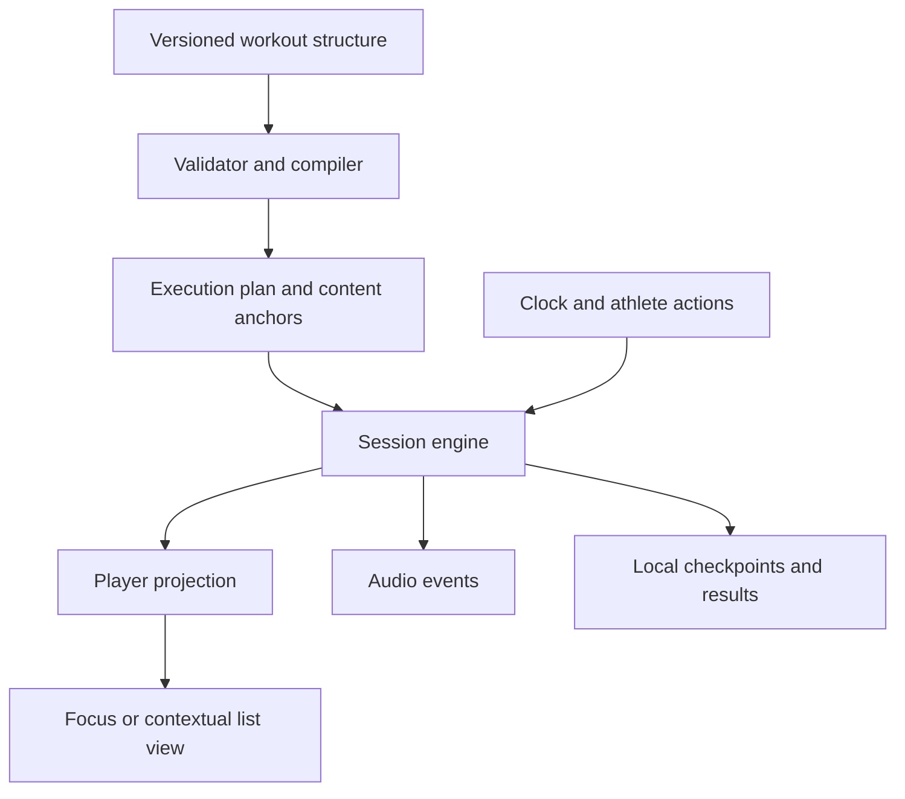
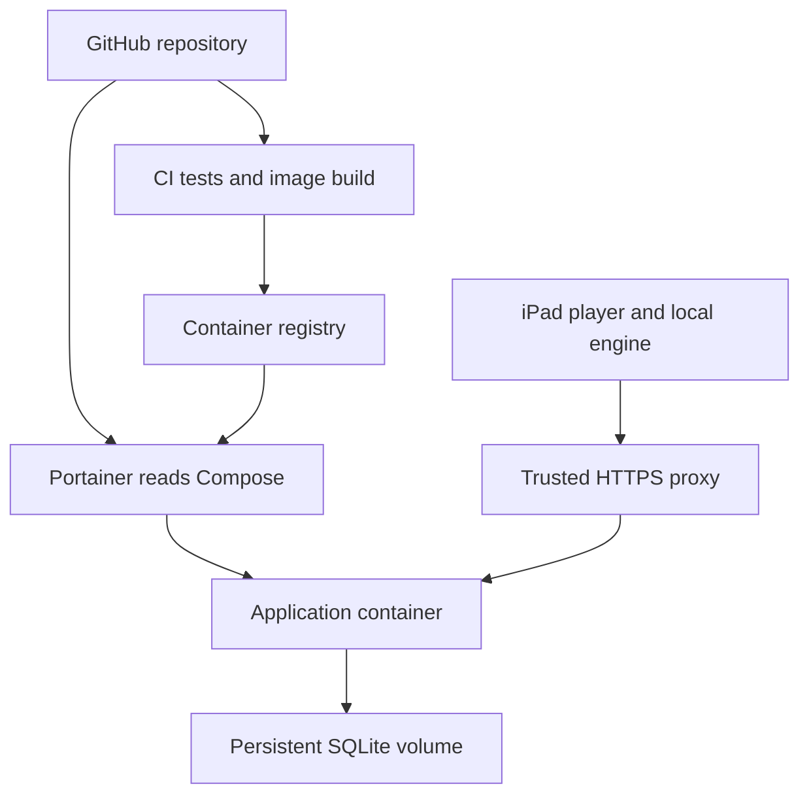

# Home Workout Player System Requirements and Implementation Plan

Version 1.12 · 27 October 2026 · Desktop-first development, portable workout sharing, and two deployment shapes

Build a self-hosted responsive web application for collecting, composing, sharing, and performing home workouts, especially solo and partner CrossFit-style and HYROX-style sessions. Initial development and UX review take place in desktop Safari and Firefox, including a Safari window occupying approximately half a monitor. The same application adapts to iPad, iPhone, and other narrow viewports. A shared iPad placed approximately two metres away remains an intended workout display. The app combines a reusable workout library with an execution engine, a context-sensitive player, a perimeter timer, and spoken cues.

The core interaction is synchronised workout content: the execution engine identifies the relevant row, athlete assignments, or exercise block; the player highlights and presents that content with what comes next. Repeated execution revisits the same content with a new round context. Timers must never invent progress through repetitions or distance-based work.
Deployment is a product requirement, in two shapes built from the same sources.
The household shape is a GitHub repository deployable through Portainer using its root Compose file, a prebuilt application image, and persistent SQLite storage.
The static shape, delivered in version 1.2.0 (section 15.5), is the same build served as a static site from GitHub Pages or any web root, with the library kept in the browser.

**Reading guide for implementers.** Sections 5–14 are normative; sections 11, 15, and 16 hold the architecture choices, the order of work, and the open risks. Start with the backlog in section 15.1 and the fixture in section 6.4, which is the first executable test. Where an architecture note says SHOULD or MAY, the behaviour it protects remains mandatory; only the technique is optional.

# 1 Purpose and requirement conventions

This specification defines observable behaviour, data semantics, operating constraints, acceptance tests, and an implementation sequence. It is sufficient to begin implementation without choosing a product name or creating a full design system first.

**SHALL** identifies a mandatory requirement for its release priority. **SHOULD** identifies a preferred implementation or usability target with a documented reason required for deviation. Architectural suggestions are explicitly separated from behavioural requirements.

| Priority | Meaning |
| - | - |
| P0 | Required for the first dependable household release. |
| P1 | Follow-up improvements after P0 passes acceptance. |
| P2 | Possible future scope; not a commitment for the first release. |

Requirements carry stable IDs. Changes should preserve IDs, record the reason, and update associated acceptance fixtures. All unmarked normative requirements are P0. Numerical limits and UI defaults below are proposed product decisions, not facts about the users' hardware.

The complete P0 scope is the dependable first release, not a prerequisite for reviewing an early usable version. Phase 2 below delivers an initial household version for saved paired timed workouts and file sharing; the remaining formats and advanced authoring follow before the complete P0 release. Partial versions SHALL identify unsupported capabilities and SHALL NOT claim complete P0 compliance.

Success means the couple can create a workout once, select it on the iPad, press Play, and complete a timed partner session without touching the screen again. Completion-driven formats require only meaningful actions such as Switch, Done, or Finish.

# 2 Scope and product defaults

## 2.1 Included in the first release

- A shared household exercise and workout library, plus named collections of workouts called programs.

- One or two athlete profiles, mapped to stable A and B positions at session start.

- Structured workouts containing sections, ordered activities, repeat blocks, timed work, rest, and completion-driven work.

- Timed circuits, Tabata-style presets, AMRAP, EMOM and configurable every-N intervals, For Time, chippers, fixed rep ladders, partner circuits, and you-go-I-go.

- HYROX-style run/station sequences, using manual completion for distances and repetitions.

- A distance-readable workout player, optional contextual list view, audio cues, and an animated screen-edge timer.

- Basic session results, local interruption recovery, portable JSON workout/program import/export, and server backup/restore. One workout per file is a first-class sharing workflow.

- GitHub Actions image publishing, Docker Compose, and Portainer Community Edition deployment on Docker Standalone.

## 2.2 Explicitly deferred

P1: separate login accounts, richer progress comparisons, reusable section templates, calendar scheduling, a larger exercise catalogue, configurable language packs, and optional locally hosted speech generation.

P2: independent athlete timelines, live synchronisation across multiple devices, remote-control phones, wearables, equipment sensors, automatic rep detection, voice commands, workout generation by AI, a hosted public workout directory or social sharing service, leaderboards, nutrition tracking, and official competition scoring. Sharing portable workout files between installations is P0 and requires no public service.

P0 is one authoritative player device per session. Two profiles do not imply two independently running timers. A simple household application does not require microservices or a database server.

## 2.3 Defaults that permit implementation now

| Decision | Baseline |
| - | - |
| Interface and speech | English; kg, metres, kilometres, and machine calories. Schema permits other units. |
| Athlete identities | A and B are session roles; display names are editable. A stays left, B stays right. |
| Access | One household login, shared library, optional persistent trusted-device session. Profiles are not security boundaries. |
| Display | Responsive web app; desktop Safari/Firefox and half-width windows first for UX review, with tablet and phone reflow from the start. Dark high-contrast player. |
| Timer perimeter | Remaining time drains clockwise from a full border to empty. |
| Prep | One configurable 10-second countdown before starting; excluded from workout score. |
| Section boundaries | Manual Ready by default; explicit automatic continuation permitted. |
| Hidden app | Auto-pause at visibility loss when detected; return requires Resume. |
| Interrupted reload | Recover paused from the last durable local checkpoint; no automatic wall-time catch-up. |
| Deployment | One application container, SQLite in a named Docker volume, one replica. |
| HTTPS | Trusted HTTPS for the intended iPad experience, normally through an existing reverse proxy. |

Validate layout and interactions first in desktop browsers and resized windows. Later real-device smoke tests cover touch, audio, wake lock, safe areas, and performance; physical iPad availability SHALL NOT block initial engineering or editor work.

# 3 Users and primary workflows

**Workout author:** creates and edits workouts on a desktop or tablet, checks timing, assigns athlete tasks, and organises programs.

**Performing athletes:** select a saved workout, review equipment and scaling, map A/B, test audio, and start. During training they need the current task, target, phase, time, and next task at a glance.

**Household administrator:** deploys and updates the stack, manages access, exports data, and restores backups. One person may fulfil all roles.

| Use case | Expected flow |
| - | - |
| Reuse a workout | Library → workout summary → choose athletes and overrides → audio/display readiness → Play. |
| Build a circuit | Add activities → set work and transition time → set repeats and round rest → inspect expanded preview → save. |
| Train in pairs | Assign A/B tasks per slot → preserve lane positions → automatically change tasks at timed boundaries. |
| AMRAP | Display the active exercise block and cap; optionally count rounds; finish at the cap. |
| You-go-I-go | Show the active athlete and task; Switch records a completed turn; the other athlete becomes active. |
| HYROX-style session | Alternate run and station tasks; Done records a split and advances; no distance completion is inferred. |
| Recover interruption | Show recovered workout, current position, and elapsed time; Resume or end as Aborted with Interrupted flagged. |
| Share a WOD | Workout menu → Export workout → send the .wod.json file through an existing channel. |
| Receive a WOD | Library or administration → Import → select file → review workout and conflicts → import a local copy → preview/play. |
| Share a collection | Administration → Export selected workouts or program → send one .wods.json pack; recipient imports without setting up catalogue records. |
| Deploy | Portainer reads Compose from GitHub, pulls the image, creates storage, and starts a healthy service. |

# 4 Domain vocabulary and workout semantics

AMRAP means completing as many rounds and/or repetitions as possible within a fixed duration. EMOM starts prescribed work at each minute boundary. A chipper is an ordered list completed in sequence. These terms follow CrossFit's glossary; they do not imply that software can observe physical completion. [S1]

HYROX combines eight 1 km runs with eight intervening functional stations. The app shall support that structural pattern and editable training variations. An official race template, if supplied later, must identify its season/division and source; training substitutions must remain visibly labelled as custom. The engine shall not hard-code race weights or act as an official judge. [S2]

| Format | Clock and completion | Player behaviour |
| - | - | - |
| Timed circuit | Each work/rest slot has a duration; sequence advances automatically. | Current task or paired row, countdown, next task. |
| Tabata-style | Preset work/rest repetitions, editable by the user. | Same engine as a timed circuit; trailing rest is explicit. |
| AMRAP | Fixed block cap; physical exercise progression is unknown. | Whole relevant block, remaining time, optional reported rounds/reps. |
| EMOM or every-N | Fixed interval boundaries, independent of whether reps were completed. | Current assignment, interval remaining, interval/round position, next assignment. |
| For Time | Count-up; athlete completion or an optional cap ends the block. | Relevant task/list, elapsed time, manual Done/Finish, optional cap remaining. |
| Chipper | For Time with an ordered sequence; manual completion marks each task. | Current and next tasks or a compact list. |
| Fixed ladder | Explicit per-round rep targets, such as 21/15/9. | Current round's actual targets; no duration inferred from rep counts. |
| You-go-I-go | Shared cap/count-up or optional fixed turn durations; declared handoff rule. | Active athlete, work unit, other athlete's rest/task, Switch. |
| Parallel pair | Both assignments occur within one shared slot or completion barrier. | Stable A/B lanes, one shared clock, explicit completion rule. |
| Run/station sequence | Usually count-up with manually acknowledged distances and reps. | Current run/station, target, next station, total elapsed and optional split. |
| Strength or skill | Manual set completion, optionally followed by timed rest. | Movement, load, reps, set number; no inferred lifting tempo. |

A **round** repeats a specified block. An **interval** is a scheduled time window. A **turn** is one athlete's work unit before handoff. An **exercise** is a movement definition. An **activity** is its prescription in this workout. A **section** groups work such as warm-up, strength, conditioning, or cooldown. Labels must not use these words interchangeably.

# 5 Functional requirements for authoring and the library

## 5.1 Library and programs

**LIB-01** The system SHALL create, read, update, duplicate, archive, and search workouts. A workout includes a stable ID, title, optional description/source URL, tags, equipment, structured content, revision, and timestamps. Archive preserves history; destructive deletion requires confirmation.

**LIB-02** The system SHALL maintain an editable movement catalogue with name, optional short display name, spoken name, equipment, and notes. Custom movements require no external service. Editing a catalogue entry SHALL NOT rewrite an existing workout prescription or completed session.

**LIB-03** A program SHALL be a named, ordered collection of workout references with optional notes. Removing a workout from a program SHALL NOT delete it. Calendar scheduling and automatic progression are P1.

**LIB-04** Search SHALL cover titles, tags, and movement names. Filters SHALL include solo/pair, format, and equipment. The library SHALL distinguish exact duration, capped duration, and unknown/estimated duration.

**LIB-05** Starting a session SHALL create an immutable snapshot of the selected workout revision and athlete overrides. Subsequent edits affect future sessions only.

## 5.2 Builder

**BLD-01** The builder SHALL support add, edit, duplicate, delete, and reorder for sections, activities, and repeat blocks. Touch and keyboard buttons SHALL provide an alternative to drag-and-drop.

**BLD-02** Each activity SHALL express a movement or instruction and optional targets: duration, reps, distance, machine calories, load, or free-text guidance. Structured targets drive behaviour; free text never becomes executable logic.

**BLD-03** Repeat blocks SHALL declare a positive finite repeat count, child sequence, and optional rest between repetitions. P0 SHALL support at least two nested repeat levels, such as two sets of five circuits, with visible hierarchy.

**BLD-04** Inter-exercise transition rest, between-round rest, and after-section rest SHALL be separate settings. Defaults omit the final exercise's transition rest and the final round's between-round rest. The preview SHALL explicitly show any trailing rest the author adds.

**BLD-05** The builder SHALL support independently prescribed A/B movements, loads, reps, distances, and notes within a shared slot. A/B identity remains fixed while assignments change. Mirroring or swapping tasks SHALL be an explicit editing action.

**BLD-06** For completion-driven paired work the author SHALL choose one rule: explicit team Done, both athletes Done, or active athlete Switch. “Both Done” waits for both acknowledgements; the earlier athlete displays Waiting/Rest. The app SHALL NOT guess a barrier rule.

**BLD-07** Each section SHALL select its format, clock behaviour, cap if any, and transition to the next section. Manual Ready between sections stops scored work until readiness; explicit automatic continuation starts the next section without an implicit extra rest.

**BLD-08** Session setup SHALL allow one-session scaling or substitution per athlete without changing the stored workout. These overrides SHALL be visible during performance and in results.

**BLD-09** The builder SHALL show a human-readable summary and expanded execution preview, including round paths, rests, assignments, manual gates, and exact timed durations. Preview and player SHALL use the same compiler.

**BLD-10** Validation SHALL block starting empty, invalid, unsupported, or unbounded workouts. Errors SHALL identify the affected item and how to fix it. Invalid drafts may be saved with a visible Draft state.

Validation includes missing IDs/references, duplicate node IDs, negative/nonfinite values, zero-duration automatic loops, invalid repeat counts, unsupported nesting, empty AMRAP work lists, absent manual termination rules, mismatched athlete assignments, and incompatible completion policies. Proposed P0 limits are 1–999 repeats per node, two repeat nesting levels, 10,000 resolved timed occurrences, and a 24-hour session cap. Limits SHALL be enforced on both client and server.

**BLD-11** The builder SHALL autosave local drafts and clearly distinguish Saved, Unsaved locally, Sync pending, and Save failed. Explicit save to the server SHALL use revision conflict checking; a conflicting version SHALL NOT silently overwrite another edit.

**BLD-12** Paired repeat blocks SHALL support an explicit assignment policy: fixed assignments or alternate the two task columns after each complete iteration. Alternation SHALL change prescriptions within stable A/B lanes, not athlete identity or lane order. The preview, spoken cues, checkpoints, and exported workout SHALL preserve the policy and resolve the correct assignments for each iteration. The first implementation MAY compile the policy into explicit per-round assignments; the shared model SHALL preserve its authored meaning. Nested repeats SHALL identify which repeat level triggers alternation.

# 6 Workout model and execution contract

## 6.1 Three layers

The system SHALL separate authoring data, execution state, and presentation. This is the central architectural constraint.



**MOD-01** Every authored node SHALL have a stable ID. Every execution occurrence SHALL have a distinct identity containing its node ID, repeat path, and visit number where needed. Replaying a row SHALL preserve its content anchor but create a new occurrence. Array position alone is not an identity.

**MOD-02** The engine SHALL expose a presentation projection containing active anchor(s), current prescriptions, next actionable work, intervening rest, section/round/interval context, active athlete or lanes, available controls, and clock values. The UI SHALL NOT independently derive workout progression. The projection SHALL change only when a command or transition changes it; continuously changing values SHALL come from a separate clock read function that takes a clock observation and returns current clock values and remaining fractions. Rendering therefore reconciles the component tree only at transitions, while the perimeter and clock labels read the clock function per frame.

**MOD-03** A content anchor MAY represent one activity, a paired row, or a whole block. AMRAP normally anchors the block. Advancing the timer SHALL NOT falsely select the next AMRAP exercise.

**MOD-04** The compiler SHALL produce a deterministic execution graph or lazy plan. Fully timed paths may be flattened; manual gates and unknown-duration blocks SHALL remain explicit. A guessed schedule for manual work is forbidden. For a flattened timed run the compiler SHOULD precompute cumulative start offsets so that resolving the current occurrence for any section time is a lookup rather than a step-by-step replay; a late callback uses that lookup to find the current occurrence and SHALL still record every crossed semantic boundary exactly once and in order, so the transition history stays complete while stale announcements are skipped (ENG-02, AUD-06). The compiled plan SHALL be computed once per session and shared by preview, engine, audio, and checkpoints.

**MOD-05** Clock policy, presentation mode, athlete participation, and completion rule SHALL be separate concepts. For example, paired participation can occur inside an AMRAP or a timed circuit; it is not a mutually exclusive workout type.

Implement named formats using a bounded set of shared behaviours: sequence/repeat, timed work/rest, fixed scheduled intervals, capped blocks, and explicit manual completion/handoff. Tabata is a timed preset; a chipper and a run/station workout are manual sequences with different prescriptions. Avoid a separate progression implementation for each format or a general-purpose scripting language. Shared behaviours retain their format-specific scoring and presentation rules.

## 6.2 Minimum data entities

| Entity | Required contents |
| - | - |
| Exercise | ID, full/short/spoken names, equipment, optional notes. |
| Workout | ID, schema version, revision, metadata, ordered section tree, optional sharing provenance and attribution. |
| Activity | Stable node ID, copied prescription, targets, athlete assignments, content anchor. |
| Block | Stable node ID, type, children, repeat/interval/cap settings, completion and transition policies. |
| Program | ID, name, ordered workout references, notes. |
| Athlete profile | ID, display name, preferred units; profile is separate from login identity. |
| Session | ID, workout snapshot, mapped athletes, settings, engine version, state, clocks, active occurrence, completion acknowledgements. |
| Session event | ID, increasing sequence, session ID, occurrence ID, event type, monotonic offset, wall timestamp, payload. |
| Result | Outcome, Interrupted and Modified flags, scores by section/athlete/team, elapsed/paused time, modifications, notes, snapshot reference. |

All executable durations SHALL be integer milliseconds internally; user-facing entry may use minutes and seconds. Quantity values SHALL include units. Missing scores SHALL remain null/unrecorded, never become zero. Timestamp storage SHALL use UTC; display uses the configured local timezone.

Immutable, self-contained session snapshots are the requirement. Storing each distinct snapshot once and referencing it by a hash of its canonical JSON form (SHR-06 defines the canonical serialisation) is an optional later optimisation, adopted only when storage measurements justify it; the first implementation MAY store one copy per session.

## 6.3 Required clock distinctions

- **Session wall elapsed:** real time from session start, including pauses and readiness waits; useful for history.

- **Session active elapsed:** time spent executing work, rest, and transitions, excluding prep, pauses, and manual Ready waits.

- **Section clock:** countdown or count-up used for the section's cap or score; includes prescribed intra-section rest and transitions, excludes pauses.

- **Slot clock:** current work/rest/EMOM interval countdown.

- **Turn or split elapsed:** time since the current manual task or athlete turn began.

The player SHALL identify which clock it displays. Paused or manually altered scored workouts SHALL be marked as modified; their adjusted elapsed times must not masquerade as uninterrupted results.

## 6.4 Representative semantic fixture

This Phase 0 data contract was formalised in a version 1 schema, since superseded by schemas/workout.v2.schema.json, and implemented as the canonical workout `workouts/default/partner-circuit.wod.yaml`. Identifiers are examples, not production records. Each slot lasts 40 seconds and contains simultaneous assignments. Additional workout capabilities extend the model in later milestones.

```json
{
  "schemaVersion": 1,
  "id": "partner-circuit",
  "revision": 1,
  "title": "Partner circuit",
  "participants": 2,
  "equipment": ["Rowing machine", "Kettlebell"],
  "prepMs": 10000,
  "sections": [{
    "id": "conditioning",
    "title": "Conditioning",
    "format": "timedCircuit",
    "transitionAfter": "manualReady",
    "body": {
      "id": "circuit",
      "type": "repeat",
      "count": 5,
      "betweenIterationsRestMs": 60000,
      "body": {
        "id": "stations",
        "type": "sequence",
        "betweenChildrenRestMs": 10000,
        "children": [
          {
            "id": "slot-1", "type": "timed", "durationMs": 40000,
            "assignments": {"A": {"name": "Row"}, "B": {"name": "Kettlebell swings"}}
          },
          {
            "id": "slot-2", "type": "timed", "durationMs": 40000,
            "assignments": {"A": {"name": "Kettlebell swings"}, "B": {"name": "Row"}}
          },
          {
            "id": "slot-3", "type": "timed", "durationMs": 40000,
            "assignments": {"A": {"name": "Burpees"}, "B": {"name": "Air squats"}}
          },
          {
            "id": "slot-4", "type": "timed", "durationMs": 40000,
            "assignments": {"A": {"name": "Air squats"}, "B": {"name": "Burpees"}}
          }
        ]
      }
    }
  }]
}
```

The between-children rule inserts rest only between children; the between-iterations rule inserts rest only between repetitions. These fields SHALL NOT silently add trailing rest.

Expected timed duration: each round is 4 × 40 + 3 × 10 = 190 seconds. Five rounds plus four 60-second breaks equal 1,190 seconds, or **19:50**. Including prep gives **20:00**. Changing the repeat count to two gives **7:20** excluding prep.

| Active section time | Expected state |
| - | - |
| 0 to less than 40s | Round 1, slot 1. |
| 40 to less than 50s | Transition, next slot 2. |
| 150 to less than 190s | Round 1, slot 4. |
| 190 to less than 250s | Round rest; preview round 2, slot 1. |
| Exactly 250s | Round 2, slot 1; contextual view returns to its anchor. |
| Exactly 1,190s | Section and session complete; no extra rest or Ready gate after the final section. |

## 6.5 User-provided Markdown workout

[docs/source/example-wod.md](docs/source/example-wod.md) is a real authoring and display reference and the second canonical timing fixture. It contains a five-minute warm-up, four paired four-row blocks of ten minutes each, and a five-minute cool-down; the title states the sum, 50 minutes, excluding prep and Ready waits. Work is prescribed as 40 seconds with 20-second transitions; the bodyweight/dumbbell task columns exchange athlete assignments after each round. Column headings describe task groups, not permanent athlete identities.

The resolved timing is explicit in the document: each block is two rounds of four slots at 40s/20s including the transition after the last slot (4:00 per round, the last transition doubling as the column switch), followed by a 2-minute block rest that every block, including Block 4, keeps, giving 2 × 4:00 + 2:00 = 10:00 per block and 40:00 for the WOD. Warm-up and cool-down are 1-minute solo-style timed slots performed together without transitions. The builder SHALL show the authored trailing rests explicitly (BLD-04); the columns swap through BLD-12 alternation after each complete round. The general rule stands for any future prose conversion: a capped partial round SHALL NOT be described as a complete round or an equal A/B role rotation, and missing timing semantics are resolved by the author, never guessed.

| Section | Expected timed duration |
| - | - |
| Warm-up | 5:00 |
| Each block | 10:00, of which 8:00 work/transition and 2:00 rest |
| WOD | 40:00 |
| Cool-down | 5:00 |
| Session | 50:00 excluding prep and Ready waits |

Use this document to test paired table/context layout, long movement names, multi-section navigation, trailing rest display, and per-round assignment alternation. Markdown remains a human authoring/reference format; automatic interpretation of arbitrary Markdown or natural language is outside P0. The editor or a reviewed manual conversion produces validated portable JSON; imported executable files SHALL never guess missing timing semantics from prose.

# 7 Session engine and timing requirements

**ENG-01** The engine SHALL be independently testable without the UI, DOM, audio device, or server. Given the same snapshot, clock observations, and ordered commands, it SHALL produce the same state and semantic events.

**ENG-02** The engine SHALL use elapsed time from a monotonic clock while running, not repeated decrement operations. Render frames and callback counts SHALL NOT determine elapsed time. Late callbacks SHALL resolve the correct current state and cross due boundaries exactly once. The engine SHALL expose the next due deadline so the host schedules one wake-up for it and re-checks on each animation frame while visible, instead of polling on a fixed interval; progression never depends on that wake-up arriving on time.

**ENG-03** Timed intervals SHALL be half-open: a slot owns its start instant but not its deadline. At a deadline the next slot becomes current. Display uses ceiling of positive remaining milliseconds to seconds; a completed slot SHALL NOT linger showing 00:00 before advancing.

**ENG-04** The engine SHALL implement these lifecycle states: Ready, Preparing, Running, Paused, AwaitingReady, Recoverable, Completed, and Aborted. Work, rest, transition, and waiting-for-partner are substates/projections of Running. A completion-driven task continues counting while awaiting Done; it is not Paused.

| Command or event | Required effect |
| - | - |
| Play from Ready | Begin prep, then start first section. |
| Pause | Freeze all active clocks and progression, cancel pending cues, checkpoint state. |
| Resume | Continue from frozen state without silently adding time or restarting the slot. |
| Timed deadline | Apply due transitions, update context, emit only relevant cues. |
| Done | Apply the current manual completion rule; ignored if not valid for the occurrence. |
| Switch | Record the active athlete's completed turn and assign the next athlete/work unit. |
| Next or Previous | Explicit navigation; mark session modified, cancel stale cues, checkpoint. |
| Finish | Finish the applicable block/session as specified by its format. |
| Stop | Confirm ending; preserve partial result as Aborted. |
| Visibility loss | Auto-pause if Running/Preparing, save checkpoint; never auto-resume on return. |
| Reload with active checkpoint | Enter Recoverable and present Resume/End options. |

**ENG-05** P0 SHALL support Pause/Resume, Next, Previous, and Stop where applicable to the format. For ordinary timed sequences, Previous restarts the preceding execution occurrence, including its repeat path; Next skips to the next occurrence. These actions do not undo physical work or erase audit events. They preserve the enclosing section clock and cap while resetting the selected slot clock; they mark the session modified. During EMOM/every-N execution, Next/Previous SHALL be disabled so interval boundaries cannot shift; browsing future prescriptions SHALL NOT change the active occurrence. Whole sections are navigated with explicit Next section and Previous section controls in every format, while running, paused or at a Ready gate: Next section scores the section left behind as skipped and honours its Ready gate, Previous section returns to the start of the previous section (or restarts the first) and drops that section's earlier score so it is played again (version 1.11). AMRAP counters use a separate Undo counter action. The clock MAY also be nudged a few seconds either way within the current countdown; a nudge never changes the recorded training time.

**ENG-06** For Time SHALL terminate on Finish or cap. AMRAP SHALL terminate on cap or explicit early finish. At an exact cap boundary, cap processing takes precedence over a manual completion timestamp at or after that boundary; the result is Capped. UI rendering delay SHALL NOT extend the cap.

**ENG-07** EMOM/every-N slots SHALL start on the scheduled section-time boundaries. Marking work Done early SHALL show Rest until the next boundary, without advancing that boundary. If work was not acknowledged, the boundary still advances and leaves completion unreported. It SHALL NOT infer failure solely from the absence of a tap.

**ENG-08** You-go-I-go SHALL declare the work unit and round rule. Default: A turn plus B turn completes one team round. The author may instead define explicit alternating activity steps. Switch indicates completion of the current turn; switching early for convenience uses a separate Skip action and marks the session modified.

**ENG-09** In a both-done paired task, completion acknowledgements SHALL be scoped to athlete and occurrence. A second tap from A SHALL NOT count as B. At the next occurrence, acknowledgement state resets.

**ENG-10** All user commands SHALL carry an occurrence ID and unique command ID. Duplicate commands and commands targeting a stale occurrence SHALL be rejected or ignored safely. Rapid double taps SHALL NOT skip two steps or create two scores.

**ENG-11** An active session SHALL continue locally during server/network failure. Remote persistence SHALL not sit on the timing path. The app SHALL persist a full checkpoint on every command and every transition; while running it SHALL additionally write one small progress record holding the current clock offsets and the ID of the checkpoint it extends, with a target of one durable progress update per second. Recovery SHALL apply a progress record only to the checkpoint it names, so incompatible records are never combined. Between events the engine state is fully determined by the last checkpoint plus the monotonic offset, so nothing else needs writing. Derived cue events such as countdown numbers and spoken previews are not semantic events and SHALL NOT be persisted or uploaded. An explicit local-storage failure indicator SHALL appear when checkpoint or progress writes fail or fall behind the one-second target. Everything the player route needs after Play, including lazily loaded code and audio assets, SHALL be loaded before the session starts so a server outage or redeploy cannot interrupt a running session.

**ENG-12** After reload or process termination, the app SHALL recover paused from the last durable checkpoint, display its age, and mark the session interrupted. Unsaved time since that checkpoint may be lost; the app SHALL not infer completed physical tasks from elapsed wall time. Restore SHALL include round path, active athlete, acknowledgements, scores, and clock offsets.

**ENG-13** P0 SHALL not promise reliable background or lock-screen execution. If the OS suspends the app before a visibility checkpoint, recovery follows ENG-12. Network loss alone SHALL not pause the session. A hidden-app pause SHALL be distinguishable from user-requested pause.

**ENG-14** Only one tab SHALL control a given session. A second tab SHALL show a read-only or explicit takeover state. Duplicate tab detection must work without a server round trip; cross-device live control is deferred. The suggested mechanism is a Web Locks API lock named by session ID, released by the browser when the controlling tab closes, with BroadcastChannel to announce takeover.

# 8 Workout player and visibility requirements

## 8.1 Information hierarchy

**UI-01** The default player SHALL prioritise phase, current activity/targets, primary clock, athlete assignment, round/interval position, and next actionable work. Editing controls, library navigation, and long notes SHALL be hidden from the performance layout.

**UI-02** The player SHALL support Focus and Context views. Focus presents current and next work. Context presents a window of surrounding rows/blocks with the active anchors highlighted. Both consume the same engine state and changing views SHALL not affect timing.

**UI-03** Context view SHALL automatically follow active anchors, including returning to the first row when a block repeats. User scrolling temporarily disables follow. A persistent Follow workout control restores it. Focus mode SHALL not move the main timer's position at each transition.

**UI-04** A/B positions and labels SHALL remain stable. Task changes SHALL update content within the lanes, not swap the lanes. Participant colour SHALL be independent of work/rest colour. Labels remain understandable without colour.

| Mode | Primary content | Next information and controls |
| - | - | - |
| Timed solo | Large countdown, phase, movement and target. | Next movement; intervening rest indicated. |
| Timed pair | Shared countdown, stable A/B lanes and assignments. | Next A/B assignments; switch/rest clearly labelled. |
| AMRAP | Remaining cap plus the full active exercise block in a compact readable form. | Optional round/rep controls; next section secondary. |
| EMOM | Interval remaining, prescribed task, interval number. | Next interval task; optional Done → remaining rest. |
| For Time/chipper | Elapsed section clock, current target or compact task list. | Next target, Done/Finish; cap remaining secondary. |
| You-go-I-go | Active athlete, work unit, shared clock, turn elapsed if useful. | Next athlete, large Switch control. |
| Both-done pair | Two tasks and Done states with one shared clock. | Early finisher displays Waiting/Rest. |
| Rest | Large rest countdown. | Upcoming tasks dominate the remaining space. |
| Paused/recovered | Explicit paused state and frozen values. | Resume and end; no misleading running animation. |

**UI-05** “Up next” SHALL resolve through repeat boundaries and rest nodes. During work it may show “10s rest, then Row”; during round rest it SHALL show the next round's actual assignments. At the end, it SHALL show Finished rather than a nonexistent next task.

**UI-06** AMRAP content SHALL not auto-scroll through exercises based on guessed pace. Optional manual focus can highlight an athlete-reported item without affecting the cap. When the block cannot fit at the minimum type size, the author SHALL receive a preflight warning and choose a compact label layout or manual paging before starting. The app SHALL NOT silently shrink essential text.

## 8.2 Distance readability and controls

**UI-07** At a baseline 1024 × 768 CSS-pixel landscape viewport, the player SHOULD use at least 112px for the primary timer, 40px for current movement names, and 28px for next tasks and athlete labels. These are initial design targets; final acceptance is the physical two-metre test. Critical loads/reps SHALL not be hidden in secondary notes.

**UI-08** Controls SHALL have at least 48 × 48 CSS-pixel hit areas; the principal Switch/Done control SHOULD be at least 72px high. A single Pause action SHALL remain visible. Destructive Stop SHALL be separated and confirmed. No hover-only or gesture-only essential action is permitted.

**UI-09** Layout SHALL respect safe areas, browser chrome, and portrait reflow. Essential content SHALL not clip. Initial UX acceptance SHALL include desktop Safari and Firefox, a half-monitor-width Safari window with its actual CSS dimensions recorded, and narrow phone/tablet viewports. A/B lanes SHALL retain A-before-B order when stacking vertically; controls SHALL remain touch-sized and essential text SHALL reflow instead of being scaled down to fit. Fullscreen or installed-PWA presentation is optional enhancement; normal Safari operation SHALL remain usable.

**UI-10** Text contrast SHALL meet a product target of at least 4.5:1. Phase changes SHALL use text and shape/icon cues in addition to colour. Reduced-motion settings SHALL suppress scrolling animation and decorative motion while preserving accurate state.

## 8.3 Perimeter timer

**UI-11** A thick inset border SHALL trace the usable application viewport, with rounded corners. It SHALL avoid controls and safe areas; the browser cannot draw outside its own viewport onto the physical iPad bezel.

**UI-12** For known-duration phases, remaining fraction SHALL be clamped to remainingMs/durationMs. The border starts full and drains clockwise to empty. It resets only when its represented phase changes and freezes on pause. Work uses green, then amber and red according to UI-13; rest uses a distinct phase colour (blue by default, chosen per theme in the settings) and an explicit REST label.

**UI-13** Warning thresholds SHALL be capped to the interval length so short intervals do not spend their entire duration in warning. Default amber threshold is min(10 seconds, 25% of duration); red is min(3 seconds, 10% of duration). Colour changes SHALL not flash.

**UI-14** For EMOM the perimeter represents the interval; for AMRAP it represents the block cap; for capped For Time it represents time remaining to the cap. Uncapped count-up/manual work SHALL show a neutral border with elapsed time, not a fabricated completion percentage. The UI SHALL label the represented time context.

**UI-15** Animation SHALL derive from engine clock state and target 60fps on the reference iPad. Dropped frames SHALL not change timing. A stable layout is more important than decorative animation. The perimeter SHOULD be one SVG path or CSS conic gradient whose progress is a single custom property or stroke offset, updated from a requestAnimationFrame loop that reads the engine clock function (MOD-02); the loop SHALL stop while paused or hidden. Clock labels update only when their displayed second changes.

**UI-16** The app SHALL be installable on a phone's home screen: a web app manifest with the name, standalone display, start URL and scope relative to the served path, PNG icons including a maskable one, and an Apple touch icon with the Apple meta tags. The status bar SHALL follow the theme colour, the layout SHALL respect the bottom safe area when standalone, and the production checks SHALL verify that the manifest, its icons and the tags ship with the bundle.

# 9 Audio and spoken cues

**AUD-01** Settings SHALL offer Voice plus beeps, Beeps only, and Silent. Users SHALL be able to test sound before starting and select available speech voice, rate, and volume. The beeps SHALL have their own volume and a choice of tones, testable on their own (version 1.11). No microphone permission is needed.

**AUD-02** Audio SHALL consume semantic engine events: prep, work start, rest start, upcoming assignment, countdown, round start, cap reached, paused, resumed, and completed. Components SHALL not independently trigger their own timers or announcements.

**AUD-03** The default sequence SHALL announce tasks during prep/rest, use short boundary cues such as Go/Rest/Switch, and count down the final three seconds. Long exercise descriptions SHALL not delay an interval boundary. Spoken aliases SHALL support short, pronounceable movement names.

**AUD-04** Paired announcements SHALL identify both athletes, for example “A: row. B: swings.” If the available rest is too short, shorten or omit the preview and retain the boundary cue. The visual display remains authoritative.

**AUD-05** Cue priority SHALL be: stop/pause and terminal events; transition cue; final countdown; next-task preview; optional encouragement. At most one spoken utterance plays at a time. Pause, seek, skip, and recovery SHALL cancel obsolete queued speech.

**AUD-06** Cue IDs SHALL include session, execution occurrence, cue type, and threshold. Re-renders SHALL not repeat cues. After a delay, missed countdown numbers SHALL not play as a burst; stale previews SHALL be dropped. A repeated round produces new cues for its new occurrence.

**AUD-07** Exact-boundary beeps SHOULD use preloaded/local audio or Web Audio scheduling. Because every timed deadline is known in advance, boundary and countdown beeps SHOULD be scheduled on the AudioContext clock when the slot starts, using a recorded mapping between the monotonic clock and AudioContext time, and cancelled on pause, navigation, or recovery; this removes JavaScript timer latency from the audible boundary. The AudioContext clock stops while the context is suspended and is not synchronised with the monotonic clock, so the mapping SHALL be re-established after every suspend/resume, visibility return, or recovery, and every cue scheduled under a previous mapping SHALL be cancelled before rescheduling. Browser speech is best-effort and SHALL not be the clock source. Speech support and available voices vary by device; browser speech is a supported starting approach, not a guarantee of identical voice quality or fully offline voices. [S4]

**AUD-08** The app SHALL initialise/unlock audio from an explicit user gesture and detect speech/audio errors where possible. Failure SHALL not stop the workout. A visible sound status and working local beep fallback SHALL remain available. No runtime call to a cloud AI service is required.

**AUD-09** Wake lock and sound readiness SHALL be checked in preflight. Screen Wake Lock requires a secure context and may be released by the platform, so the app SHALL detect release and reacquire when appropriate on return. Unavailable wake lock SHALL be explained before starting. [S3]

# 10 Persistence and results

**DAT-01** SQLite SHALL be the authoritative server datastore for workouts, programs, profiles, settings, and session records. All persistent application data SHALL live under a documented mounted data directory. Container replacement SHALL not lose data.

**DAT-02** IndexedDB SHALL hold current snapshots, drafts, checkpoints, and a retryable event/result outbox. Related checkpoint/event/outbox updates SHALL be transactional so recovery and upload agree on acknowledged progress. Storage work SHALL remain outside the render/timing path. Starting a loaded workout and finishing it SHALL not require continued network connectivity. P0 does not require cold-starting the entire app offline; cached offline startup is P1.

**DAT-03** Synchronisation SHALL use stable session/event IDs and idempotent writes. Repeated upload after a timeout SHALL not duplicate sessions or results. A reconnect SHALL upload pending events in order without resetting the active player. Uploads SHALL contain commands, transitions, and results only; the per-second progress record of ENG-11 stays local. Events SHOULD be uploaded in batches rather than one request per event.

**DAT-04** Results SHALL distinguish final outcomes Completed, Capped, and Aborted, with separate Interrupted and Modified flags. Recovery sets Interrupted without predetermining the final outcome: a recovered session may subsequently be Completed or Capped. Ending a recovered session without resuming records Aborted with Interrupted flagged. Store actual overrides and relevant scores: time, rounds plus reps, reps, distance, load, and optional notes. Scores may be per athlete or team, explicitly labelled. Completion of a timer is not proof that prescribed reps were completed.

**DAT-05** Users SHALL see recent sessions, reopen the workout snapshot, and repeat it as a new session. Correcting a score SHALL preserve the prior value and correction timestamp. Basic history is P0; charts and personal-record inference are P1.

**DAT-06** JSON export/import SHALL include schema version and selectable workouts/programs, and support a full application-data export excluding authentication secrets. Imports SHALL validate before applying, show counts/conflicts, and be transactional. Default import creates copies with remapped IDs; explicit replacement requires confirmation. Unknown future schema versions SHALL be rejected with a useful message.

**DAT-07** The deployment SHALL provide consistent SQLite backup and restore procedures. Online backup must use SQLite-supported snapshot/backup facilities; copying a live database file without handling its journal is insufficient. A pre-migration backup SHALL be created and a restore rehearsal SHALL be part of release acceptance.

**DAT-08** Database migrations SHALL be versioned and transactional where supported. Startup SHALL fail with an actionable error rather than serving against an incompatible schema. Downgrades SHALL never silently reinterpret newer data.

**DAT-09** Archiving/deleting a workout SHALL not invalidate session snapshots. Clearing browser storage SHALL not erase already-synchronised server data; unsynchronised data is local-only and must be labelled accordingly.

**DAT-10** In the static shape the library SHALL live in IndexedDB of the browser profile, behind the same `Backend` interface as the server client, with the same revision, import and correction semantics, and the Settings page SHALL say where the data lives and offer persistent storage. The interface SHALL label the library as this browser's, without server wording. The static shape SHALL keep at least the newest 2000 sessions, pruning the oldest beyond that and reporting what a restore pruned.

**DAT-11** The `openwod.export` JSON SHALL restore into either shape, replacing everything after an explicit confirmation that shows the counts and export date. The server SHALL write a pre-restore SQLite backup first. Restore SHALL be validated and all-or-nothing.

## 10.1 Portable WOD sharing

SQLite remains the live datastore. JSON files are portable exchange documents; sharing a workout SHALL NOT require copying the database, accessing the container filesystem, or running another service.

**SHR-01** Each workout SHALL offer Export workout, producing one UTF-8 YAML file named from its title with a .wod.yaml suffix. The library and administration screen SHALL offer Import; administration SHALL also offer export of selected workouts/programs as one .wods.yaml pack. Import SHALL also accept the earlier JSON form, since YAML 1.2 is a superset of JSON. These actions SHALL work through ordinary browser file selection/download on desktop, tablet, and phone. Workout sharing SHALL be available when the first circuit editor is delivered.

**SHR-02** A single-workout document SHALL use the discriminator `format: "openwod.workout"`, an integer `formatVersion`, and one `workout` conforming to the separately versioned domain schema. File version 2 writes durations as human-readable strings such as `40s`, `1m30s` or `1:30` under keys without the Ms suffix (`duration`, `prep`, `betweenChildrenRest`, `trailingRest`, `betweenIterationsRest`); a bare number means seconds. The internal model stays integer milliseconds (section 6.2); version 1 files with `*Ms` integer keys remain importable. A pack SHALL use `format: "openwod.workoutPack"`, `formatVersion`, and workout/program collections. Files SHALL contain the complete prescriptions, targets, units, repeats, rests, section policies, A/B roles, and required movement names/short/spoken names. Referenced exercise definitions SHALL be included or resolved into copied prescriptions during export. Files SHALL remain usable on an empty compatible installation without source-server access, catalogue IDs, household athlete profiles, or linked external assets.

**SHR-03** Shared files SHALL contain workout/program content and optional author-entered attribution only. They SHALL exclude household profile identities, session history/results, authentication data, deployment configuration, and local draft state. Any author/source URL or workout notes intentionally included SHALL be visible in the export preview. Household A/B names SHALL export as role labels. Full application-data export under DAT-06 SHALL be a separate, clearly labelled administrative operation and SHALL NOT use the workout-sharing discriminator.

**SHR-04** Import SHALL preview titles, formats, athlete roles, timing summary, equipment, attribution, and conflicts before confirmation. Validation SHALL complete before a transactional import; invalid or unsupported files SHALL produce actionable errors without partial changes. Default import creates independent local copies, remaps local workout/program/node/reference IDs consistently, and preserves separate sharing provenance. Reimport detection SHALL use provenance identity/revision when available, not titles alone, and offer Skip or Import another copy. Explicit replacement SHALL identify the local target, require its expected revision and confirmation, and preserve existing session snapshots. Importing SHALL never start a session automatically.

**SHR-05** Workouts SHALL support optional sharing provenance (stable sharing ID and source revision), author, source URL, description, and licence/permission text. Imports and re-exports SHALL preserve declared attribution and provenance; edited derivatives SHALL record their source and receive a distinct sharing identity. Local database identity and local edit revision SHALL remain separate from source provenance. An absent content licence SHALL remain unspecified; the application's code licence SHALL NOT be applied automatically to contributed workouts. A central directory, public accounts, and in-app publishing are deferred; users may distribute files through existing channels or Git repositories.

**SHR-06** The repository SHALL publish the versioned exchange/domain JSON Schemas (which validate the parsed YAML document), readable format documentation, and valid single-workout/pack examples. YAML export SHALL use one canonical serialisation, with a fixed human-friendly key order, two-space indentation, no anchors or aliases, and no document markers, for reading and stable diffs, without volatile export timestamps; the same canonical form serves the optional snapshot hashing of section 6.2. Import SHALL accept older supported versions through explicit migrations, reject unknown newer versions, and identify unsupported workout capabilities in partial releases. Round-trip and cross-installation fixtures SHALL verify semantic equivalence of prescriptions, timing, attribution, and program references after ID remapping, by comparing a normalised representation of workout meaning with local IDs and local revision mapped out; import intentionally changes IDs, so byte equality of canonical YAML is not the test. Import SHALL reject YAML anchors/aliases and duplicate keys. Parsing and expansion SHALL enforce BLD-10/NFR-10 limits before writes; source URLs SHALL be treated as metadata and SHALL NOT be fetched automatically.

Example filename: `partner-circuit.wod.yaml`. Its workout payload is the complete fixture in section 6.4 in the version 2 human-duration form, wrapped with `format: "wodva.workout"` and `formatVersion: 2`; `workout.schemaVersion` versions the workout model independently of the exchange envelope. Program packs embed referenced workouts rather than depending on another installation's library. The public schemas SHALL specify required fields, optional metadata, ID remapping, and migration behaviour before the first sharing release.

# 11 Architecture and interface boundaries

The selected stack is React + TypeScript with Vite, CSS Modules and CSS variables, a pure TypeScript execution engine, a Node.js + Fastify backend, SQLite server storage, and IndexedDB browser storage. Use Vitest for domain/engine tests and Playwright for browser integration tests. Select and pin supported dependency/runtime versions and a maintained SQLite driver during implementation; prefer a driver that needs no native compilation per architecture, such as the Node.js built-in SQLite module if it is stable in the pinned Node.js version, or one that ships prebuilt binaries for both image architectures. The specification intentionally does not freeze patch versions before setup.

Frontend, backend, and tests SHALL share the versioned domain schemas and validation rules. The schemas SHALL have one source of truth in packages/domain, from which TypeScript types, runtime validators, and the published JSON Schemas under schemas/ are generated; CI SHALL fail when a committed generated file differs from its source. The backend SHALL serve the production frontend assets and same-origin API in one application container. The static shape (DEP-15) serves the same frontend without a backend and keeps the library in the browser behind the same client interface (DAT-10). SQLite is an embedded file datastore under /data and SHALL NOT require a second database container. Development may use separate Vite and API processes, with a development proxy. An existing HTTPS reverse proxy remains external deployment infrastructure.

The engine executes on the player device. The server stores content and results; it does not send once-per-second timer ticks. Rendering, audio, and persistence subscribe to state/events without controlling progression.

Responsive layouts SHALL use available container/viewport space rather than device-name detection. The projection/clock split in MOD-02 and the perimeter technique in UI-15 keep per-frame work out of React reconciliation; this is a presentation optimisation, not a second source of progression. Prefer a small set of shared components and design tokens; add dependencies when a concrete workflow needs them.



## 11.1 Suggested repository boundaries

| Path | Purpose |
| - | - |
| apps/web/ | Library, builder, setup, player, history, client persistence. |
| apps/server/ | HTTP API, authentication, SQLite repositories, migrations. |
| packages/domain/ | Versioned schema, validators, compiler, shared types. |
| packages/engine/ | Pure state machine, clock adapter contract, events and projections. |
| workouts/ | The workout registry: one hand-written YAML file per bundled workout, one folder per bundled collection, bundled at build time. |
| tests/unit/traces/ | Expected execution traces of the canonical timed workouts. |
| tests/e2e/ | User flows, network failure and persistence tests. |
| schemas/ | Published versioned JSON Schemas for domain and sharing documents. |
| docs/ | Deployment, backup, architecture decisions, contributor guide. |
| compose.yaml | Default Portainer-ready production stack. |
| deploy/compose.dev.yaml | Optional source-build/development setup. |
| Dockerfile | Multi-stage production image build. |
| .env.example | Documented configuration values without secrets. |
| .github/workflows/ | Validation, image build and release publishing. |

## 11.2 Minimum API contract

**API-01** The server SHALL expose versioned JSON endpoints for workouts, programs, profiles, settings, sessions/results, import/export, authentication, and health. Exact route names may be established in implementation; the following operations are required.

| Operation | Contract |
| - | - |
| Read/list content | Stable IDs, revision, filtering/pagination; no secret fields. |
| Create/update content | Shared schema validation; updates require expected revision. |
| Start/register session | Accept client-generated session ID and immutable snapshot; retry-safe. |
| Append session events | Ordered per-session sequence and unique IDs; duplicate-safe. |
| Finish/update result | Idempotent finalisation; corrections distinguished from first finish. |
| Export/import | Single-workout and pack exchange under SHR-01–06; separate administrative application-data export; versioned schemas, preview/validation and transactional application. |
| Health/live | Process responsiveness. |
| Health/ready | Database available, migrations complete, service ready. |

**API-02** Failed requests SHALL return structured errors with a machine code, readable message, and field path where applicable. Conflicts SHALL return a conflict response; validation failures SHALL not create partial records.

**API-03** No WebSocket service is required for P0. A future remote-control feature may add one without replacing engine semantics or the stored workout format.

# 12 GitHub Docker and Portainer deployment

Portainer supports stack deployment from a Git-hosted Compose file with a repository reference and Compose path. Git-deployed stack definitions are maintained in the repository. The default deployment SHALL use this path. [S5]

The static shape of DEP-15 to DEP-17 is the second deployment: no container and no household server, published on GitHub Pages and as a zip on every release.

**DEP-01** The repository SHALL include a root compose.yaml that deploys the entire application on Docker Standalone through Portainer Community Edition. P0 SHALL not depend on Business Edition features, Swarm, Kubernetes, a local source checkout, or host-side compilation.

**DEP-02** Production Compose SHALL reference a prebuilt image from GitHub Container Registry or an equivalent registry. GitHub Actions SHALL run validation and publish release images. Portainer pulling the repository supplies the stack definition; pulling the image supplies the application. A repository pull alone does not rebuild or publish application code. [S7]

**DEP-03** One application image SHALL package the frontend assets and backend. SQLite runs within that service, not as an extra database container. No mandatory Redis, message broker, or separate speech service is permitted in P0. The service SHALL use one replica.

**DEP-04** Persistent data SHALL use a named volume mounted at /data by default. No production dependency may require relative bind mounts into the cloned Git repository. Portainer's documented relative-path-volume support is edition-specific; named volumes avoid that dependency. [S6]

**DEP-05** Images SHALL publish linux/amd64 and linux/arm64 variants, subject to CI smoke tests on both. Smoke tests SHOULD run natively on amd64 and arm64 hosted runners rather than under emulation, and the image SHOULD avoid dependencies that compile native code during the build so both variants build from the same lockfile. Image metadata SHALL identify version, source repository, and commit. Release tags SHALL be immutable; deployment SHALL support digest pinning.

**DEP-06** Compose SHALL include restart policy, readiness health check, graceful shutdown, configurable host port, and documented volume ownership. The application SHOULD run as non-root with only required write access. No Docker socket mount or privileged mode is needed.

**DEP-07** Configuration SHALL be provided through Portainer stack environment variables or explicitly documented secrets. The default production Compose SHALL not require an untracked .env file to exist on the server.

| Setting | Required behaviour |
| - | - |
| APP_IMAGE | Required full image reference, preferably pinned release/digest; example namespace clearly a placeholder. |
| HTTP_PORT | Configurable host port; default 8080. |
| PUBLIC_URL | Required canonical URL for deployment, normally trusted HTTPS. |
| SESSION_SECRET | Required high-entropy secret; startup rejects missing/example values. |
| BOOTSTRAP_PASSWORD | Required only for an empty database; hashed immediately and never logged. |
| DATABASE_PATH | Defaults to /data/app.sqlite inside the persistent volume. |
| LOG_LEVEL | Defaults to info; excludes credentials and full workout content. |
| TRUST_PROXY | Explicit setting for a known reverse-proxy deployment. |

The implementation SHALL document exact environment names in .env.example and the README. If the public URL is HTTP, the setup screen SHALL indicate which browser capabilities are unavailable; production acceptance uses trusted HTTPS.

**DEP-08** A new deployment SHALL require only repository URL/reference, Compose path, image reference and environment values, plus registry credentials when the image is private. Git authentication and registry authentication SHALL be documented separately. No terminal commands should be necessary on the standard Portainer route.

**DEP-09** The repository SHALL offer an equivalent Docker Compose CLI route for troubleshooting. A separate development configuration may build from source; it SHALL not complicate the production route.

**DEP-10** The release workflow SHALL test, build, and publish the image before presenting that version as deployable. A failed test SHALL block release publication. Fork/setup instructions SHALL explain registry namespace, package visibility, and the first successful image publication.

**DEP-11** The update procedure SHALL specify image selection, image re-pull/redeploy, automatic migration, readiness verification, and retained volume use. Automatic application updates SHALL be off by default. The previous image and pre-upgrade database backup SHALL be retained for rollback.

**DEP-12** Rollback documentation SHALL distinguish image-only rollback from database restore. If schema compatibility is absent, restoring the matching backup is required and may discard newer writes; the administrator SHALL be told before doing so.

**DEP-13** Backups SHALL be downloadable or copyable outside the active container/volume. Stack recreation using the same volume SHALL preserve data. Documentation SHALL explain volume identity and that changing the stack/volume name may create a separate empty datastore.

**DEP-14** The README SHALL contain a short Portainer walkthrough, configuration table, HTTPS example, backup/restore instructions, upgrade/rollback procedure, and troubleshooting for permissions, private images, audio, wake lock, and unhealthy startup. Exact tested Portainer/Docker versions SHALL be recorded for each release.

**DEP-15** A static build target (`vite build --mode static`, define `__OPENWOD_STATIC__`, relative base `./`, output `dist/static`) SHALL produce a site that runs from any static web root and from `https://<owner>.github.io/<repo>/` without rewrites, from the same sources and the same cue scripts as the image.

**DEP-16** Every `v*` tag SHALL publish the static site to GitHub Pages and attach `openwod-static-<tag>.zip` to a GitHub Release whose body is `docs/releases/<tag>.md`, both gated on the image smoke and on the static smoke in three engines. A manual workflow run SHALL build and smoke the static site without publishing it. Existing releases SHALL never be overwritten.

**DEP-17** The production smoke SHALL run in both shapes and SHALL be base-path safe, so the same spec checks the container, a `vite preview` of the static build, and the live Pages URL.

**DEP-18** The container SHALL serve HTTPS itself when `HTTPS_KEY` and `HTTPS_CERT` are set, each a PEM file path inside the container or the PEM text with newlines written as `\n`, SHALL refuse to start when only one of them is set, and SHALL serve plain HTTP for a reverse proxy when neither is. The health check SHALL follow the protocol in use.

## 12.1 Portainer acceptance path

1. Publish a tested version to the chosen registry.

2. In Portainer, create a stack using Repository, select the Git URL/reference, and set Compose path to compose.yaml.

3. Enter documented variables and credentials if necessary; deploy without changing source files.

4. Confirm healthy status and load the setup/login page through the configured URL.

5. Save a workout, run a session, redeploy the same stack, and verify both records remain.

6. Upgrade to a fixture release with a migration, verify data, then rehearse the documented rollback on test data.

# 13 Nonfunctional requirements

| ID | Requirement and acceptance target |
| - | - |
| NFR-01 | On the recorded reference device/browser in the foreground, a 60-minute timing test SHALL end within 250ms of the test reference clock, excluding deliberate pauses. Individual visible boundaries SHOULD be within 150ms; exact speech latency is not guaranteed. Fake-clock tests verify exact engine deadlines; the browser suite verifies the visible boundaries under the injected clock. No real-duration run is a release gate (version 1.11). |
| NFR-02 | A delayed callback test SHALL produce correct state with no accumulated tick drift and no replay burst of obsolete cues. |
| NFR-03 | At two metres, both users SHALL correctly identify current task, primary time, A/B role, and next task in at least 9 of 10 random screen states each, under normal room lighting. |
| NFR-04 | With 1,000 workouts and 10,000 session summaries, library search SHOULD respond within 500ms and a preloaded workout SHOULD enter prep within 300ms on the reference hardware/LAN. Search SHOULD use SQLite full-text search or an indexed search column with server-side pagination; the client SHALL NOT download the whole library to filter it. |
| NFR-05 | A 60-minute session SHALL remain usable with network disabled after setup; reconnection SHALL synchronise one result without duplicates. Verified under the injected clock in the browser suite and by the production smoke test (version 1.11). |
| NFR-06 | Server idle memory SHOULD remain below 256MiB and routine household use below 512MiB, excluding optional future TTS. Measure on the recorded deployment hardware. |
| NFR-07 | Initial player and editing acceptance SHALL pass in desktop Safari and Firefox, including a recorded half-monitor-width window and responsive tablet/phone viewports. Automated browser tests SHALL cover Chromium, Firefox, and WebKit, with WebKit described as engine coverage rather than the installed Safari browser. Later physical iPad/iPhone smoke tests SHALL record device/OS/browser versions and cover touch, sound, wake lock, safe areas, and performance; home-screen mode SHALL be tested if offered. Physical-device checks SHALL NOT gate initial implementation or desktop UX review. |
| NFR-08 | Essential controls SHALL be keyboard accessible with visible focus and accessible names. Screen-reader output SHALL announce phase changes without reading every second. |
| NFR-09 | Authentication SHALL protect API data and exports; sessions SHALL use secure cookie settings appropriate to HTTPS, hashed passwords, login throttling, and protection against cross-site state-changing requests. |
| NFR-10 | Untrusted import content SHALL be treated as data, never executable HTML/script. Request/import sizes and model expansion SHALL be bounded. |
| NFR-11 | Core operation SHALL not require third-party accounts, analytics, cloud AI, or an external exercise API. Browser/OS speech behaviour is a separately tested capability. |
| NFR-12 | Schema migrations, domain validation, and engine transitions SHALL have automated tests. Production errors SHALL include actionable diagnostics without secrets. |
| NFR-13 | Application upgrades SHALL not replace a running player's assets mid-session. An available frontend update SHALL apply at idle/reload after the session ends. Assets SHALL use content-hashed filenames, and the player SHALL preload every chunk it can need before Play (ENG-11). |
| NFR-14 | The repository SHALL include a licence selected before public release, a dependency lockfile, and documented asset/voice licensing. The existing repository licence is GNU GPL version 3 and SHALL be retained; the suggested MIT default from version 1.0 is superseded by the existing project licence. |

Desktop reference hardware, browser versions, and actual CSS viewport sizes are established in Phase 0. Record physical mobile hardware when available. These thresholds are targets to test, not measured performance claims. The two-metre recognition test applies to shared-display use, not handheld phone use.

# 14 Acceptance scenarios and traceability

Tests below define release gates at their applicable milestones. Unit tests use a fake monotonic clock; desktop/browser tests verify integration and responsive behaviour; later real-device tests verify visibility and platform behaviour. The browser build SHALL accept an injected clock and audio stub behind an explicit test flag so timing scenarios such as AT-01 run in seconds under Playwright rather than in real time. AT-18 and the device checklist stay on real hardware; the real-duration 60-minute run is no longer a release gate (version 1.11). The clock and audio injection SHALL exist only in test builds and SHALL NOT be reachable in the production image. Browser tests SHOULD replay the same fixture traces as the engine unit tests.

| Test | Scenario and expected outcome | Requirements |
| - | - | - |
| AT-01 | Execute the five-round fixture: exactly 19:50 active duration, 20:00 including prep; no final transition or round rest. | BLD-03/04, MOD-04, ENG-02/03 |
| AT-02 | Change the fixture to two rounds: active duration 7:20, or 7:30 including prep; at active time 4:10 return to slot 1 with Round 2/2. Both lanes remain correctly labelled. | MOD-01/02, UI-03/04 |
| AT-03 | Pair assignments change Row/Swings → Swings/Row; A remains left and B right; next preview resolves through rest. | BLD-05, UI-04/05 |
| AT-04 | Run a 10-minute AMRAP with three movements. After one minute without taps, the list is unchanged and cap is 9:00; finish at 10:00 without fabricated reps. | MOD-03, ENG-06, UI-06, DAT-04 |
| AT-05 | Complete EMOM work at 20s. Rest lasts until 60s; next task starts exactly then. Missing a Done tap never shifts the schedule. Next/Previous are disabled; browsing future prescriptions does not change the active interval or deadlines. | ENG-05/07 |
| AT-06 | A completes a you-go-I-go turn and taps Switch twice rapidly. Only one switch occurs; after B completes, team round increments once. | ENG-08/10 |
| AT-07 | Both-done task: A taps Done twice, B has not. Task remains active; B's later Done advances once. | BLD-06, ENG-09/10 |
| AT-08 | Finish For Time at 299.9s of a 300s cap: Completed. At 300.0s: Capped. Event order and status are deterministic. | ENG-03/06 |
| AT-09 | Pause with 23s remaining for 30 real seconds. Resume at 23s; border frozen while paused; no queued countdown plays. For a 10s work slot, amber starts at 2.5s and red at 1s remaining under UI-13. | ENG-04, UI-12/13, AUD-05 |
| AT-10 | Delay processing across several timed boundaries. Resolve current occurrence correctly; do not announce missed countdown numbers. | ENG-02, AUD-06, NFR-02 |
| AT-11 | Disconnect network mid-session, finish, reconnect and retry upload twice. Exactly one complete session/result exists. | ENG-11, DAT-02/03 |
| AT-12 | Reload in round 3 during athlete B's turn. Recover paused from checkpoint with correct lane, round, clock and acknowledgements. Finish after resuming: outcome Completed, Interrupted true. End from recovery: outcome Aborted, Interrupted true. | ENG-12, DAT-04 |
| AT-13 | Hide the app, return, and test wake-lock reacquisition. Show Paused, require Resume, preserve state. If terminated, use checkpoint recovery. | ENG-13, AUD-09 |
| AT-14 | Edit a workout while a snapshot session is active. Running prescriptions and saved history remain unchanged. | LIB-05 |
| AT-15 | Import malformed/oversized/future-schema data. Reject without partial changes. Export/import a valid program and remap references correctly. | BLD-10, DAT-06, NFR-10 |
| AT-16 | Exhaust or deny local storage. Display failure clearly; do not claim recovery is available. Existing server records remain intact. | ENG-11, DAT-09 |
| AT-17 | Use long exercise names, large rep targets, and two athlete lanes in desktop Safari/Firefox at full and half-window widths, plus tablet/phone portrait and landscape viewports. No critical clipping or whole-page horizontal scrolling; stacking preserves A-before-B order and touch-sized controls; preflight flags non-fitting AMRAP content. | UI-04/06/07/09, NFR-07 |
| AT-18 | Complete the physical two-metre recognition test and a 30-minute audio session with music at normal training volume. No conflicting/stale cues. | UI-07, AUD-03/06, NFR-03 |
| AT-19 | Deploy from Git in Portainer, preserve data across redeploy, migrate and restore a backup without server-side source builds. | DEP-01–14, DAT-07/08 |
| AT-20 | Execute a custom run → station → run sequence. Clock never auto-completes distance; manual Done records splits and correct next work. | BLD-02, MOD-04, DAT-04 |
| AT-21 | Open a second tab for the same session. It cannot produce duplicate audio, events, or conflicting timer commands. | ENG-14 |
| AT-22 | Complete a mixed session: timed warm-up → Ready → manual strength/rest → Ready → capped AMRAP. Each clock and transition follows its declared scope. | BLD-07, MOD-05, ENG-04/06 |
| AT-23 | Execute two sets of two circuits with distinct between-circuit and between-set rests. Compare occurrence IDs, repeat paths and duration against a hand-calculated trace. | BLD-03/04, MOD-01 |
| AT-24 | Restart the server during active play; then restart the container after saving results. Player continues locally and stored results survive. | ENG-11, DAT-01, DEP-04/06 |
| AT-25 | Export one paired workout through its menu as .wod.yaml, import into an empty second installation through the browser, and compare prescriptions, assignments, repeats/rests and compiled duration. No source catalogue/profile setup is required. Household names, results, credentials and configuration are absent from the shared file. | SHR-01–04/06, LIB-05 |
| AT-26 | Import a file twice and import another file with colliding local IDs. Preview identifies known provenance, offers Skip/Import another copy, remaps copied IDs/references, and leaves existing workouts and session snapshots unchanged. A title match alone never overwrites content. | SHR-04/05, DAT-06/09 |
| AT-27 | Export/import a program pack with two workouts sharing an exercise reference. All required movement definitions and program references resolve on a fresh installation; attribution/provenance survive re-export. Editing a derivative gives it a distinct sharing identity while recording its source. | SHR-02/05/06, LIB-02/03 |
| AT-28 | Import malformed, oversized, unknown-version or unsupported-capability sharing files. Preview reports actionable failures and no records are written. Validate published examples against schemas and round-trip supported older fixtures through migrations. | SHR-04/06, BLD-10, NFR-10 |
| AT-29 | Execute the fixture converted from example-wod.md: each block 2 × 4:00 plus 2:00 rest, WOD 40:00, session 50:00 excluding prep and Ready waits, trailing rests shown in the preview. Alternate bodyweight/dumbbell assignments after each complete round, keep athlete A/B lanes stable, preview the next round correctly, and recover/export/import the same policy. | BLD-04/10/12, MOD-01/02, SHR-02/06 |

# 15 Implementation plan and release gates

Build complete vertical slices, keeping the execution core independent. The first useful milestone is the paired fixture playable in desktop Safari/Firefox, including a half-monitor-width window and responsive phone/tablet layouts. Start with the real, minimal tested engine so the first player evolves into the application. Real-device trials follow desktop UX progress and SHALL NOT block editor work.

| Phase | Deliverables | Exit gate |
| - | - | - |
| 0 Tested browser fixture | Selected TypeScript stack and generated shared schema; pure sequence/repeat/timed work/rest engine with injectable clock and browser test hook; paired focus/context prototype; timer/perimeter; voice/beeps; pause/resume; responsive layout. Initial CI, image publishing and root Compose. | AT-01/02/03/09/10 pass for timed circuits; desktop Safari/Firefox full/half-window UX works with narrow-viewport checks under AT-17. Build/publish the initial image and exercise Git → registry → Portainer over HTTPS as deployment access becomes available. |
| 1 Dependable saved workout | Thin authenticated API with SQLite/migrations; save/load fixture and immutable session snapshot; IndexedDB checkpoints/events/outbox; recovery and single-tab control; idempotent results; initial backup/restore. | Saved workout → play → reload/recover → finish/upload → redeploy → retain data works. Applicable timed-circuit cases of AT-11–14/16/21/24 pass, including completion after recovery. |
| 2 Initial household version | Simple timed-circuit editor/library, duplicate/reuse, presets, per-athlete overrides and round assignment alternation, accurate previews, basic history, single-workout sharing and multi-workout packs, public schemas/examples and import preview. | Create → save → play → repeat → export → import on a fresh installation works. AT-25/26/28/29 pass for supported circuit capabilities; unsupported formats are identified before import/start. Desktop UX remains the review gate; later physical-device smoke tests can inform iteration. |
| 3 Complete P0 formats and authoring | Shared engine behaviours for caps, manual gates, AMRAP, EMOM, For Time/chippers/run-station sequences and handoffs; full player layouts; advanced/nested builder; catalogue/program management; complete pack/application-data import/export. | AT-01–17/20–29 pass at applicable engine/browser layers, including program-pack references. Full complete-P0 create → play → save → share flow works. |
| 4 Release hardening | Multi-architecture image verification, Portainer walkthrough, migration/rollback and restore rehearsal, dependency/assets review, recorded performance and physical-device validation. | Fresh Portainer deployment and AT-19 pass; all 29 acceptance scenarios pass at applicable layers, including AT-18 shared-display/audio checks and real-device smoke tests. |
| 5 Follow-up improvements | Prioritised P1 items based on actual training sessions. | Each addition preserves engine fixtures and deployment simplicity. |

A minimal image, CI publishing and Compose file start in Phase 0: the production Dockerfile and compose.yaml in their final shape, serving the static fixture build and a liveness endpoint, with no authentication or secrets until Phase 1 introduces the API. Do not build a throwaway deployment that is later replaced. Exercise the actual deployment route early; retain comprehensive migration/rollback and multi-architecture release gates in Phase 4. Program export joins the pack format when program authoring arrives in Phase 3. Phase 2 is an initial usable milestone, not the complete P0 release.

## 15.1 First implementation backlog

The ten backlog items of version 1.2 (architecture decisions, repository skeleton and CI, the two fixtures and the schema source, the pure engine, the paired screens and perimeter, cue scheduling, the SQLite API with checkpoints and recovery, the circuit editor and library, export and import with packs, the remaining formats and release hardening) are all delivered.
The revision record in section 18 names the version that closed each one.

## 15.2 Definition of done for the first release

- [x] All P0 requirements implemented, each mapped to an automated test, a documented inspection or a real-device result. Open: NFR-09 (login, deferred by decision). The import half of DAT-06 arrived in version 1.12 as the JSON restore of DAT-11.
- [x] All 29 acceptance scenarios pass at their applicable automated layers. AT-18, AT-19 and the real-device parts of AT-13 stay with the user's hardware.
- [ ] Two real household workouts completed: one automatic paired circuit and one mixed manual/timed session.
- [x] No critical unresolved timing, data-loss, A/B assignment or duplicate-command defect in the automated suites.
- [x] Production image deployable from Git through Portainer with persistent data. The Portainer walkthrough itself is pending on the user's side.
- [x] Backup restored successfully into a fresh test stack (`scripts/rehearse-restore.sh`).
- [x] A shared workout file and a pack imported into a fresh installation with equivalent prescriptions and timing, preserved attribution, and no household identities or results in the files.
- [x] Desktop Safari/Firefox full/half-window review and responsive phone/tablet layouts pass. Physical-device smoke tests (`docs/device-checklist.md`) pending.
- [x] Release notes identify supported browsers, hardware tested, known limitations, image digest and schema version (`docs/releases/v1.0.0.md`, digest and hardware to fill in).
- [x] README gives another developer enough to run, test, deploy, upgrade and restore the application.

## 15.3 Implementation status

Recorded 26 October 2026 after version 1.8. "Done" means implemented with automated tests at the applicable layer.

| Phase | Status | Open items |
| - | - | - |
| 0 Tested browser fixture | Done | User-side exit gate: publish an image, one Portainer deployment, physical iPad checks. |
| 1 Dependable saved workout | Done (version 1.8) | Login deferred by decision; the server is for a trusted network. |
| 2 Initial household version | Done (versions 1.3 to 1.8) | None since version 1.12: the full application export restores (DAT-11). |
| 3 Complete P0 formats | Done (versions 1.4 to 1.7) | None. |
| 4 Release hardening | Tag `v1.0.0` pushed, its workflow failed in validation before any image was built, `v1.1.0` prepared (version 1.10) | User-side: a manual workflow run as the dry run, the tag, the Portainer walkthrough with the digest, the device checklist, the digest and hardware lines of the release notes. |
| 5 Static shape and Pages | Done (version 1.12, section 15.5) | User-side: Pages source "GitHub Actions", the `github-pages` environment for `v*` tags, the `v1.2.0` tag, a look at the live site and the zip. |
| 6 Follow-up improvements | Open | Prioritised from real training sessions. |

## 15.4 Waves

The open items of the request list at the end of this document were reconciled with the phases above into waves, each closed by a revision entry in section 18.
Decisions taken along the way: collections and programs (LIB-03) are one concept named Collections; the file discriminator is `openwod.workout`; a session counts as done when it finishes or reaches 80 % of a timed or capped workout; movement records carry no loads; the server is authoritative and each device a cache with an outbox; login stays deferred (NFR-09).

| Wave | Delivered | Entry |
| - | - | - |
| 2 Library, identity and polish | Branding, inline load levels, bundled benchmarks, collections, the settings page with master data, the session log, accumulative filters, the timer wash, recorded cue packs, the tidied repository. | 1.5 |
| 2b Exercises, search and feel | The movement catalogue with families, the `movement` id on prescriptions, one ranked search, imports as editor drafts, movement housekeeping, filters kept per session, press feedback and contrast fixes, five self-contained voices. | 1.6 |
| 2c Registry, polish and master-data flow | The YAML workout registry with a content pass, women's loads and kg/lb display, the Training view settings with the Look & feel miniature, one CRUD flow for master data, exclusive collections, the end of the working title, the structured editor row. | 1.7 |
| 3 Persistence and sharing | The SQLite household server and API, device cache and outbox, checkpoints and recovery, single-tab control, history with corrections, packs with provenance, backup and restore, the device-library migration. | 1.8 |
| 4 Release hardening | Version 1.0.0, the named stack, volume and environment, deployment docs with backup, restore, upgrade and rollback, the restore rehearsal, the device checklist, release notes; the user-side gates are in 15.3. | 1.8 |
| 5 Static shape and Pages | The static build target, the browser-only library behind a `Backend` interface, one household core shared by SQLite and IndexedDB, restore from the JSON export in both shapes, voices rendered in CI, Pages and a GitHub Release on every tag. See 15.5. | 1.12 |
| 6 Workout generator | Planned: a rule-based Generate button in the editor (BLD-13). See 15.6. | 1.12 |

Out of scope by decision: teams of three or four athletes; celebrity or Australian voices (Piper ships British and American English only); default loads on movement records.

## 15.5 Planned wave 5: the static deployment shape (version 1.2.0)

Delivered in version 1.12 as release 1.2.0: see the revision record in section 18 and DEP-15 to DEP-17, DAT-10 and DAT-11.

Recorded in version 1.9 before any code.
The user decided: ship it in the release after the first published image (1.2.0, since 1.1.0 became the release that repairs the 1.0.0 tag), voices rendered in CI, Pages on every `v*` tag with a zip on the GitHub Release, and a JSON backup with restore.

**Decisions.**

- Mode by Vite mode: `static` and `static-test` set `__OPENWOD_STATIC__`, `base: './'` and `dist/static`, without the `/api` proxy. `test` and `static-test` set `__OPENWOD_TEST__`. Hash routing keeps the pathname constant, so relative URLs work on Pages, from a zip and under `vite preview`.
- `Backend` interface in `apps/web/src/data/backend.ts` with today's `remote` (HTTP) and a new `local-backend.ts` (IndexedDB), chosen at module load by `DATA_MODE`. The local backend throws the client `ApiError`, never `NetworkError`, so the hook and outbox stay unchanged.
- One household core: the semantics of `apps/server/src/store.ts` move to `packages/household/src/core.ts` as `class Household` over a synchronous `HouseholdTables` port. SQLite implements the port with prepared statements inside `Store.transaction`, the browser with Maps inside one IndexedDB transaction. A shared conformance suite pins both.
- IndexedDB version 2 adds `workouts`, `master` and `sessions` (indexes `byFinished`, `byWorkout`), corrections embedded in the session record. Inside a transaction only `settle()` of that transaction is awaited, so imports and restore are atomic.
- Restore replaces everything after a confirmation with counts and export date. `parseExportDocument` checks `format` and `formatVersion <= EXPORT_VERSION`, compiles every workout and snapshot, sanitises master data. The server writes `pre-restore-<ts>.sqlite` under `/data/backups` first. The client clears the outbox and refetches.
- Legacy pre-1.0 localStorage data migrates automatically in the static shape with one notice. The server shape keeps the banner.
- Limits: 100 saved workouts as today, 2000 sessions in the static shape with the oldest pruned.
- Voices in CI with `scripts/generate-cues.ts` and `PIPER_PYTHON=python3`, cached by `actions/cache` keyed on the two cue scripts and `movements.ts`, warmed on `main` by a `cues.yml` workflow because tag caches are invisible to later tags.

**Phases.**

| Phase | Work | Gate |
| - | - | - |
| A Household core | `packages/household/src/{types,errors,core,export}.ts`, `Store` becomes `SqliteTables` plus delegation, `Store.restore`, route `POST /api/v1/import/restore`, shared suite `tests/unit/helpers/household-suite.ts`. | Existing server suites pass unchanged, then the split suite passes. |
| B Local backend | `vite.config.ts` mode matrix, `apps/web/src/globals.d.ts`, `data/mode.ts`, `data/backend.ts`, `idb.ts` v2 with `closeIdb`, `local-backend.ts`, `remote.exportAll/restore`, `clearOutbox`, static branches in `use-library-data.ts` (`mode`, `exportAll`, `restore`, `stats`). | `fake-indexeddb` suite: shared cases plus pagination, pruning, 409 as `ApiError`, atomic import, v1 to v2 upgrade. |
| C UI | `settings/RestoreDialog.tsx`, `ServerCard` and `BrowserCard` in `GeneralSettings.tsx` ("This browser": storage estimate, Keep data on this device, counts, JSON backup, restore), `downloadBlob`, header pill only in server mode, `BASE_URL` for cues and LICENSE, mode-specific strings in Library, History, Editor. | Screenshot pass in WebKit, both themes, 1024 and 390. |
| D Build and tests | Scripts `build:static`, `dev:static`, `preview:static`, `test:e2e:static`, `check-production.mjs` with a dist argument, Playwright webServer on 5175 with `static-*` projects reusing player, editor, settings, screens, tabs, library and recovery, `tests/e2e/static/` (library, packs, history, backup, migration, strings, settings), base-path-safe production spec with `OPENWOD_PRODUCTION_MODE`. | Firefox and WebKit in both project groups, preview smoke in static mode, container smoke unchanged. |
| E Workflows | `release.yml` jobs `static`, `release`, `pages`, `check.yml` builds static and runs `static-chromium`, `cues.yml` warms the voice cache. | A `workflow_dispatch` run builds and smokes without publishing. |
| F Docs and version | `docs/deploy.md` static section, README features and "Just open it", architecture, development, validation, `docs/releases/v1.2.0.md`, this document, version 1.2.0 in `package.json`, lock, `CITATION.cff`, `.env.example`, `Dockerfile`. | Markdown rules, version grep. |

**User-side gates.** Enable Pages with source "GitHub Actions", push `main` or dispatch `cues.yml`, tag `v1.2.0`, open the Pages URL and check the footer version and five voices, serve the zip from a plain web root once.

## 15.6 Planned wave 6: the workout generator (version 1.3.0)

Recorded in version 1.12 before any code.
The user wants a Generate button on the New workout page that fills the editor with a workout drawn from the household's own movement catalogue.
It is rule-based, deterministic and offline, so it fits NFR-11 and leaves "workout generation by AI" in section 2.2 deferred.
The decisions, the modules, the phases and the tests are in the plan "Plan: the workout generator (version 1.3.0, after the static shape)" at the end of this document.
Its planned requirement is BLD-13, to be appended after BLD-12 when the code starts.

# 16 Risks and decisions to validate

| Risk or decision | Baseline treatment | When to validate |
| - | - | - |
| iPad speech timing or voices are inadequate | Keep boundary beeps local and precise; speech is advisory. Consider cached local TTS in P1. | Desktop audio in Phase 0; physical mobile smoke test later. |
| Screen visibility and long prescriptions conflict | Prioritise essential targets, provide short names, test reflow at full/half/narrow widths, warn before starting crowded blocks. | Phase 0 desktop UX; later shared-display recognition test. |
| Approaching the iPad for handoffs is inconvenient | Large Switch control in P0; keyboard/Bluetooth remote support is a possible later enhancement. | First you-go-I-go workout. |
| Hidden app behaviour surprises users | Explicit auto-pause policy and interrupted-session flag; no lock-screen guarantee. | Desktop in Phases 0–1; physical mobile smoke test later. |
| Rest interpretation changes workout duration | Explicit between-item/between-round/trailing rest settings and exact preview. | Domain fixtures before editor implementation. |
| Independent athlete progress is requested later | Keep athlete and completion policy explicit; defer truly independent timelines. | After first household release. |
| Browser loses unsynchronised state | Durable checkpoints, visible sync status, recovery tests; completed server data remains authoritative. | Phase 1, before full editor work. |
| Database migration breaks rollback | Pre-upgrade consistent backup; explicit image/schema compatibility and restore procedure. | Phase 4. |
| Private GitHub repository or image | Separate Git and registry credential instructions; neither credential belongs in source. | First Portainer deployment. |
| Container architecture mismatch | Publish and test amd64/arm64, verify actual server architecture. | Phases 0 and 4. |
| Shared files depend on another installation or expose household data | Self-contained copied prescriptions, role labels, separate administrative export, schemas and cross-installation tests. | Exchange schema in Phase 0; sharing delivery in Phase 2. |
| Schema drift between TypeScript types, validators and published JSON Schema | One schema source in packages/domain with generated artefacts and a CI drift check. | Phase 0 schema setup. |
| Timing tests take as long as the workouts they test | Injected clock and audio stub behind a test flag; fixture traces shared by unit and browser tests. | Phase 0 test setup. |
| Prose workout leaves timing or assignment rotation ambiguous | Resolved for example-wod.md in version 1.2 by stating rounds, transitions, block rest, and column swap explicitly; future conversions request the same decisions from the author and validate authored repeats/caps/rests. | Editor validation in Phases 2–3. |

No further product decision is required to begin Phase 0 with the unambiguous timed fixture. The first review examines desktop Safari/Firefox full/half-window UX, responsive A/B layouts, foreground timing/audio and pause behaviour. The real Markdown example informs content layout immediately and, with its timing now explicit, serves as the second executable fixture. Physical iPad/iPhone checks follow without holding up desktop development.

# 17 Source references

Sources establish terminology and platform/deployment constraints. Workout semantics, numeric targets, default policies, and release scope in this specification are product requirements.

- **S1 — CrossFit terminology:** [CrossFit Terms Explained](https://www.crossfit.com/essentials/crossfit-terms-explained). AMRAP, EMOM, chipper and scaling vocabulary.

- **S2 — HYROX format:** [HYROX Doubles Rulebook 2026/27](https://maintain.hyrox.com/rulebooks/HYROX_RulebookDoubles_EN.pdf), concept and race structure. Specific competition prescriptions remain external, versioned data.

- **S3 — Wake lock:** [MDN Screen Wake Lock API](https://developer.mozilla.org/en-US/docs/Web/API/Screen_Wake_Lock_API). Secure-context and active-document constraints.

- **S4 — Speech:** [MDN Web Speech API](https://developer.mozilla.org/en-US/docs/Web/API/Web_Speech_API). Speech synthesis interfaces and device-provided voices.

- **S5 — Portainer Git deployment:** [Add a new stack](https://docs.portainer.io/user/docker/stacks/add) and [Inspect or edit a stack](https://docs.portainer.io/user/docker/stacks/edit).

- **S6 — Portainer volume paths:** [How Relative Path Support works in Portainer](https://docs.portainer.io/advanced/relative-paths).

- **S7 — Image publishing:** [GitHub documentation on publishing Docker images](https://docs.github.com/en/actions/tutorials/publish-packages/publish-docker-images).

Reference review date: 26 October 2026. Recheck platform support and deployment documentation when selecting implementation versions.


# 18 Plan revision record

## Version 1.12 — 27 October 2026

- Wave 5 delivered as release 1.2.0: the static deployment shape of section 15.5 (DEP-15 to DEP-17, DAT-10, DAT-11).
- The household's rules moved from the server's store into `packages/household` as `class Household` over a synchronous `HouseholdTables` port, which the SQLite store implements with prepared statements in one transaction per call (DAT-01, DAT-03).
- A shared conformance suite runs the same household cases against SQLite and against IndexedDB, so both shapes keep one set of revision, import, session and correction semantics (DAT-10).
- The static build target `vite build --mode static` writes `dist/static` with the relative base `./` from the same sources, and `scripts/check-production.mjs` fails on an absolute `href` or `src` in its `index.html` (DEP-15).
- In the static shape the library lives in IndexedDB version 2 (stores `workouts`, `master`, `sessions` with indexes by finish time and by workout), each call one IndexedDB transaction running the core synchronously so imports and restore are atomic (DAT-10).
- The static shape keeps the newest 2000 sessions and prunes the oldest on write and on restore, and a restore reports what it pruned (DAT-10).
- Settings → General shows a "This browser" card in the static shape with the storage used, whether the browser keeps the data, a Keep data on this device button for `navigator.storage.persist()`, the library format, the counts, Download backup and Restore from backup (DAT-10).
- The interface speaks of this browser instead of the server in the static shape, shows no server pill, and loads the cue clips and the LICENSE link through the build's base URL (DAT-10, DEP-15).
- A pre-1.0 device library migrates into the browser's library automatically in the static shape with one notice, while the server shape keeps its offer to upload (DAT-10).
- The JSON export (`openwod.export`, format version 1) restores into either shape after a confirmation with its counts and date, replacing everything, validated whole and refused when newer (DAT-06, DAT-11).
- The server restores through `POST /api/v1/import/restore` and writes `pre-restore-<timestamp>.sqlite` under `/data/backups/` before it replaces everything in one transaction (DAT-07, DAT-11).
- The server card under Settings → General gains Restore from backup with a hint about the copy under `/data/backups/` (DAT-11).
- New scripts `dev:static`, `build:static`, `preview:static` and `test:e2e:static`, and the Playwright projects `static-chromium`, `static-firefox` and `static-webkit` against a `static-test` dev server, rerunning the shared specs and adding the static ones under `tests/e2e/static/` (DEP-15).
- The production smoke uses relative URLs alone and takes `OPENWOD_PRODUCTION_MODE=static` or `server`, so one spec checks the container, `vite preview` of the static site and the live Pages URL (DEP-17).
- The Release image workflow gains a `static` job that renders the voices on the runner, builds with all five packs required, smokes `vite preview` in three engines and zips the site (DEP-15, DEP-16).
- On a `v*` tag a `release` job creates the GitHub Release from `docs/releases/<tag>.md` with the image digest line appended and the zip attached, refusing an existing release, and a `pages` job deploys to GitHub Pages, waits for the new entry script and smokes the live URL in Chromium (DEP-16, DEP-17).
- A manual run of the Release image workflow builds and smokes the static site but never creates a release or deploys Pages (DEP-16).
- The Check workflow builds the static shape and runs the `static-chromium` project, and a new Cues workflow renders the voices on `main` to warm the cache that tag runs cannot share (DEP-10, DEP-15).
- The GitHub Release is created by the workflow from now on, where releases up to 1.1.2 were created by hand.
- Section 15.6 records the planned wave 6, the workout generator for version 1.3.0, with its plan appended at the end of this document.
- Version 1.2.0 prepared with the static shape and the JSON restore, with the database schema still at version 1.
- The footer reads shape, version, the GitHub mark with OpenWOD, and the licence: the shape label says Server or Static and explains itself in one line on hover, tap or keyboard focus, and the "workouts run locally" note is gone because the shape label now says where the data lives.
- The accent now tints the neutrals as well: the background and its glow, the cards, the inputs, the text greys, the dialog backdrop and the text selection take the hue of the chosen accent, where before they stayed green whatever the accent. A new Background choice per theme sets the depth (Black, Deep or Grey in the dark theme, White, Paper or Grey in the light one), Deep and Paper reproduce the built-in values, every depth keeps the text greys at the contrast of the built-in theme or better (unit-tested), and index.html applies the last palette before first paint so a chosen background never flashes the built-in one.
- The README is rewritten in a plainer tone with four parts: the introduction, Setup (the static site first, then self-hosting with Docker, removing either setup, and how workout files work), developer notes with the system requirements, and the acknowledgements.

## Version 1.11 — 26 October 2026

- The real-duration 60-minute run is dropped as a release gate by the user's decision: NFR-01 and NFR-05 are verified under the injected clock and by the production smoke test, and the device checklist remains the only by-hand gate.
- The Docker voice stage starts from the bare Node image with a pinned `tsx`, so version bumps and dependency updates no longer re-render the voices.
- The Check workflow runs on branch pushes and pull requests and is callable; the Release image workflow chains onto a green Check of the tagged commit and calls the Check workflow only when there is none, so a release no longer runs the browser suite twice or three times (DEP-10: a failed Check still blocks the release).
- The workflows run every GitHub Action on its Node 24 major (checkout 7, setup-node 7, upload-artifact 7, Docker setup-buildx 4, login 4, build-push 7) after the runner's Node 20 deprecation warning.
- The accent is chosen per theme (dark and light each keep their own swatch or custom colour, migrated from the single 1.1.0 draft value), the rest colour of UI-12 is chosen the same way under Training view → Look & feel (one derived `--phase-rest` token per theme, the built-in blue by default), and the beeps have their own volume and one of five tones, including the held 1 kHz gym-clock beep and a sawtooth alarm (AUD-01). In Voice + beeps the beep always marks the instant and the recorded word follows it (AUD-07); before, the clip replaced the beep.
- The first cues of a Start wait for the audio context's resume (at most two seconds), because the Start command and the unlock share one gesture and the first frame reached the audio layer while the context was still suspended: "Get ready" then fell back to the device voice and the prep countdown was never scheduled (AUD-02, AUD-07).
- The prep countdown shows its remaining time in count-up formats as well (the count-up rule had applied during prep, showing 00:00), and the prep wears the rest colour of UI-12 with a draining ring.
- Section navigation: Next section and Previous section controls and Shift+arrow keys in the player, a `skipped` section outcome in the records (ENG-05).
- Clock nudge: a `nudge` command moves the current countdown (prep, slot, interval, turn or cap) by a signed number of milliseconds, clamped to the span of every clock it touches, counted in the projection so the audio layer reschedules its countdown without announcing again, and recorded as a `nudged` event that marks the session modified (ENG-05). The player's skip buttons and the J and L keys send it with the configurable length (10 seconds by default). The training time stays real.
- Overall progress gains a fourth option that also shows the session percentage beside the clock, the progress bar follows the ring width, and the athlete columns drop the lane letter.
- The context view's game plan shows the load levels and the notes of every prescription, so it carries everything the focus view shows.
- The cue renderer normalises every clip in two passes (RMS to -18 dBFS, limiter at -1 dBFS) with a render version that discards older packs; single-pass loudnorm had peak-aligned the short clips about 15 dB too quiet and some 14 dB apart (AUD-03).
- The cue renderer synthesises a clip again when it came out silent, up to three times, and names the clip when it stays silent: Piper samples noise on every synthesis, and the arm64 image build of `v1.1.0` had died on one silent clip after the amd64 build had passed (AUD-03, DEP-10).
- The Check workflow gains a `BROWSER_SUITE` switch that pauses the browser suite while lint, typecheck, unit tests and build keep running; it is on (DEP-10).
- The image job's amd64 runner is pinned to `ubuntu-24.04` like the arm64 one, its browser install is bounded to ten minutes and the browsers are cached per Playwright version, runner OS and architecture: the apt step of the install had twice hung on `ubuntu-latest` until the 40-minute job timeout while the arm64 candidate passed and was pushed (DEP-10).
- Both Compose files read `DATABASE_PATH` from the stack variables with `/data/app.sqlite` as the default, as `.env.example` and the Portainer guide had implied all along (DEP-07).
- Starting a workout over plain HTTP (a phone on `http://YOUR_SERVER_ADDRESS:8080`) crashed on `crypto.randomUUID`, which exists only in secure contexts: the first session id threw inside React, the whole tree unmounted and the player went black. The app now builds its session, command, sharing and device ids from `crypto.getRandomValues` when the function is missing (ENG-10, DAT-03), a root error boundary shows the message of any later render error instead of an empty page, and only the screen wake lock (AUD-09) and the Web Locks single-tab control (ENG-14) still need HTTPS, as the deployment guide says (DEP-14).
- The server serves HTTPS itself when `HTTPS_KEY` and `HTTPS_CERT` are set, each a PEM file path or the PEM text with `\n` for newlines as Actual Budget takes it, so a home network without a reverse proxy gets a secure context from a mkcert certificate: the health checks of the image and both Compose files follow the protocol and accept the self-signed certificate on loopback, and the deployment guide walks through mkcert, the two ways of handing over the files and the root certificate on a phone (DEP-14, DEP-18).
- Version 1.1.1 prepared with the plain-HTTP fix, the built-in HTTPS and the release workflow hardening, released from the same schema version 1.
- The training view fits a phone screen without scrolling (UI-09): on a narrow viewport while performing, the header drops the section or round label that the overall line repeats, the clock and the lanes sit tighter, a lane's amount and movement share one line, the coaching sentence beside the elapsed time goes, the transport buttons shrink, the AMRAP block gets shorter rows with smaller level chips, its counter and Finish section form a two-row grid and the tap hint goes, a lane's own Done button moves into its label row, the you-go-I-go lanes drop the "Your turn" and "Rest" headings that the state pill and the phase label repeat and the resting lane keeps only its label and state, Done or Switch share a row with Finish section or Skip turn, and "Up next" names a movement once when both athletes have the same and is hidden when nothing follows. Measured in WebKit at 390 × 664 across twenty situations: the circuit, For Time, EMOM, double-AMRAP and you-go-I-go screens had overflowed by 113, 212, 276, 206 and 233 pixels and now fit, and only a three-movement you-go-I-go unit with loads and a partner chipper with two-line names still scroll by 58 and 86 pixels.
- The app installs on a phone's home screen (UI-16): `manifest.webmanifest`, PNG icons rendered from the SVG mark (192, 512, a maskable 512 and the 180 Apple touch icon), the Apple meta tags with the status bar in the theme colour, a footer that clears the home indicator when standalone, and the production bundle check and smoke test verify it. No service worker yet: the installed app loads from the server on every start.
- Version 1.1.2 prepared with the phone layout and the home-screen install, with the schema still at version 1.
- The manifest job of the release workflow runs whenever both image jobs passed (`always()` with the image result), where before it was skipped whenever the chained Check job was skipped for an already-checked commit, since GitHub skips a job behind any skipped job in its chain. The `v1.1.0` and `v1.1.1` manifests had to be published by hand for that reason (DEP-10).
- The Dockerfile's deps, cues and build stages run on the building machine's platform (`--platform=$BUILDPLATFORM`), because their output is architecture-independent: a multi-architecture build on one machine renders the voices once natively instead of once per target under emulation, and the release runners, which build their own architecture, are unaffected (DEP-10).

## Version 1.10 — 26 October 2026

- Release 1.1.0 prepared: the `v1.0.0` tag had failed in validation (the ignored data layer), so 1.1.0 carries everything from 1.0.0 plus the accent colour setting, the three-column library feed with whole-card clicks and the collection beside the title, the Advanced collection (formerly Coach programming), the footer with the repository link, and the hardened sound test.
- The static deployment shape (15.5) moves to 1.2.0.

## Version 1.9 — 26 October 2026

- Wave 5 planned, not built: the static deployment shape for version 1.1.0 (section 15.5, DEP-15 to DEP-17, DAT-10 and DAT-11), with the user's decisions on release, voices, publishing and backup recorded there.
- Housekeeping after 1.0.0: the `.gitignore` rule `data/` had hidden `apps/web/src/data/` from every commit and is now anchored to the root, the dead pre-1.0 storage writers and the unused helpers were removed, the frozen `workout.v1` schema was dropped, and the footer links to the GitHub repository and the release of the running version.

## Version 1.8 — 26 October 2026

- Wave 3 delivered as app version 1.0.0: the server is the authoritative store (SQLite through `node:sqlite`, revisioned JSON documents, immutable session records with the workout as played and the event log, a correction table), each device keeps a cache and an outbox in IndexedDB, checkpoints and per-second progress records drive recovery, a Web Lock with a BroadcastChannel takeover keeps one tab in control, packs (`openwod.workoutPack` v1) and the `sharing` key carry provenance, and a device's pre-1.0 library moves to the server once.
- Decisions: session events ride along with the finished session rather than streaming; the JSON export is readable but not importable; login stays deferred; the Docker stack and its container are named `openwod` (`openwod-preview` for the source build); restored offsets that overran a boundary are pulled back to it rather than inventing the next slot; a session ended from the recovery prompt is recorded aborted and interrupted.
- Phase 4 rehearsed locally (version, volume, environment, deployment docs, `scripts/rehearse-restore.sh`, device checklist, release notes); the Dockerfile keeps the voice layer independent of app edits; the release workflow checks the tag against `package.json`, caches layers and prints the digest.
- Also in 1.8: an overall progress line and clock options in the Training view settings. AGENT.md itself was restored from a dangling git blob after the working copy had been emptied and committed; versions 1.3 to 1.7 had never been committed.

## Version 1.7 — 26 October 2026

- Wave 2c delivered: the hand-written YAML registry under `workouts/` with a content pass, women's loads with kg/lb display, movement records without loads, the Training view settings, one CRUD flow for master data, exclusive collections shown as a corner label, the working title removed entirely (`wodva.workout` and file versions 1 and 2 refused, `npm run check` guards against its return), the structured editor row. Randy's 34 kg heavy confirmed as the published 75 lb Rx.

## Version 1.6 — 26 October 2026

- Wave 2b delivered: movements as first-class master data with families (190 bundled records), the optional `movement` id on prescriptions, one ranked typo-tolerant search, imports as editor drafts with unknown movements highlighted, movement housekeeping on a settings page split into sections, filters kept per session, press ripple and card tilt, five English Piper voices rendered in the image with one clip per bundled movement.

## Version 1.5 — 26 October 2026

- Branding is OpenWOD ("Not born. Made."), discriminator `openwod.workout`. Wave 2 delivered: inline load levels, 16 bundled benchmarks, collections, the settings page with master data and equipment merges, the local session log with "last done", accumulative filters, equipment on the overview, one chip style, the timer wash, three recorded cue packs, the tidied repository root and the rewritten README.

## Version 1.4 — 26 October 2026

- Model version 2 and file version 3: the manual `task` node, the six section formats with their settings, targets `calories`, `distance` and `timeMs`, loads as a value or light/medium/heavy levels. ENG-05 to ENG-10 implemented with the engine snapshot pair for later recovery. Section 15.3 added. Login (NFR-09) deferred by decision.

## Version 1.3 — 26 October 2026

- Exchange format is YAML (`.wod.yaml`, `.wods.yaml`) with human durations; anchors, aliases and duplicate keys rejected; optional `attribution` on workouts. The six first requests delivered: YAML files, a projected difficulty, the overview page, sourced example workouts, better voices with recorded cues, a timed-circuit editor with autosaved drafts. Phase 0 (player, engine, fixtures, schema generation, audio and wake-lock adapters, browser tests, container and CI) was complete at this point.

## Version 1.2 — 26 October 2026

- Reading guide added. MOD-02 and MOD-04: a projection that changes at transitions plus a per-frame clock function and one scheduled wake-up per deadline. ENG-11 and DAT-03: checkpoints per command and transition plus a per-second progress record, batched uploads, assets preloaded before Play. AUD-07: beeps scheduled on the audio clock. ENG-14: Web Locks plus BroadcastChannel. One schema source with generated artefacts and a drift check. Test builds accept an injected clock and audio stub. Phase 0 ships the final-shape Dockerfile and Compose. example-wod.md resolved to 50 minutes with explicit rounds, transitions, block rest and column swaps.

## Version 1.1 — 26 October 2026

- Desktop Safari/Firefox review first with responsive layouts from the start. Stack selected (React, TypeScript, Vite, CSS Modules, Fastify, SQLite, IndexedDB, Vitest, Playwright). Milestones reordered to start with a tested engine and fixture. SHR-01 to SHR-06 and AT-25 to AT-28 added for portable files and packs; BLD-12 and AT-29 for per-round alternation. Requirement IDs preserved throughout.

# Future Features Requests

Every request so far is delivered. The gist of each, with where it landed; the user's original wording lives in the git history of this file.

| Request | Landed in |
| - | - |
| Read-through overview before starting | 1.3: `#/wod/<id>`, player at `#/wod/<id>/play` |
| YAML workout files | 1.3: `.wod.yaml` with human durations |
| An editor for every format | 1.3 (timed circuits), 1.4 (the other five) |
| A natural-sounding voice | 1.3 device voices, 1.5 and 1.6 recorded Piper packs |
| A projected difficulty per workout | 1.3 `rateDifficulty`, 1.7 calibration in settings |
| More example workouts (CrossFit and HYROX) | 1.3, 1.5 benchmarks, 1.7 the registry content pass |
| The remaining engine formats | 1.4 |
| Conclude the initial plan | 1.8 (section 15.3) |
| Big rep and calorie targets, colour-coded L/M/H load chips | 1.4 |
| Crisper UX, a full-screen timer wash | 1.5, 1.6 (ripple, tilt), 1.7 (pulse settings) |
| Tidy repository root, a readable README | 1.5, README rewritten again in 1.8 |
| Coach programming as standalone workouts, equipment per workout and an owned-equipment filter | 1.5 (teams of three or four left out) |
| Voices inside the Docker image, English accents | 1.5 (three packs), 1.6 (five) |
| Master data for equipment names with merges | 1.5 |
| Inline load numbers instead of a toggle | 1.5 |
| Branding OpenWOD, "Not born. Made." | 1.5 |
| Equipment beside the movement list on the overview | 1.5 |
| A session log with "last done" and a sort by it | 1.5 locally, 1.8 on the server |
| Accumulative filters | 1.5 |
| The benchmarks bundled, collections with chips and a maintenance page | 1.5, 1.7 (one collection per workout) |
| Chips used consistently | 1.5 |
| A dedicated settings page | 1.5, split into sections in 1.6 |
| Movements as first-class records with variants | 1.6 |
| Press feedback like a ripple, drop shadow, slight tilt | 1.6 |
| Filters cached per session, one Clear button | 1.6 |
| Better chip contrast, brand mark in dark mode | 1.6 |
| Buttons that read as buttons | 1.7 |
| A thicker perimeter timer | 1.7 (configurable) |
| "Exercise" renamed to "movement" | 1.7 |
| No remnants of the working title | 1.7 (guarded by `npm run check`) |
| A softer click effect | 1.7 |
| One systematic flow for editing master data | 1.7 |
| No default loads on movement records | 1.7 (decision: dropped) |
| Family heads on top when filtering movements | 1.7 |
| Training view settings: kg/lb, ring width, pulse, colour marks | 1.7 |
| Women's loads in brackets from the published Rx | 1.7 |
| No "Bundled" label on cards | 1.7 |
| The YAML files as the real workout registry, polished | 1.7 |
| A cleaner editor with men's and women's L/M/H | 1.7 |
| An overall progress indicator and a configurable clock in the training view | 1.8 |


# Plan: v1.2.0 — Static deployment shape (GitHub Pages) with browser-only library and backup restore

Restored 27 October 2026 from the plan written for 1.1.0 (recorded in AGENT.md §15.5 as wave 5, version 1.2.0).
Version updates against the original text: the release is **1.2.0** (not 1.1.0), release notes go to `docs/releases/v1.2.0.md`, the AGENT.md revision log continues under a new header **"## Version 1.12 — 27 October 2026"** above "## Version 1.11", the 1.0.0 prerequisite is met (v1.1.2 is tagged and published).

## Context

OpenWOD ships as one container: Fastify serves the built web app and the household API, SQLite holds the library. The user wants a second shape: the same build served as a **static site** (GitHub Pages, or any web server) with **no server at all**, where the library lives permanently in the browser. The architecture already allows it: the client is cache-first with an outbox, routing is hash-based, bundled workouts are compiled in, and the engine/editor/player/recovery/single-tab code never talks to the server.

Decisions made by the user: the static site carries the **recorded voices rendered in CI**; **Pages deploys on every `v*` tag** and a **static zip is attached to a GitHub Release**; backup in static mode is the **JSON export with a new Restore**, built once so it also works on the server (lifting the "export cannot be imported back" limitation). Both shapes stay fully supported.

Standing constraints: no runtime cloud service; imports never start a session; requirement IDs never renumbered (append DEP-19…, DAT-12…, check the current highest first); the user commits; local browser tests with `--project=firefox --project=webkit` (Chromium headless fails locally, CI uses Chromium); Markdown one sentence per line, no semicolons; temporary specs go in `tests/e2e/zz-*.spec.ts` and are deleted afterwards.

---

## Architecture decisions

1. **Mode by Vite mode.** `vite.config.ts`: `isStatic = mode.startsWith('static')`, `isTest = mode === 'test' || mode === 'static-test'`.

   | mode | `__OPENWOD_STATIC__` | `__OPENWOD_TEST__` | `base` | outDir | `/api` proxy |
   | - | - | - | - | - | - |
   | default | false | false | `/` | `dist/web` | yes |
   | `test` | false | true | `/` | – | yes |
   | `static` | true | false | `./` | `dist/static` | no |
   | `static-test` | true | true | `./` | – | no |

   Relative `base: './'` so one artifact works at `https://romanboegli.github.io/OpenWOD/`, from a zip in any web root, and under `vite preview`. Hash routing keeps the pathname constant. The PWA manifest (`start_url: "./"`) and icons already use relative paths.
2. **`Backend` interface, two implementations.** `apps/web/src/data/backend.ts` declares the method set of today's `remote` plus `exportAll`/`restore`/`counts?`. `remote.ts` is the HTTP backend (`satisfies Backend`), new `local-backend.ts` the IndexedDB one. `apps/web/src/data/mode.ts` exports `DATA_MODE: 'server' | 'static'`; `backend.ts` picks at module load. `LocalBackend` throws the client `ApiError` (never `NetworkError`), so the outbox and hook keep working unchanged: a local 409 is a conflict, a validation failure is rejected, everything else succeeds immediately.
3. **One household core, not two copies.** Extract the semantics of `apps/server/src/store.ts` (putWorkout revision rules, archive, master revision, idempotent putSession, listSessions, correctSession, importDevice, importPack, exportAll, new restore) into `packages/household/src/core.ts`: `class Household` over a small synchronous port `HouseholdTables` (get/list/put workout, get/put master, has/get/put/list/all sessions, clear). SQLite implements the port with prepared statements inside `Store.transaction`; the local backend implements it with Maps preloaded inside one IndexedDB transaction. A shared conformance test suite pins both. Package `packages/household` depends on domain and engine (because `SessionRecord` lives in engine); nothing depends on it except server and web.
4. **IndexedDB v2.** New stores `workouts` (keyPath `id`), `master` (one row `id: 1`), `sessions` (keyPath `id`, indexes `byFinished` on `finishedAt`, `byWorkout` on `['workoutId','finishedAt']`), corrections embedded in the session record. Existing stores untouched. Inside `transaction()` only `settle()` of the same transaction is awaited; all core logic runs synchronously between the reads and the puts, so imports and restore are atomic.
5. **Restore replaces everything** after an explicit confirmation showing counts and export date. Validation (`parseExportDocument`) checks `format: 'openwod.export'` and `formatVersion <= EXPORT_VERSION` (the SQLite `schemaVersion` is informational only), parses and compiles every workout and session snapshot, sanitises master data. Server: pre-restore SQLite backup under `/data/backups/pre-restore-<ts>.sqlite`, then one transaction. Client: outbox cleared, then `fetchAll`.
6. **Legacy pre-1.0 localStorage data in static mode migrates automatically** on first boot (same importDevice semantics, keys removed, `meta.migration` written, one notice). Server mode keeps today's banner.
7. **Limits.** `SAVED_LIMIT` 100 unchanged (enforced in `App.saveDraft`). Static sessions capped at `STATIC_SESSION_LIMIT = 2000`, oldest pruned on put and on restore (reported).
8. **Voices in CI** with the same scripts the Dockerfile uses (`scripts/generate-cues.ts` + `render-cues.py`, `PIPER_PYTHON=python3`), cached by `actions/cache` keyed on the hash of the two scripts and `packages/domain/src/movements.ts`, warmed on `main` by a small `cues.yml` workflow because tag caches are not visible to later tags.
9. **Publishing** = new jobs in `release.yml`: `static` (build, smoke in three engines against `vite preview`, zip, Pages artifact), `release` (GitHub Release with `docs/releases/<tag>.md` as body, digest line appended, zip attached, refuses an existing release), `pages` (deploy, wait for the new asset hash, live smoke in Chromium). Both publishing jobs run only for `github.ref_type == 'tag'`. The existing `manifest` job keeps `if: always() && needs.image.result == 'success'`.

---

## Phase A — Household core package (server unchanged in behaviour)

- **New `packages/household/src/types.ts`**: `StoredWorkout`, `SessionListItem`, `PackDecision`, `PackImport`, `PackImportReport`, `DeviceImport`, `DeviceImportReport` (moved from `apps/server/src/store.ts` and `apps/web/src/data/remote.ts`, both re-export), plus `MasterRow`, `StoredSession` (`SessionRecord & { workout, revision, receivedAt, corrections }`), `ExportDocument`, `RestoreReport { workouts, archived, sessions, corrections, masterRevision, exportedAt, pruned? }`.
- **New `packages/household/src/errors.ts`**: `HouseholdError(status, code, message, path?, extra)`, `NotFoundError`, `ConflictError(expected, current)` with the exact bodies of today's `apps/server/src/errors.ts`; the server file re-exports them (`HouseholdError as ApiError`) and keeps `errorHandler`.
- **New `packages/household/src/core.ts`**: `HouseholdTables` port and `class Household` with the public methods of today's `Store` (same signatures) plus `exportAll(schemaVersion)` and `restore(document, { sessionLimit? })`. Bodies are today's `store.ts` logic with SQL replaced by port calls; `canonicalWorkout` (sortKeys + stringify) moves here.
- **New `packages/household/src/export.ts`**: `EXPORT_FORMAT`, `EXPORT_VERSION = 1`, `MAX_RESTORE_BYTES = 32 MiB`, `ExportDocumentSchema` (TypeBox: ≤ 200 workouts, ≤ 5000 sessions, `MasterDataSchema`, `SessionRecordSchema` items), `parseExportDocument(value, supportedFormatVersion)` (400 `VALIDATION_FAILED` with path, 400 `FORMAT_NEWER` "update first"), `summariseExport(document)`.
- **`apps/server/src/store.ts`**: keep `open/close/schemaVersion/backupDir/transaction/backupTo`; add private `SqliteTables implements HouseholdTables` (today's SQL incl. `rowToSession`, corrections table, `clear()`), delegate every public method as `this.transaction(() => this.core.x(...))`; new `async restore(document)` = backup file first (file-backed only), then `core.restore` in one transaction.
- **`apps/server/src/routes.ts`**: `POST /api/v1/import/restore` (`bodyLimit: MAX_RESTORE_BYTES`) → `parseExportDocument` → `store.restore`, returns `RestoreReport & { backup? }`.
- `tsconfig.json` `include` already covers `packages`.
- **Tests**: `tests/unit/helpers/household-suite.ts` exports `describeHouseholdSemantics(name, open)` with the cases moved out of `store.test.ts` (documents, master revision, sessions + corrections + list filters, device import + repeat, pack import SHR-06) and new ones (export shape; restore replaces everything keeping archived rows and corrections; restore rejects bad `format`/`formatVersion`/invalid document with no partial write). Errors asserted as `rejects.toMatchObject({ status })`. `store.test.ts` keeps migrations and backup, runs the suite through a sync-to-async adapter, adds "restore writes `pre-restore-*.sqlite`". `server.test.ts` adds the restore route (happy, 400, `FORMAT_NEWER`). New `household-export.test.ts`. Gate: existing suites still pass before the suite is split.

## Phase B — Local backend and the mode switch

- **`vite.config.ts`**: mode matrix above; `define` gains `__OPENWOD_STATIC__`; `base`, `build.outDir`, proxy only when not static.
- **New `apps/web/src/globals.d.ts`** declaring the `__OPENWOD_*` constants once; remove the per-file `declare const` lines.
- **`apps/web/src/data/mode.ts`**: `DATA_MODE`. **`backend.ts`**: interface + `backend` constant.
- **`idb.ts`**: `IDB_VERSION = 2`, new store names, idempotent `onupgradeneeded`, `closeIdb()` for tests.
- **New `local-backend.ts`**: `createLocalBackend({ sessionLimit?, now? })`, `localBackend`, `STATIC_SESSION_LIMIT`; `IdbTables` preloads `workouts`/`master` via `getAll`, session keys via `getAllKeys`, full sessions only for `exportAll`; one `run(stores, mode, fn)` helper opens the transaction, preloads, runs the core synchronously, converts `HouseholdError` to the client `ApiError` (so `error.payload?.current` works). `listSessions` = cursor on the index, direction `prev`, strips `events`/`workout`/`corrections`. Pruning beyond the limit on put and restore. `ready()` returns `{ status:'ok', persistence:true, schemaVersion: EXPORT_VERSION, version: __OPENWOD_VERSION__ }`.
- **`remote.ts`**: add `exportAll` (`GET /export`, 60 s) and `restore` (`POST /import/restore`, 120 s), `satisfies Backend`.
- **`outbox.ts`**: `upload()` and the master merge call `backend.*`; add `clearOutbox()`.
- **`use-library-data.ts`**: `remote.` → `backend.`; `LibraryData` gains `mode`, `exportAll`, `restore`, `stats?`. Static branches keyed on `DATA_MODE`: skip cache read/write; `refresh()` sets `online` and turns a storage failure into the notice "This browser's storage is not available. Workouts play, but nothing can be saved."; no `online`/`offline` listeners; auto-migrate legacy data after boot with the notice "Moved n workouts and m sessions into this browser's library."; `pendingIds` empty and `sessions` without outbox views. `restore` = backend.restore → clearOutbox → fetchAll (both modes).
- **Tests**: add `fake-indexeddb` devDependency; `tests/unit/local-backend.test.ts` (`import 'fake-indexeddb/auto'`, fresh `IDBFactory` + `closeIdb()` per test) runs the shared suite plus: pagination over 120 sessions (clamp, `before`, `workoutId`), pruning with `sessionLimit: 3` on put and restore, 409 as client `ApiError` with `payload.current`, a failing second workout in an import leaves the first unwritten, a hand-made version-1 database upgrades to 2 keeping checkpoint rows.

## Phase C — UI for both modes

- **`settings/shared.ts`**: `HouseholdStatus` gains `mode`, `stats?`, `onRestore`, `onExportAll`.
- **New `settings/RestoreDialog.tsx`**: file input (`.json`), size guard, `parseExportDocument`, `summariseExport` counts and date in a `ConfirmDialog`, mode-specific warning, calls `onRestore`, reports the outcome. Used by both cards.
- **`settings/GeneralSettings.tsx`**: `ServerCard` (today's content plus "Restore from backup" and the hint about `/data/backups`) and `BrowserCard` for static: title "This browser", hint about IndexedDB per browser profile, rows Storage used (`navigator.storage.estimate()`), Kept on this device (persisted state + button "Keep data on this device" → `navigator.storage.persist()`, hidden without the API), Library format, Saved workouts, Sessions; actions Download backup (JSON Blob from `onExportAll`), Restore from backup. `downloadText` in `Player.tsx` becomes an exported `downloadBlob(blob, name)`.
- **`App.tsx`**: header pill only when `mode === 'server'`; pass `mode`, `stats`, `onRestore`, `onExportAll` into `household`; pass `mode` to `Library` and `History`; LICENSE link uses `import.meta.env.BASE_URL`.
- **`audio.ts`**: `clipBase = \`${import.meta.env.BASE_URL}cues/\``. Check every other absolute `/…` asset path (icons, manifest) is relative or `BASE_URL`-based.
- **Strings by mode** (server → static): Library unreachable banner and legacy banner not rendered in static; conflict "another tab of this browser already saved revision N of it"; rejected "A change could not be saved and will not be retried"; History intro "Every session played in this browser, newest first."; Editor conflict dialog mode-neutral in both ("Revision N (“title”) of this workout was saved elsewhere while you were editing."); storage notices in the hook "This browser cannot store anything: browser storage is unavailable. The change is lost when this page closes."

## Phase D — Build scripts, production checks, tests

- **`package.json`**: scripts `build:static` (`npm run typecheck && vite build --mode static && node scripts/check-production.mjs dist/static`), `dev:static`, `preview:static` (`vite preview --mode static --host 127.0.0.1 --port 4173 --strictPort`, pass `--outDir dist/static` if preview ignores the mode), `test:e2e:static`.
- **`scripts/check-production.mjs`**: dist dir from `argv[2]`; for `dist/static` also assert no `href="/` or `src="/` in `index.html`, and five packs in `cues/packs.json` when `OPENWOD_REQUIRE_CUES=1`. The manifest/icon checks keep working for both dirs.
- **`tests/playwright.config.ts`**: third webServer `npm run dev -- --mode static-test --port 5175`; existing projects `testIgnore: 'static/**'`; new projects `static-chromium/-firefox/-webkit` with `baseURL` 5175 and `testMatch: ['static/**/*.spec.ts', 'player.spec.ts', 'editor.spec.ts', 'settings.spec.ts', 'screens.spec.ts', 'tabs.spec.ts', 'library.spec.ts', 'recovery.spec.ts']`.
- **`tests/e2e/fixtures.ts`**: `isStaticProject`, `serverOnly()` (skips in static projects), the `api` fixture throws a clear error in static projects. `recovery.spec.ts`: `serverOnly()` in the API-asserting tests.
- **New `tests/e2e/static/`**: `library.spec.ts` (save, reload, still there, no `/api` requests observed), `packs.spec.ts` (import, reimport detection, replace newer), `history.spec.ts` (finish, history, correction keeps the earlier value), `backup.spec.ts` (download JSON, fresh context, restore, data back), `migration.spec.ts` (legacy localStorage seeded via `addInitScript` migrates on first load with the notice), `strings.spec.ts` (no "household server"/"upload" wording on library, Settings → General, History), `settings.spec.ts` ("This browser" card, persist button with `navigator.storage.persist` stubbed).
- **`tests/playwright.production.config.ts`**: normalise `baseURL` to a trailing slash. **`tests/production/player.spec.ts`**: relative URLs (`./`, `./#/settings/sound`, `./cues/packs.json`, `new Audio('cues/scottish/complete.mp3')`, manifest and icons relative); `OPENWOD_PRODUCTION_MODE=static|server` (default server) gates two new tests: server "health answers with the shipped version", static "no server, Settings shows This browser"; both assert the footer version.

## Phase E — Workflows

- **`.github/workflows/release.yml`**: `validate` adds `npm run build:static`. `manifest` exports `outputs.digest`. New `static` job (needs `validate`, `ubuntu-24.04`, 40 min): setup-python 3.12 + `pip install piper-tts==1.8.0`, ffmpeg, `actions/cache` on `apps/web/public/cues` and `.cache/piper-voices` (key `cues-v1-${{ hashFiles(...) }}`, `restore-keys: cues-v1-`), `PIPER_PYTHON=python3 npx tsx scripts/generate-cues.ts`, `OPENWOD_REQUIRE_CUES=1 npm run build:static`, browsers (cached and bounded like the image job), `preview:static` in the background + poll, `OPENWOD_PRODUCTION_URL=http://127.0.0.1:4173/ OPENWOD_PRODUCTION_MODE=static npm run test:production`, zip `openwod-static-<tag>.zip`, `upload-artifact` + `upload-pages-artifact`, traces on failure. New `release` job (needs `[static, manifest]`, tag only, `contents: write`): refuse if the release exists, notes = `docs/releases/<tag>.md` + "Image digest" line, `gh release create --verify-tag --notes-file … <zip>`. New `pages` job (needs `[static, manifest]`, tag only, `pages: write`, `id-token: write`, environment `github-pages`, concurrency `pages`): `deploy-pages`, poll the live URL until `index.html` carries the new `assets/index-*.js` hash (carried as a `static` job output), live smoke `--project=chromium` with mode static, Pages URL in the step summary. Check the current Actions majors used in the repo (Node 24 majors) and match them.
- **`.github/workflows/check.yml`**: `npm run build:static`; e2e adds `--project=static-chromium` (behind the existing `BROWSER_SUITE` switch).
- **New `.github/workflows/cues.yml`**: on push to `main` with a `paths` filter on the three cue inputs and on `workflow_dispatch`, renders and saves the cache.

## Phase F — Docs, AGENT.md, release notes, version

- `docs/deploy.md`: new section "Static site (GitHub Pages or any web server)" before the Portainer route: what it is, what you lose (no shared household, backup is a file you keep), Pages URL, zip on the release, self-hosting needs HTTPS (wake lock and `storage.persist`), eviction and "Keep data on this device", restore. Intro line names the two shapes.
- `README.md`: Features `- [x] Runs as a static site (GitHub Pages) or as one container with a household server`; "Run it at home" gets "Just open it" (Pages URL, zip) before the container route; Commands table gains the three scripts; Releasing mentions the static smoke, the GitHub Release and Pages.
- `docs/architecture.md`: "Two deployment shapes" paragraph; "Deployment and tests" lists the static projects and the relative-base rule.
- `docs/development.md`: static commands, static projects, CI voice rendering and `cues.yml`, "Cutting a release" updated for the publishing jobs.
- `docs/validation.md`: "Static site and release publishing" entry with the counts.
- New `docs/releases/v1.2.0.md`: What is in it, Where to get it (image, Pages URL, zip), Known limitations (drops the export line; adds per-browser-profile data, no cross-device library in the static shape, eviction unless persisted, private windows), Upgrading.
- `AGENT.md`: header version bumped to 1.12; the intro and deployment lines reworded to two shapes; append new DEP and DAT requirements (static build target; every `v*` tag publishes Pages and the zip; production smoke in both shapes; browser-only library in IndexedDB; JSON backup restores into either shape with replace semantics and a server backup first) after the current highest IDs; §15.5 marked delivered with a pointer; §15.4 wave row; "## Version 1.12 — 27 October 2026" log entry.
- Version 1.2.0 in `package.json`, `package-lock.json`, `CITATION.cff` (+ date), `.env.example` (`:v1.2.0`), `Dockerfile` `ARG VERSION`.

## Order

A → B → C → D → E → F. A is gated by the unchanged server suites, B by the shared suite in both backends, C/D by the static browser projects, E by a dry run (`workflow_dispatch` builds and smokes without publishing).

## Verification

1. `npm run check && npm run build && npm run build:static`; `grep -c 'href="/\|src="/' dist/static/index.html` → 0; after `npm run cues:generate`, `ls dist/static/cues`.
2. `npx playwright test --config tests/playwright.config.ts --project=firefox --project=webkit --project=static-firefox --project=static-webkit`.
3. `npm run preview:static`, then `OPENWOD_PRODUCTION_URL=http://127.0.0.1:4173/ OPENWOD_PRODUCTION_MODE=static npm run test:production -- --project=firefox --project=webkit`.
4. `docker compose -f deploy/compose.dev.yaml up --build -d`, then `npm run test:production -- --project=firefox --project=webkit` (server shape unchanged), plus a restore of a JSON export through Settings → General on the container and a check that `pre-restore-*.sqlite` appeared.
5. Screenshot pass (WebKit, both themes, 1024/390): "This browser" card, restore dialog, static library with no server wording.
6. Docs: one sentence per line, no semicolons; `grep -n 1.2.0 CITATION.cff .env.example Dockerfile package.json`.

## User-side gates (after the code lands)

1. Repository Settings → Pages → Source "GitHub Actions".
2. Push `main` (or dispatch `cues.yml`) to warm the voice cache.
3. Commit, tag `v1.2.0`, push; watch the Check, then validate → image → manifest and static → release/pages.
4. Open `https://romanboegli.github.io/OpenWOD/`: footer says 1.2.0, Settings → Sound lists five voices, a saved workout survives a reload.
5. Download the zip from the release and serve it from a plain web root once.

# Plan: the workout generator (version 1.3.0, after the static shape)

## Context

The user wants a "magic button" in the create-workout view that generates a workout, inspired by dgurkaynak/wod-generator.
That project is a char-RNN trained on 5,000 scraped WODs, run from Python, and it invents movements ("brusseane push-up").
It does not fit OpenWOD: AGENT.md §2.2 defers "workout generation by AI" to P2, NFR-11 forbids cloud AI, and the app must stay offline and deterministic.
What fits is a **rules-based generator** in `packages/domain`: it draws from the household's own movement catalogue, builds a `BuilderDraft` through the existing builder model, verifies it with the same compiler and difficulty rating the editor already uses, and fills the editor with an editable draft.

Decisions made by the user (27 October 2026):

- A **Generate** button on the New workout page opens a dialog with knobs: duration, format or Surprise me, difficulty, gear source and focus. Athletes come from the editor's Solo/Pair choice. The result fills the editor. **Shuffle again** rerolls with the same knobs.
- Generated loaded movements carry **levelled loads** (light/medium/heavy, men and women, kg) from a reference table inside the generator, shifted a notch by difficulty. Catalogue records stay load-free (AGENT.md decision).
- Ships as **1.3.0**, after the static shape (wave 5, 1.2.0). This session records the plan in AGENT.md as §15.6 (as §15.5 did for the static shape). Code follows once 1.2.0 is out.

Standing constraints: no runtime cloud service, deterministic and seedable, requirement IDs appended (next builder ID **BLD-13**), the user commits, Markdown one sentence per line and no semicolons, local browser tests with `--project=firefox --project=webkit`.

---

## Facts verified against the code (they shape the templates)

Measured through `builderToWorkout` → `compileWorkout` → `rateDifficulty` with the default calibration:

- The movement intensity tier (`movementIntensity` in `packages/domain/src/difficulty.ts`: 0.4 core, 0.6 mid, 0.9 high) is the biggest lever, then duration, then rests.
- AMRAP and you-go-I-go are one occurrence: one loaded lane marks the whole block loaded, one lane with reps ≥ 15 boosts the whole block. EMOM and for time count per task.
- Brutal (≥ 62) needs 15 minutes or more. Strength alone caps near 42 (Moderate), so Hard/Brutal strength needs a conditioning finisher section. Light is unreachable at 45 minutes (the duration factor alone adds 10 points) and for the manual formats at 30 minutes. Tabata tops out near 60.
- `blockRestMs`, `betweenSlotsRestMs` and `rounds` are ignored for list formats (`builder.ts` L152–156): no rest between two AMRAP/EMOM/you-go-I-go sections except the Ready gate.
- EMOM slots cycle across intervals (`compiler.ts` L175–177): a 20-minute EMOM of 2 movements is 2 slots with `intervals: 20`.
- For time without a cap and you-go-I-go by team rounds only are rated as open (nominal 60 s per task): the generator always sets a cap.
- `completion` must be absent on AMRAP and you-go-I-go tasks and present on pair for-time, strength and EMOM tasks (`compiler.ts` L80–83).
- Shared object references fail `assertBounded` and `tidy()` keeps load objects by reference (`builder.ts` L77): every load and prescription is built fresh.
- `alternate` reaches the workout only for a pair with rounds > 1. Percent loads cannot carry `women`.
- `handstand-walk` rates 0.15 (the `walk\b` rule) and `muscle-up` 0.9: skill gating uses the generator's own list, not the intensity.

---

## Design

### Modules (all pure, in `packages/domain/src/`)

- `random.ts`: `mulberry32(seed)` and a `Random` helper (`next`, `int`, `pick`, `weighted`, `shuffle`, `chance`). The Library's private LCG (`apps/web/src/Library.tsx` L67–77) stays.
- `generator-pool.ts`: focus groups, exclusions, tiering, equipment filter, widening. `buildPool(catalogue, request)`.
- `generator-loads.ts`: the load table, `loadFor(record, difficulty)` (fresh `LoadLevels` every call), `snapLoad(kg, kind)`.
- `generator-targets.ts`: reps, calories, distance and hold targets by movement kind and tier, `targetFor(candidate, format, difficulty, random)`.
- `generator-templates.ts`: one builder per format returning `BuilderSection[]` plus an estimated duration, and `chooseFormat(request, random)`.
- `generator-text.ts`: titles and descriptions.
- `generator.ts`: types, `generateWorkout`, the rate-and-nudge loop, notes.

```ts
export type GeneratorMinutes = 10 | 15 | 20 | 30 | 45;
export type GeneratorGear = 'mine' | 'bodyweight' | 'all';
export type GeneratorFocus = 'full' | 'upper' | 'lower' | 'core' | 'engine';
export interface GeneratorRequest { minutes: GeneratorMinutes; format: SectionFormat | 'any'; difficulty: DifficultyLevel; gear: GeneratorGear; myEquipment: string[]; focus: GeneratorFocus; participants: 1 | 2 }
export interface GeneratorContext { catalogue: Catalogue; calibration: DifficultyCalibration; seed: number; dayName?: string }
export interface GeneratorResult { draft: BuilderDraft; seed: number; target: DifficultyLevel; difficulty: Difficulty; hit: boolean; estimatedMs: number; format: SectionFormat; attempts: number; notes: string[] }
export function generateWorkout(request: GeneratorRequest, context: GeneratorContext): GeneratorResult;
```

The result's draft always passes `validateDraft` and compiles. It throws `No movements match these choices.` only when the pool is empty after every widening step.

### Movement selection (`generator-pool.ts`)

- Each record becomes a candidate: `head` (`catalogue.head`), `groups` (upper, lower, core, engine, full), `tier` from `movementIntensity` (< 0.5 low, 0.5–0.79 mid, ≥ 0.8 high), `kind` (reps, calories, distance, hold), `skill`, `loaded` (has a load table entry).
- Focus groups: a table keyed by family head id with a keyword fallback on the normalised name for household records. upper: press, bench-press, pull-up, muscle-up, handstand-push-up, handstand-walk, wall-walk, push-up, dip, rope-climb, bent-over-row, biceps-curl, overhead-triceps-extension. lower: squat, deadlift, lunge, box-jump, broad-jump, good-morning, kettlebell-swing, sled-push/pull/drag. core: sit-up, plank, toes-to-bar, l-sit, turkish-get-up, dumbbell-woodchopper, farmers-carry, plate-pinch-hold. engine: every monostructural record plus burpee, jumping-jack, high-knee, mountain-climber, skater-jump. full: clean, snatch, thruster, wall-ball, slam-ball, devil-press, man-maker, ground-to-overhead, sandbag-over-shoulder, kettlebell-swing, burpee. Unknown records go to full.
- Focus rules per section of n picks: full needs two different groups and at most one engine record. upper/lower/core need ⌈2n/3⌉ from the group, never the opposite group. engine needs at least half monostructural (up to three).
- Exclusions: mobility records, `rest`, `active-recovery`, the umbrella heads `squat`, `press`, `dip`, and `ghd-sit-up` outside gear `all`. Skill list only at Hard and Brutal: muscle-up family, handstand-walk, rope climbs, strict and deficit HSPU, pistol, butterfly-pull-up, crossover. Same head never twice in a section (ladder rungs are one pick). At most one monostructural per section unless engine focus.
- Equipment: `mine` → `equipmentKey` set of `myEquipment`, `bodyweight` → empty set, `all` → no filter. "Wall" is always available. A record is allowed when every item of its `equipment` is in the set. `mine` with an empty list equals bodyweight, with a note.
- Widening in order, each noted: focus falls back to full, the monostructural limit lifts, heads may repeat across sections, the skill gate lifts at Moderate. Equipment is never widened.
- Tier profile by level: Light at least half low tier and no loads outside strength. Moderate mid tier, at most one high, at most one loaded, reps below 15. Hard at least two high of three or four, 15+ reps allowed. Brutal all high where possible, at least one task at 15+, at least two loaded.

### Templates (`generator-templates.ts`)

Every section: `transitionAfter: 'manualReady'`, `prepMs: 10_000`, `equipment: []`, no attribution. Every prescription carries `movement`, `name`, and `shortName`/`spokenName` from the record. Pair slots get `B` as a fresh copy of `A` unless stated.

- **AMRAP**: cap = bucket, `counter: 'roundsAndReps'`, 3–5 tasks, no `completion`. 10: one AMRAP 10 of 3. 15: one of 3–4. 20: one of 4 or two AMRAP 10. 30: two AMRAP 14 or one AMRAP 30 of 5 at Hard/Brutal. 45: two AMRAP 20 or three AMRAP 14. Reps ≥ 15 only at Hard/Brutal.
- **For time**: cap = bucket, `betweenSlotsRestMs: 0`, `completion: 'team'` for pairs. Shapes: rounds for time (10: 3×3, 15: 4–5×3, 20: 5×3–4, 30: 5×4 with 60 s round rest, 45: two sections), ladders laid flat with `rounds: 1` (21-15-9 of two movements, 15-12-9 at Light/Moderate, 10 down to 1 at 20 minutes or more), chipper at 20 minutes or more (6–10 tasks, target factor 2.5).
- **EMOM**: slot count divides `intervals` (prefer 3, 4, 2, 5). 10: 60 s × 10. 15: 60 s × 15. 20: 60 s × 20. 30: 90 s × 20 or 120 s × 15. 45: 120 s × 22 or EMOM 20 + EMOM 24. Target factor 0.8 (1.2 for 120 s windows). Pairs mirrored with `completion: 'team'`, with the crossed "swap" shape of `partner-emom-16` 30 % of the time at 2 slots.
- **Timed circuit**: work/rest by level (Light 20/40 or 30/30, Moderate 40/20 or 30/15, Hard 40/20 or 45/15, Brutal 45/15 or 50/10 with 45 s round rest), 4–6 slots, round rest 60 s, `rounds = clamp(round((S + 60) / (n·work + (n−1)·rest + 60)), 2, 10)`. Tabata variant 35 % of the time at 10–30 minutes (20/10 × 8, 60 s between slots, movements 2/3/5/7/10 by bucket), never at Brutal. Pairs mirrored, or at full focus 50 % the stations shape of `full-body-partner` with `alternate: true` and even rounds.
- **Strength**: one section per lift, `rounds` = sets, `completion: 'both'` for pairs. Lifts from the strength subset (back/front squat, deadlift, RDL, bench, shoulder press, push press, weighted pull-ups, goblet squat, DB bench, DB RDL, DB shoulder press, DB rows), picked by focus. 10: 4×5 at 90 s. 15: 5×5 at 2 min. 20: 5×5 + 3×8. 30: 5×5 at 2:30 + 4×8, or 6×3 at 3 min + accessory 3×10. 45: two lifts plus a finisher AMRAP 8–10. Hard/Brutal always add a finisher. Barbell lifts carry percent levels (65/75/85 for 5s, 60/70/80 for 8s, 75/82/90 for 3s, no `women`). Dumbbell and kettlebell lifts carry kg levels.
- **You-go-I-go** (pairs only): cap = bucket, 1–3 movements with sprint targets (factor 0.6), `B` left empty so `builderToWorkout` mirrors A, optional `turnMs` 60–90 s and `teamRounds` at 20 minutes or more with the cap kept. Solo requests fall back to AMRAP with a note, and the dialog disables the option for solo.
- **Surprise me**: weighted by minutes (10: amrap 30, forTime 25, emom 20, circuit 25. 15: 30/20/25/15/strength 10. 20: 25/20/25/15/15. 30: 15/20/20/25/20. 45: 10/10/10/20/15/combo 35), then adjusted: pairs move 15 points to youGoIGo, strength is zero for core and engine, engine doubles emom and circuit, Light doubles circuit and strength and zeroes amrap and youGoIGo at 30 and 45, Brutal zeroes strength-only and Tabata and doubles amrap and forTime. "Combo" is strength + conditioning, circuit + AMRAP, or EMOM + for time, each half the bucket.
- Estimated duration = compiled active time for circuits and EMOMs, the cap for AMRAP, for time and you-go-I-go, sets × (rest + 40 s) for strength. Must land within ±20 % of the bucket.

### Targets and loads

- Base targets at Moderate by kind and tier, × level factor (0.75 / 1 / 1.25 / 1.5) × format factor (AMRAP and rounds 1, EMOM 0.8, you-go-I-go 0.6, chipper 2.5), rounded to whole numbers, to 5s above 20, to 50 m for distances. High-tier reps 8–12, mid 12–15 (pull-ups and dips 6–10, HSPU 5–8, muscle-ups 3–5, rope climbs 2–3), low 15–20, wall balls 15–20 (25 at Brutal), swings 15–20, double-unders 30–50, calories 12–15 (bikes 10–12), run 200 m (400 m at 20 minutes or more, 800 m only in a 30+ chipper), carries 50 m, sled 20–25 m, holds `timeMs` 20–45 s in manual formats.
- Load table: `Record<string, { kind: 'barbell' | 'dumbbell' | 'kettlebell' | 'ball' | 'slamBall' | 'sandbag' | 'sled' | 'plate'; men: [light, medium, heavy]; women: [light, medium, heavy]; perHand?: boolean }>` keyed by family head or record id (record wins), about 25 entries following `workouts/README.md` (heavy = Rx, medium ≈ 70 %, light ≈ 45–50 %, women ≈ 0.65–0.75 × men): thruster 20/30/43 · 15/20/29, clean 30/42.5/60 · 20/30/42.5, snatch 20/30/43 · 15/20/29, press family 30/42.5/60 · 20/30/42.5, deadlift 40/60/85 · 30/42.5/60, front squat 30/42.5/60, overhead squat 20/30/43, SDHP 20/30/43, bench 40/60/80 · 25/35/50, bent-over row 30/40/50, barbell lunges 20/30/40, dumbbell pairs per hand 7.5/10/15 · 5/7.5/10, light dumbbell 5/7.5/10, single dumbbell 10/15/22.5 · 7.5/10/15, kettlebell 12/16/24 · 8/12/16, carries 16/24/32 · 12/16/24, wall and med balls 4/6/9 · 3/4/6, slam balls 10/15/20, sandbag 10/15/20, sled push 70/105/152 · 50/70/102, sled pull 50/75/103, sled drag 40/60/80, plate pinch 5/10/15.
- Snapping ladders: barbell and dumbbell 2.5 kg, kettlebell 8/12/16/20/24/28/32, ball 2/3/4/6/9, slam ball 10/15/20/30, sandbag 5/10/15/20, sled 5 kg, plate 2.5 kg.
- Difficulty shift: Light −1 (`snap(light × 0.7), light, medium`), Moderate and Hard 0, Brutal +1 (`medium, heavy, snap(heavy × 1.2)`).

### Difficulty loop (`generator.ts`)

Band from `calibration.thresholds`, centre = midpoint (Brutal: brutal + 10). Attempt 0 builds from the profile. Up to 6 reversible nudges: rate, keep the best by distance to the centre, stop on a hit, revert a nudge that fails validation or compile. Return the best with `hit` and notes.

Nudge order by format: AMRAP/you-go-I-go: movement tier, the 15-rep line, cap ±2 minutes within ±20 %, drop the single load at Light/Moderate. EMOM/for time: tier, reps, intervals or rounds ±1, interval 60↔90 s. Circuit: work/rest step along 20/40 → 30/30 → 40/20 → 45/15 → 50/10, round rest 60 → 45 → 30 s, tier, rounds ±1. Strength: rest ±30 s, sets ±1, add or remove the finisher, finisher tier.

Known-unreachable cells get a note at attempt 0 instead of nudges: Light at 45 minutes, Light for the manual formats at 30 minutes, Brutal at 10 minutes for EMOM, circuit and strength, Brutal Tabata, strength-only above Moderate.

### Text (`generator-text.ts`)

Titles from patterns that apply: `${gear} ${formatWord} ${n}` ("Barbell AMRAP 15", "Kettlebell and bar 21-15-9", "Mixed gear circuit 20"), `${focus} ${formatWord} ${n}` ("Engine EMOM 20"), `${dayName} …` when given, or record names joined for two- or three-movement pieces ("Thrusters and pull-ups for time"). Descriptions of two to four sentences built from the draft: structure, pair rule, loads sentence when loaded, and provenance ("Generated on this device: Hard, 15 minutes, full body, my equipment."). No attribution.

### UI (`apps/web/src/`)

- `GenerateDialog.tsx` on `FormDialog` (`settings/FormDialog.tsx`), `submitLabel="Generate"`, radio groups or selects with `aria-label`s "Duration", "Format", "Difficulty", "Gear", "Focus". You-go-I-go disabled for solo. Under Gear = My equipment with an empty list: "No equipment ticked yet, so this makes a bodyweight workout. Tick your gear in settings." linking `settingsHref('equipment')`. Athletes shown read-only from the draft.
- Knob persistence: `generator: { minutes, format, difficulty, gear, focus }` in `Preferences` (`preferences.ts`), defaults `{ 15, 'any', 2, 'mine', 'full' }`, validated in `loadPreferences` like the other fields. Editor gains `preferences` and `onPreferencesChange` props, passed from `App.tsx` L210.
- Placement: a right-hand actions block in the editor's `shared.workoutHeading` (as `Overview.tsx` L53–58), only when `mode === 'create'` and not `importedFrom`: **Generate** (`Icon name="dice"`). After a generation: **Shuffle again** beside it and a `role="status"` line "Generated a Hard AMRAP 15 (score 55), three movements." plus notes, with Dismiss.
- Applying: `setDraft(result.draft)` inside the Editor. A `ConfirmDialog` "Replace the current draft?" guards a non-empty draft that is not the last generated one. Shuffle again uses a fresh `Math.random()` seed and skips the confirm when the draft still equals the last generated. `dayName` from `toLocaleDateString('en', { weekday: 'long' })` in the dialog. Participants from `draft.participants`.

---

## Phases

| Phase | Work | Gate |
| - | - | - |
| 0 Record (this session) | AGENT.md §15.6 "Planned wave 6: the workout generator (version 1.3.0)" with the decisions and phase table, BLD-13 appended after BLD-12, §2.2 keeps "workout generation by AI" deferred with "(a local rule-based generator ships under BLD-13)", a revision-log bullet under the current version header. | Markdown rules, IDs appended. |
| A Random and tables | `random.ts`, `generator-loads.ts`, `generator-targets.ts` with unit tests. | Table ordered and snapped, fresh objects, fixed-seed values. |
| B Pool | `generator-pool.ts` with tests on the seed catalogue. | Exclusions, equipment, focus rules, widening notes. |
| C Templates | `generator-templates.ts` per format and `chooseFormat`. | Grid validity and duration ±20 %. |
| D Loop and text | `generator.ts`, `generator-text.ts`, hit-rate tuning. | ±1 level everywhere, ≥ 80 % exact hits, unreachable cells noted. |
| E UI | Preferences block, `GenerateDialog.tsx`, Editor actions and status, App props. | Playwright scenario, visual pass in both themes at 1024 and 390 px. |
| F Docs and version | README feature line, `docs/architecture.md` Editor paragraph, `docs/validation.md` wave entry, `docs/development.md` package line, AGENT.md wave row and log, version 1.3.0 in `package.json`, `package-lock.json`, `CITATION.cff`, `.env.example`, `Dockerfile`, `docs/releases/v1.3.0.md`. | `npm run check`, browser suites. |

Phases A–F run after the static shape (1.2.0) has shipped.

---

## Tests

- `tests/unit/generator.test.ts`: determinism per seed (equal drafts, 10 seeds give ≥ 8 distinct results). Grid formats (6 + any) × minutes (5) × difficulty (4) × gear (3, `myEquipment: ['Kettlebell', 'Pull-up bar', 'Dumbbells']`) × focus (5) × participants (2): `validateDraft` empty, compiles, `estimatedMs` within ±25 % of the bucket, every lane resolves with a `movement` id, equipment within the allowed set, no mobility or rest records, no skill records at Light/Moderate, distinct heads per section, at most one monostructural outside engine, loads only table values for the level, percent loads without `women`, pair `B` and `completion` rules per format. Difficulty `|achieved − target| ≤ 1` everywhere and exact hits ≥ 80 % with an allowlist of noted unreachable cells. Drop focus to three values if the grid runs over 20 s.
- `tests/unit/random.test.ts`, load table tests, `preferences.test.ts` (junk `generator` block falls back), text tests (titles only from record names and gear words, ≤ 160 chars).
- `tests/e2e/editor.spec.ts`: open `/#/new`, Generate, Duration 15, Format AMRAP, Difficulty Hard, Gear Everything, Focus Full body, submit, expect a non-empty Title, Summary "Cap 15:00", status "Generated", Shuffle again changes the title or the first movement within three tries, Save to library lands on `#/wod/<slug>` with the h1 equal to the title.

## Verification

1. `npm run check` (lint, typecheck, unit tests, build) and `npx playwright test --config tests/playwright.config.ts --project=firefox --project=webkit`.
2. WebKit screenshots of the dialog and the editor after a generation in both themes at 1024 and 390 px.
3. A by-hand pass: generate for each of the six formats, solo and pair, with "My equipment" against the user's ticked gear, start one generated workout in the player.
4. Markdown rules in every touched file, `grep -n 1.3.0 CITATION.cff .env.example Dockerfile package.json`.
