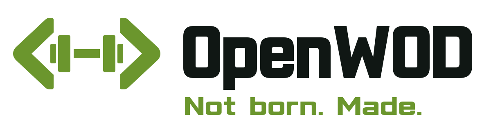
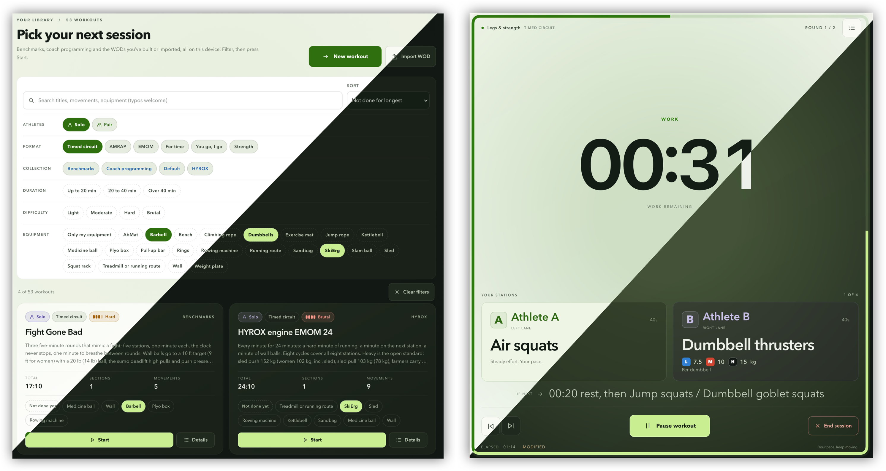

# **OpenWOD**

*Not born.
Made.*

OpenWOD is a self-hosted virtual training coach for home workouts, solo or in pairs.
It executes structured sessions in six formats (timed circuits, AMRAP, EMOM, for time, you-go-I-go and strength sets) on a deterministic clock, announces every transition by voice, and maintains an extensible workout library.
It runs as a static site straight from GitHub Pages, or as a single container on your own hardware, and requires no account, cloud service or telemetry.

<div align="center">
  <picture>
    <source media="(prefers-color-scheme: dark)" srcset="assets/brand/openwod-logo-dark.svg">
    
  </picture>
  </br></br>
  
  </br></br>

**[👋 Introduction](#-introduction)** | **[🚀 Setup](#-setup)** | **[🔧 Developer notes](#-developer-notes)** | **[🙏 Acknowledgements](#-acknowledgements)**

  </br>

[](https://github.com/RomanBoegli/OpenWOD/actions/workflows/check.yml)
[](https://github.com/RomanBoegli/OpenWOD/actions/workflows/release.yml)
[](LICENSE)


</div>

## 👋 Introduction

OpenWOD plays a workout the way a coach would run it: it tells you what is next, counts you in, calls the boundaries, and otherwise stays out of the way.
Pick a session from the library, press Start, and put the phone down.

| Format | What the clock does |
| --- | --- |
| **Timed circuit** | Work and rest slots on the clock, rounds and blocks with their own rests, A and B lanes that can alternate. |
| **AMRAP** | The whole block stays on screen with a round and rep counter. The timer never tells you what to do next, you do. |
| **EMOM** | Work starts on every boundary and never waits. An early Done shows the rest you earned. |
| **For time** | Counts up, ends on Done, with an optional cap. |
| **You go, I go** | Hands over on Switch and counts team rounds. |
| **Strength** | Rest on a timer between Done taps, set by set. |

### Features

- [x] Proper **CrossFit and HYROX timers** with voice cues and beeps for work, rest and the countdown
- [x] Train **alone or with a partner**, with the timer telling each of you who is up
- [x] **54 ready-made workouts**, from Fran and Murph to HYROX sessions and partner circuits, each with a **difficulty rating**
- [x] **Scaled loads** for every weighted movement: light, medium and heavy, with women's weights alongside
- [x] **Find a workout** that fits the time you have, the gear you own and how hard you want to go
- [x] **Write your own workouts** or share them with friends as a single file
- [x] **Let your AI assistant write one**: copy the guide into ChatGPT, Claude or any other assistant, describe the workout and paste its answer back
- [x] See **what you trained** and when, and repeat a session with one tap
- [x] **Make it yours**: pick one of five offline voices, show weights in kg or lb, tune the difficulty scale to your fitness, and choose your theme and accent colour
- [x] Open it in the browser or add it to your **phone's home screen**, no install needed
- [x] Optionally **self-host** it, so every device at home shares the same library and settings
- [x] **No account, no cloud, no tracking**

> [!NOTE]
> On the static site everything you build, import or log stays in that browser.
> The household server has no login yet, so keep a shared instance on your own network.

## 🚀 Setup

OpenWOD runs in one of two shapes built from the same code.
The static site needs nothing but a browser and keeps the library in that browser.
The container adds a household server, so every device in the home shares one library and one session log.

### Static site

The current release is published at **[romanboegli.ch/OpenWOD](https://romanboegli.ch/OpenWOD/)**.
Open it, pick a workout and press Start.
On a phone or tablet it installs as an app, see [On a phone or tablet](#on-a-phone-or-tablet).

Everything you build, import or log is stored in that browser's storage, separately for each browser and browser profile.
Download a backup now and then under Settings → General → This browser, and use Keep data on this device on the same card so the browser does not clear the library when space runs low.
A backup restores into any OpenWOD, static or server.

To host the site yourself, download `openwod-static-vX.Y.Z.zip` from the [latest release](https://github.com/RomanBoegli/OpenWOD/releases/latest) and unpack it into any web root.
Serve it over HTTPS (or `localhost`), because the screen wake lock and persistent storage require a secure context.
No rewrites or server configuration are needed.

> [!TIP]
> Press **Test sound** once after opening the app.
> Browsers only play audio after a user gesture, and that tap unlocks the beeps and voices for the session.

### Self-hosting with Docker

The container serves the app and the household API on one port and stores its data in a SQLite database in the `/data` volume.
It needs Docker on any `amd64` or `arm64` host, for example a NAS.
Images are published to `ghcr.io/romanboegli/openwod` for every release.

```sh
curl -O https://raw.githubusercontent.com/RomanBoegli/OpenWOD/main/compose.yaml
APP_IMAGE=ghcr.io/romanboegli/openwod:v1.6.0 HTTP_PORT=8080 docker compose up -d
```

Open `http://<host>:8080`.
In Portainer, create a stack from this repository with the Compose path `compose.yaml` and set `APP_IMAGE` as a stack variable.
The settings, HTTPS with your own certificate, backup and restore, upgrades and rollback are described in [docs/deploy.md](docs/deploy.md).

> [!IMPORTANT]
> The household server has no login yet.
> Run it on your own network or behind an authenticating proxy, never on the public internet.

### On a phone or tablet

OpenWOD is a [progressive web app](https://en.wikipedia.org/wiki/Progressive_web_app) (PWA), so either shape can be installed on a phone's or tablet's home screen.
It then opens full screen under its own icon, without the browser bars, and the training view is laid out to fit the screen.

| Device | How to install |
| --- | --- |
| iPhone and iPad | Open the app in Safari, tap Share, then Add to Home Screen. |
| Android | Open the app in Chrome, open the menu, then Install app or Add to Home screen. |

Install it from an HTTPS address, so the screen stays awake during a workout.
The installed app still loads from its address on every start, so it needs a connection to Pages or to your server and is not an offline copy.
On iOS the installed app keeps its own storage, separate from Safari's, so a static-site library built in Safari does not appear in the installed app.
Move it with Download backup in Safari and Restore from backup in the installed app.

### Cleanup

Download a backup first if you want to keep the library, since every step below deletes it.

| Setup | Remove the app | Remove its data |
| --- | --- | --- |
| Static site | Delete the home-screen icon, or the unpacked files on your web server. | Clear the site's data in the browser settings for `romanboegli.ch` or your own address. |
| Docker Compose | `docker compose down` in the folder holding `compose.yaml`, then `docker image rm ghcr.io/romanboegli/openwod:<tag>`. | `docker compose down -v`, which also deletes the `openwod_openwod-data` volume. |
| Portainer | Remove the `openwod` stack. | Delete the volume `openwod_openwod-data` under Volumes. |

### Workouts

A workout is a single YAML file with the suffix `.wod.yaml`.
The file is self-contained: prescriptions, targets, loads, repeats, rests and section rules all travel with it, and it never refers to another library.
The same file is used for the bundled workouts, for workouts built in the editor, and for workouts exchanged between installations.

A workout has one or more sections.
Each section has a format, which defines how the clock behaves, and a body of nodes.

| Node | Purpose |
| --- | --- |
| `timed` | Work for a fixed duration, used in timed circuits. |
| `task` | Work that ends when the athletes tap Done, with targets such as reps, calories, distance or time. |
| `rest` | A timed rest. |
| `sequence` | Child nodes in order, with optional rests between them. |
| `repeat` | A body repeated a number of times, optionally swapping the A and B assignments every round. |

Each piece of work assigns a prescription to lane A, and in pair workouts to lane B.
A prescription names the movement and carries its targets, an optional load as one value or as light, medium and heavy levels with a women's amount, and free-text notes that are never executed.
Durations are written as `40s`, `1m30s` or `10m`.

```yaml
format: openwod.workout
formatVersion: 3
workout:
  schemaVersion: 2
  id: fran
  revision: 1
  title: Fran
  participants: 1
  prep: 10s
  sections:
    - id: fran-for-time
      title: 21-15-9
      format: forTime
      transitionAfter: manualReady
      cap: 10m
      body:
        id: fran-ladder
        type: sequence
        children:
          - id: thrusters-21
            type: task
            assignments:
              A:
                name: Thrusters
                reps: 21
                load:
                  heavy: { value: 43, women: 29, unit: kg }
          - id: pull-ups-21
            type: task
            assignments:
              A: { name: Pull-ups, reps: 21 }
```

Workouts are imported and exported in the library, one file at a time or as a `.wods.yaml` pack with collections.
Create with AI in the library hands you a guide to this format for any AI assistant, and takes the assistant's answer back into the import preview.
A sharing identity in each file lets an installation recognise a reimport and offer a newer revision as a replacement.
The complete format is specified in [docs/formats.md](docs/formats.md) and published as JSON Schemas under [schemas/](schemas/).
The bundled workouts, their sources and the load convention are documented in [workouts/README.md](workouts/README.md).

## 🔧 Developer notes

### Requirements

| Tool | Version | Needed for |
| --- | --- | --- |
| Node.js | `24` (pinned in `.nvmrc`), with `npm` | Everything. The server uses the built-in `node:sqlite` module. |
| Playwright browsers | as installed by `npx playwright install` | Browser tests. |
| Docker | with `docker compose` (Compose v2) | Building and running the image. |
| `uv`, or `python3` with `piper-tts==1.8.0`, and `ffmpeg` | | Rendering the recorded voices locally. The Docker build and the release workflow render them on their own. |

### Getting started

```sh
git clone https://github.com/RomanBoegli/OpenWOD.git
cd OpenWOD
npm ci
npm run dev:full      # app on http://127.0.0.1:5173, household API on port 8787
npm run dev:static    # the static shape: no API, the library in IndexedDB
```

`dev:full` keeps its data in `.data/app.sqlite`.
Run `npm run cues:generate` once to render the five voices into `apps/web/public/cues`, otherwise the app falls back to the device voice.

### Commands

| Command | Purpose |
| --- | --- |
| `npm run check` | Typecheck, schema and workout bundle drift checks, unit tests. |
| `npm run test:e2e` | Browser tests in both shapes. Select engines with `--project=firefox --project=webkit`, or the static shape with `--project=static-webkit`. |
| `npm run build` | Production build of the web app and the server. |
| `npm run build:static` | The static site into `dist/static`, with relative paths. |
| `npm run preview:static` | Serves `dist/static` on port `4173`. |
| `npm run test:production` | Smoke test against a running container or static preview, set by `OPENWOD_PRODUCTION_URL` and `OPENWOD_PRODUCTION_MODE`. |
| `npm run workouts:bundle` | Rebuilds the bundled workouts from `workouts/`. |
| `npm run schemas:generate` | Regenerates the published JSON Schemas from the TypeBox source. |

To build and run the container from source, use `docker compose -f deploy/compose.dev.yaml up --build -d`.
It binds to `127.0.0.1:8080` and keeps its own volume.

### Project structure

```
apps/
  server/        Fastify: the household API over SQLite, migrations, health, the built app
  web/           React 19 + Vite: library, editor, player, history, settings, the data layer under src/data/
packages/
  domain/        Schema (TypeBox), compiler, difficulty, loads, movement catalogue, YAML exchange
  engine/        Deterministic session engine
  household/     Library rules (revisions, imports, sessions, export and restore) over SQLite or IndexedDB
deploy/          Compose file for building from source
docs/            Architecture, deployment, development, formats, validation, release notes
schemas/         Published JSON Schemas (generated)
scripts/         Bundling, schema generation, voice rendering, checks
tests/           Unit (Vitest), browser (Playwright) and production smoke tests
workouts/        The bundled workouts, one folder per collection
```

### Releasing

A pushed `v*` tag runs the Release image workflow.
It reuses the green Check of the tagged commit, builds and smoke-tests the `amd64` and `arm64` images, and publishes the multi-architecture image.
It also builds and smoke-tests the static site, creates the GitHub Release from `docs/releases/<tag>.md` with the static zip attached, and deploys the site to GitHub Pages.
The version bump, the one-time repository settings and the complete procedure are in [docs/development.md](docs/development.md#cutting-a-release).

### Further reading

- [docs/architecture.md](docs/architecture.md): design decisions behind the engine, the formats, the catalogue and the two deployment shapes.
- [docs/development.md](docs/development.md): repository layout, test strategy and the voice pipeline.
- [docs/validation.md](docs/validation.md): what has been verified for each release.
- [docs/plans/](docs/plans/): designs of planned features.

To reset a working copy, run `rm -rf node_modules .cache .data dist test-results` and `docker compose -f deploy/compose.dev.yaml down -v`.

## 🙏 Acknowledgements

The code is licensed under the [GNU GPL version 3](LICENSE).
The bundled workout files are data under [CC BY 4.0](https://creativecommons.org/licenses/by/4.0/), each citing its source (see [workouts/README.md](workouts/README.md)).
The benchmark workouts and station standards are those published by CrossFit and HYROX.
CrossFit® is a registered trademark of CrossFit, LLC, and HYROX® of Upsolut Sports AG.
OpenWOD is an independent project with no affiliation to or endorsement by either.
The cue voices are rendered with [Piper](https://github.com/OHF-Voice/piper1-gpl).

If OpenWOD is useful in your work, cite it via the **Cite this repository** button on GitHub (it reads [CITATION.cff](CITATION.cff)) or with:

```bibtex
@software{boegli_openwod_2026,
  author  = {B{\"o}gli, Roman},
  title   = {{OpenWOD}},
  year    = {2026},
  url     = {https://github.com/RomanBoegli/OpenWOD},
  license = {GPL-3.0}
}
```
